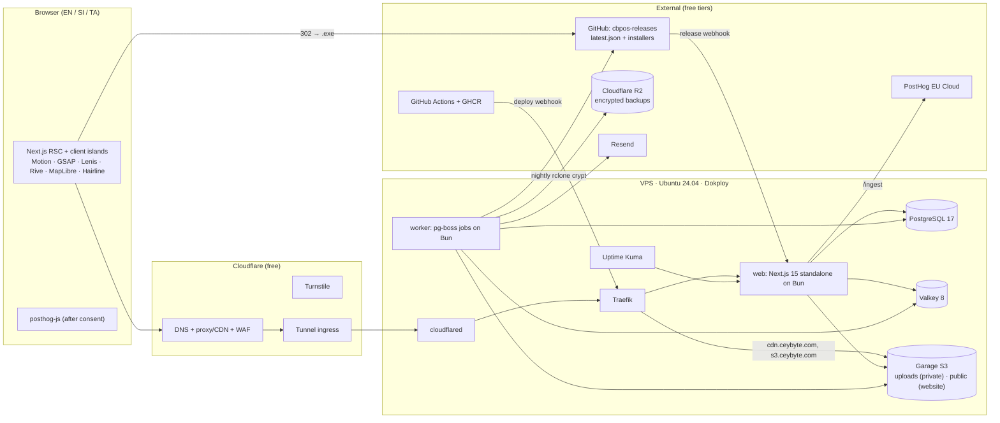
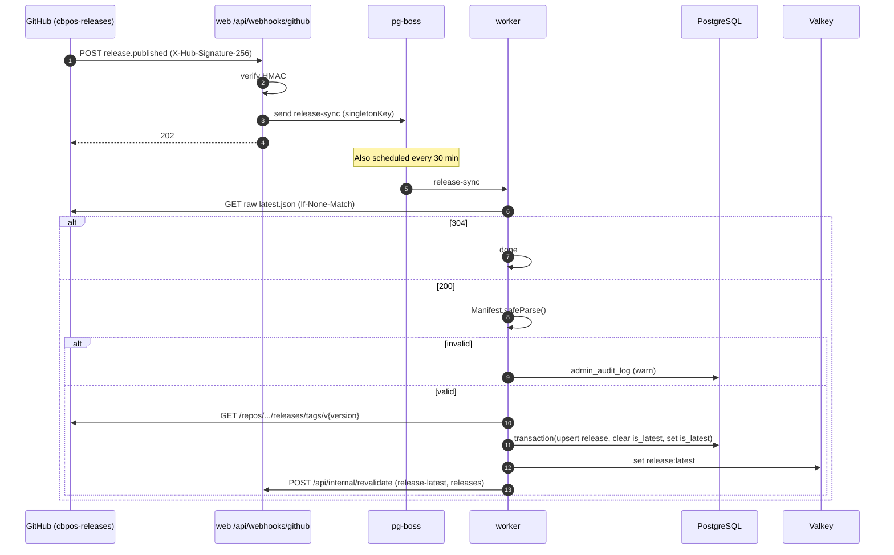
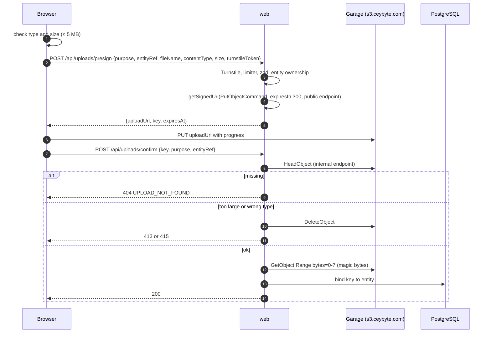
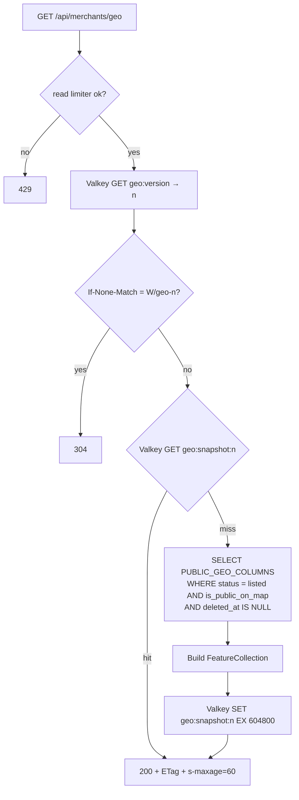

# 02 — Technical Requirements Document (TRD) · branch `main`

| | |
|---|---|
| Version | 2.0-main |
| Date | 2026-10-21 |
| Status | Approved for build |
| Branch | `main`: full architecture on one VPS. The $0/month static architecture is on `free` |
| Depends on | `00-CBPOS_FACTS.md` (product facts), `01-PRD.md` (requirements), `05-SCHEMA.md` (data) |

---

## 1. Architecture overview



### 1.1 Key decisions

| # | Decision | Why |
|---|---|---|
| D1 | **One VPS, Docker Compose, managed by Dokploy** | Lowest cost and operational load for 1–3 maintainers. Dokploy deploys Compose natively, runs Traefik and is lighter than Coolify (which had 11 CVEs disclosed in January 2026) |
| D2 | **Cloudflare Tunnel in front, no open HTTP ports** | The origin IP is never exposed. Only SSH (keys only, rate-limited) is open. Free CDN, WAF managed rules and Turnstile stay available |
| D3 | **Bun runs the web server and the worker** (`bun server.js` on Next's standalone output). Node 22 is a one-line fallback in `Dockerfile.web` | Bun's Next.js guide supports `bun --bun next start`; Next's standalone server is plain Node HTTP. The fallback covers any incompatibility without code changes (ADR-0012) |
| D4 | **Public pages are static/ISR; only dashboard and admin render per request** | Fast pages from cache and low CPU on a small VPS. `revalidateTag` keeps content fresh within seconds |
| D5 | **Background work in pg-boss** (Postgres-backed queue and cron) in a separate worker container | No extra broker. Jobs survive restarts. Web requests stay fast |
| D6 | **Markdown rendered to hast at publish time by a job** (no runtime MDX) | Admin-authored MDX would be arbitrary code execution. Rendering once at publish keeps page renders cheap |
| D7 | **Installer bytes never pass through the VPS.** `/api/download/latest` logs and returns `302` to GitHub | Saves VPS bandwidth and keeps downloads fast from GitHub's CDN |
| D8 | **Garage for object storage** (single node, `replication_factor = 1`) | MinIO's community edition was archived in 2026 and gets no security fixes. Garage is a single small binary, S3-compatible, actively maintained |
| D9 | **Off-site backups to Cloudflare R2** (free 10 GB), encrypted with `rclone crypt` | A single VPS is a single point of failure. R2 egress is free, so restores cost nothing |
| D10 | **Self-hosted Protomaps tiles** in Garage's public bucket, cached by Cloudflare | CARTO basemaps need a paid licence for commercial use (ADR-0008) |
| D11 | **PostHog stays on its EU Cloud free tier** | A self-hosted PostHog needs ~16 GB RAM, more than the whole VPS (ADR-0013) |
| D12 | **Shop data never touches this system.** CB-POS keeps data on the shop's PC; LAN Sync and PostgreSQL network mode run between the shop's own machines [G4], [H] | Keeps Ceybyte out of the custody chain for sales data |

---

## 2. Infrastructure

### 2.1 VPS

| Item | Minimum | Recommended |
|---|---|---|
| CPU / RAM / disk | 2 vCPU · 4 GB · 80 GB SSD | 4 vCPU · 8 GB · 160 GB NVMe |
| Region | Singapore (lowest latency to Sri Lanka among common providers) | Same |
| OS | Ubuntu 24.04 LTS, 2 GB swap | Same |
| Providers that fit | Hetzner (SIN), DigitalOcean (SGP1), Vultr (SGP), Linode/Akamai (SG). Pick on price and backups; no provider lock-in | — |

Hardening (`deploy/bootstrap.sh`, idempotent): non-root sudo user, SSH keys only, `PermitRootLogin no`, `ufw` allowing only SSH, `fail2ban`, `unattended-upgrades` (security), Docker with log rotation (`max-size 10m`, `max-file 3`), time sync, Dokploy install, `cloudflared` as a service.

### 2.2 Services (`deploy/compose.prod.yml`, deployed by Dokploy)

| Service | Image | Memory limit | Exposed via | Volumes |
|---|---|---|---|---|
| `web` | `ghcr.io/ceybyte/web:<sha>` (Bun) | 768 MB | Traefik → `ceybyte.com` | `next-cache:/app/.next/cache` |
| `worker` | `ghcr.io/ceybyte/worker:<sha>` (Bun) | 384 MB | — | — |
| `postgres` | `postgres:17-alpine` | 1 GB (`shared_buffers=256MB`, `max_connections=50`) | internal network only | `pg-data` |
| `valkey` | `valkey/valkey:8-alpine` | 128 MB (`maxmemory 96mb`, `volatile-lru`, AOF on) | internal only | `valkey-data` |
| `garage` | `dxflrs/garage:v2` | 256 MB | Traefik → `s3.ceybyte.com` (S3 API), `cdn.ceybyte.com` (website endpoint). Admin API internal only | `garage-meta`, `garage-data` |
| `uptime-kuma` | `louislam/uptime-kuma:1` | 192 MB | Traefik → `status.ceybyte.com` behind Cloudflare Access | `kuma-data` |
| `cloudflared` | host service | 64 MB | Tunnel to Traefik | — |
| Dokploy + Traefik | Dokploy-managed | ~400 MB | `deploy.ceybyte.com` behind Cloudflare Access | Dokploy-managed |

Total ≈ 3.3 GB at limits: it fits the 4 GB minimum with swap, and 8 GB leaves room for staging.

Every app container runs as a non-root user with `read_only: true` and `no-new-privileges`. PostgreSQL, Valkey and Garage's admin port never bind to a host interface.

### 2.3 Garage

`deploy/garage.toml`: single node, `replication_factor = 1`, `db_engine = "lmdb"`, S3 API on `:3900`, website on `:3902`, admin on `:3903` (internal). Buckets:

| Bucket | Access | Contents |
|---|---|---|
| `uploads` | Private. Key `web-app` read/write. CORS: `PUT` from `https://ceybyte.com` | Slips, crash logs, private screenshots |
| `public` | Website mode on `cdn.ceybyte.com` (read-only). Key `web-app` write | `tiles/`, `media/docs/`, `media/blog/`, `media/screenshots/`, `og/`, `search/` |

Cloudflare Cache Rules cache `cdn.ceybyte.com/*` (edge TTL 30 days for `tiles/` and hashed files, 1 day otherwise). PMTiles range requests are cached at the edge.

### 2.4 Environment & secrets (Dokploy env, validated by `src/lib/env.ts`)

| Variable | Used by |
|---|---|
| `DATABASE_URL` | web, worker (`postgres://cbpos:…@postgres:5432/cbpos`) |
| `VALKEY_URL` | web, worker |
| `S3_ENDPOINT` (internal `http://garage:3900`), `S3_PUBLIC_ENDPOINT` (`https://s3.ceybyte.com`), `S3_REGION` (`garage`), `S3_ACCESS_KEY_ID`, `S3_SECRET_ACCESS_KEY` | web, worker |
| `SITE_URL`, `CDN_URL` | web, worker |
| `BETTER_AUTH_SECRET`, `GOOGLE_CLIENT_ID`, `GOOGLE_CLIENT_SECRET` | web |
| `RESEND_API_KEY` | worker |
| `TURNSTILE_SITE_KEY`, `TURNSTILE_SECRET_KEY` | web |
| `GITHUB_WEBHOOK_SECRET`, `GITHUB_API_TOKEN` (optional, read-only) | web, worker |
| `RELEASE_MANIFEST_URL`, `RELEASES_REPO` | worker |
| `IP_HASH_PEPPER`, `CLAIM_TOKEN_SECRET`, `INTERNAL_SECRET` | web, worker |
| `POSTHOG_KEY`, `POSTHOG_HOST` | web, worker |
| `DONATION_BANK_NAME`, `DONATION_BANK_BRANCH`, `DONATION_ACCOUNT_NAME`, `DONATION_ACCOUNT_NUMBER` | web |
| `BACKUP_R2_*`, `BACKUP_CRYPT_PASSWORD`, `BACKUP_CRYPT_SALT` | backup job (host cron) |
| `LOCALES_ENABLED` | web |

### 2.5 Environments

| Env | Where | Data |
|---|---|---|
| local | `bun run dev` + `compose.dev.yml` | Local Postgres/Valkey/Garage, seeded |
| staging | Second Dokploy project on the same VPS (`staging.ceybyte.com`, Cloudflare Access) | Separate database and buckets, synthetic data |
| production | `ceybyte.com` | Real data |

---

## 3. Request lifecycle & middleware

Cloudflare (DNS, WAF, cache) → Tunnel → `cloudflared` → Traefik → `web:3000`.

- **Client IP:** `CF-Connecting-IP` is trusted because the only ingress is the tunnel. It's hashed immediately (§11).
- `src/middleware.ts` (no database access, cookies only):
  1. Skip `/_next/*`, `/api/*`, `/ingest/*`, static files.
  2. `/admin/*` without a session cookie → rewrite to `/404`. The role check is in `app/admin/layout.tsx` and in every action.
  3. `/{locale}/dashboard/*` without a session cookie → redirect to `/{locale}/login?next=…`.
  4. `next-intl` routing, `localePrefix: "always"`; detection only on `/`.
  5. CSP nonce generation (§12.3).

---

## 4. Route structure (pages)

| Route | Screen (06) | Render | Revalidate / tags |
|---|---|---|---|
| `/{locale}` | S01 Home | SSG + ISR | `home-stats`, `release-latest`; 600 s fallback |
| `/{locale}?download=1` | S02 Gate | client island | — |
| `/{locale}/download` | S02 no-JS | SSG | `release-latest` |
| `/{locale}/map` | S03 | SSG shell + client map | `home-stats` |
| `/{locale}/docs` | S04 | SSG + ISR | `docs` |
| `/{locale}/docs/[...slug]` | S05 | SSG + ISR | `docs`, `doc:{translationKey}` |
| `/{locale}/docs/shortcuts/print` | S05 variant | SSG | `docs` |
| `/{locale}/releases` | S06 | SSG + ISR | `releases` |
| `/{locale}/feedback` | S07 | ISR | `feedback`; 120 s |
| `/{locale}/feedback/new` | S08 submit | SSG | — |
| `/{locale}/feedback/[number]` | S08 detail | ISR (on-demand) | `ticket:{id}` |
| `/{locale}/donate` | S09 | SSG + ISR | `supporters`; 600 s |
| `/{locale}/blog`, `/{locale}/blog/[slug]` | S10 | SSG + ISR | `blog`, `post:{translationKey}` |
| `/{locale}/blog/rss.xml` | — | route handler, ISR | `blog` |
| `/{locale}/legal/[doc]` | S11 | SSG | — |
| `/{locale}/login` | S12 | SSG shell | — |
| `/{locale}/dashboard/**` | S13 | dynamic | — |
| `/admin/**` | S14 | dynamic | — |
| `/sitemap.xml`, `/robots.txt` | — | route handlers, ISR | `docs`, `blog` |

The ISR cache lives on the `next-cache` volume (single instance; no shared cache handler needed).

---

## 5. API surface

### 5.1 Route handlers

| Method & path | Auth | Guards | Purpose |
|---|---|---|---|
| `POST /api/downloads` | public | Turnstile, `forms` limiter + hourly window, zod | Gate submit → merchant upsert, log, claim cookie |
| `GET /api/download/latest?asset=exe&ref=` | public | `read` limiter | Log (job) → `302` to the GitHub asset |
| `GET /api/releases/latest` | public | `read` limiter, `s-maxage=300` | Latest release JSON |
| `GET /api/stats` | public | `s-maxage=300` | `{ districtsCovered, listedShops, supporters }` from Valkey |
| `GET /api/merchants/geo` | public | `read` limiter, Valkey snapshot | Public GeoJSON (§10) |
| `GET /api/docs/search-index?locale=&v=` | public | immutable | Redirect to `cdn.ceybyte.com/search/{locale}-{v}.json` |
| `POST /api/uploads/presign` · `POST /api/uploads/confirm` | public or session | Turnstile or session, `uploads` limiter, zod | Presigned PUT to Garage + verification (§9) |
| `POST /api/feedback` · `GET /api/feedback/similar` · `POST /api/feedback/[id]/vote` | public | Turnstile / limiters | Tickets and votes |
| `POST /api/donations` · `POST /api/donations/[ref]/submit` · `GET /api/donations/[ref]/status` | public (+ ref cookie secret) | Turnstile / limiters | Bank-transfer donations |
| `POST /api/webhooks/github` | GitHub | HMAC | Enqueue `release-sync` |
| `POST /api/internal/revalidate` | `X-Internal-Secret` | constant-time compare | `revalidateTag()` for tags sent by the worker |
| `GET /api/health` | public | — | `{ db, valkey, s3 }` status for Uptime Kuma and deploy checks |
| `GET/POST /api/auth/[...all]` | — | `auth` limiter | Better Auth |
| `/ingest/[...path]` | — | — | PostHog proxy (rewrite) |

### 5.2 Server Actions

| File | Actions | Role |
|---|---|---|
| `src/features/merchants/actions.ts` | `updateMyListing`, `setMyVisibility`, `deleteMyListing`, `claimListing` | merchant |
| `src/features/admin/merchants.actions.ts` | `setMerchantStatus`, `setSupporter`, `linkMerchantToUser`, `revealContact`, `exportMerchantsCsv` | admin |
| `src/features/admin/donations.actions.ts` | `approveDonation`, `rejectDonation`, `getSlipUrl` | admin |
| `src/features/admin/feedback.actions.ts` | `setTicketStatus`, `markDuplicate`, `respond`, `markScreenshotSafe` | admin |
| `src/features/admin/content.actions.ts` | `saveDocArticle`, `publishDocArticle`, `saveDocCategory`, `saveBlogPost`, `publishBlogPost`, `rebuildSearchIndex` | admin |
| `src/features/admin/releases.actions.ts` | `forceSync`, `setYanked`, `editNotes` | admin |

Every action: `requireSession(role)` → zod → `db.transaction` → `writeAudit()` (admin) → enqueue jobs / `revalidateTag` → typed result.

### 5.3 Error codes

| Code | HTTP | Meaning |
|---|---|---|
| `VALIDATION_FAILED` | 422 | zod failure, `error.fields` keyed to i18n |
| `TURNSTILE_FAILED` | 403 | Token missing, invalid or expired |
| `RATE_LIMITED` | 429 | With `Retry-After` |
| `LOCATION_OUTSIDE_SRI_LANKA` | 422 | lat/lng outside the bounds |
| `INVALID_PHONE` | 422 | Not a Sri Lankan number |
| `FILE_TOO_LARGE` | 413 | > 5 MB after the head check |
| `FILE_TYPE_NOT_ALLOWED` | 415 | MIME, extension or magic bytes don't match |
| `UPLOAD_NOT_FOUND` | 404 | Confirm before the PUT finished |
| `NOT_FOUND` | 404 | Also for non-admins on admin routes |
| `UNAUTHENTICATED` | 401 | |
| `FORBIDDEN` | 403 | Merchant routes |
| `RELEASE_UNAVAILABLE` | 503 | No non-yanked release in Valkey, Postgres or the build fallback |
| `SIGNATURE_INVALID` | 400 | Webhook HMAC mismatch |
| `SERVICE_UNAVAILABLE` | 503 | Postgres, Valkey or Garage unreachable |
| `INTERNAL` | 500 | Logged with a request ID |

```ts
type ApiResult<T> =
  | { ok: true; data: T }
  | { ok: false; error: { code: ErrorCode; fields?: Record<string, string>; requestId: string } };
```

---

## 6. Rendering & caching

| Layer | What | TTL / invalidation |
|---|---|---|
| Cloudflare edge | `/_next/static/*`, `cdn.ceybyte.com/*`, fonts | Immutable or 1–30 days (Cache Rules) |
| Next ISR (`next-cache` volume) | Marketing, docs, blog, releases, legal, feedback | `revalidateTag()` from actions and from the worker via `/api/internal/revalidate` |
| Valkey | `geo:snapshot:{n}`, `geo:version`, `stats:v1`, `release:latest`, rate-limit keys, Better Auth sessions | Written on change |
| HTTP | API JSON `Cache-Control: public, max-age=30, s-maxage=60, stale-while-revalidate=300` | Edge caching for API only where a Cache Rule allows it (`/api/merchants/geo`, `/api/stats`, `/api/releases/latest`) |

---

## 7. GitHub release sync

### 7.1 `latest.json` contract (in `ceybyte/cbpos-releases@main`)

This file is generated by the CB-POS release workflow and **read by the desktop app's updater** on every launch [A6], [A7]. The website only reads it. Its six keys must never be renamed or removed. Additive keys are coordinated through UR-08.

```json
{
  "version": "1.3.0",
  "release_date": "2026-09-27",
  "download_url": "https://github.com/ceybyte/cbpos-releases/releases/download/v1.3.0/CBPOSSetup-1.3.0.exe",
  "changelog": "",
  "min_version": "1.0.0",
  "sha256": "<64 hex chars>"
}
```

- `changelog` is empty today and `min_version` is unused by the app [A6]. Size and publish time come from `GET https://api.github.com/repos/ceybyte/cbpos-releases/releases/tags/v{version}`.
- One stable channel; one `.exe` (`CBPOSSetup-{version}.exe`); no portable zip [A3].
- SHA-256 is computed by the release CI. We never hash the installer.

```ts
// src/features/releases/manifest.ts
export const Manifest = z.object({
  version: z.string().regex(/^\d+\.\d+\.\d+$/),
  release_date: z.string().regex(/^\d{4}-\d{2}-\d{2}$/),
  download_url: z
    .string()
    .url()
    .startsWith("https://github.com/ceybyte/cbpos-releases/releases/download/")
    .regex(/\/CBPOSSetup-\d+\.\d+\.\d+\.exe$/),
  changelog: z.string().default(""),
  min_version: z.string().optional(),
  sha256: z.string().regex(/^[a-f0-9]{64}$/),
  size: z.number().int().positive().optional(),          // UR-08
  published_at: z.string().datetime().optional(),        // UR-08
  notes_url: z.string().url().optional(),                // UR-08
}).passthrough();
```

Sync rules:
- `download_url` must equal the GitHub asset's `browser_download_url`, or the sync is rejected with an audit warning.
- Release notes = admin-edited `notes_md`, else the manifest `changelog`, else the GitHub release body (a fixed template; admins paste the `CHANGELOG.md` entry until UR-09).
- An invalid manifest never changes `is_latest`.

### 7.2 Sync sequence



### 7.3 Download endpoint

`GET /api/download/latest?asset=exe&ref={merchantPublicId?}`
1. Resolve: Valkey `release:latest` → Postgres `is_latest AND NOT is_yanked` → `FALLBACK_RELEASE` (written at build by `scripts/snapshot-release.ts`).
2. Enqueue `log-download` (`merchant_logs`, `ip_hash`, release) and the PostHog server event. Never block the redirect.
3. `302 Location: <download_url>`, `Cache-Control: no-store`.

---

## 8. Docs & blog rendering

- Markdown in Postgres. Directive whitelist: `:::callout{type=tip|warn|danger}`, `:kbd[F3]`, `::screenshot{src alt}`, `::video{src}`, `:::steps`.
- **Publish** (Server Action) sets the status, then enqueues `render-content`. The job runs `remark-parse → remark-gfm → remark-directive → whitelist → remark-rehype → rehype-slug → rehype-autolink-headings → @shikijs/rehype → rehype-sanitize`, stores `body_hast`, `toc_json` and `search_text`, rebuilds the locale's Orama index into `public/search/{locale}-{version}.json`, then calls `/api/internal/revalidate` with `docs`/`doc:{key}` (or `blog`/`post:{key}`). Live within 60 s.
- Pages render stored hast with `hast-util-to-jsx-runtime` and the Fumadocs component map. Tax articles get the disclaimer callout injected [C5].
- Fumadocs: `DocsLayout`, `DocsPage`, TOC, page tree from Postgres via `src/features/docs/source.ts`.
- OG images: `render-og` job (`satori` + `@resvg/resvg-js`) → `public/og/{locale}/{slug}.png`.

---

## 9. Presigned uploads (Garage)

| Purpose | MIME | Ext | Max |
|---|---|---|---|
| `donation_slip` | `image/jpeg`, `image/png`, `application/pdf` | jpg, jpeg, png, pdf | 5 MB |
| `crash_log` | `text/plain`, `application/zip`, `application/x-zip-compressed` | log, txt, zip | 5 MB |
| `ticket_screenshot` | `image/jpeg`, `image/png` | jpg, jpeg, png | 5 MB |
| `docs_media`, `blog_media` (admin) | `image/png`, `image/jpeg`, `image/webp`, `video/mp4` | — | 5 MB images, 50 MB video |

CB-POS exports logs as `cbpos_logs.txt` [J1].



```ts
// src/server/s3.ts
import "server-only";
import { S3Client, PutObjectCommand } from "@aws-sdk/client-s3";
import { getSignedUrl } from "@aws-sdk/s3-request-presigner";
import { env } from "@/lib/env";

const credentials = { accessKeyId: env.S3_ACCESS_KEY_ID, secretAccessKey: env.S3_SECRET_ACCESS_KEY };
export const s3 = new S3Client({ endpoint: env.S3_ENDPOINT, region: env.S3_REGION, forcePathStyle: true, credentials });
const s3Public = new S3Client({ endpoint: env.S3_PUBLIC_ENDPOINT, region: env.S3_REGION, forcePathStyle: true, credentials });

export const presignPut = (key: string, contentType: string) =>
  getSignedUrl(s3Public, new PutObjectCommand({ Bucket: "uploads", Key: key, ContentType: contentType }), { expiresIn: 300 });
```

Admins view private objects through presigned GET URLs (120 s) in a sandboxed `<iframe sandbox>` or ``. A cleanup job deletes unconfirmed objects older than 24 h.

---

## 10. `/api/merchants/geo` caching

Properties are exactly `PUBLIC_GEO_PROPERTIES` (`05-SCHEMA.md §7`); coordinates rounded to 4 dp.



- Every write that changes a public field enqueues `geo-rebuild` (debounced with `singletonKey` + 5 s delay), which increments `geo:version` and writes the snapshot. Cloudflare caches the response for 60 s, so changes appear within about a minute (AC-04.4).
- `/api/stats` reads `stats:v1`, refreshed by the same job.

---

## 11. Rate limiting

`rate-limiter-flexible` (`RateLimiterRedis` on Valkey). Identity: `sha256(CF-Connecting-IP + dailySalt)`, `dailySalt = sha256(IP_HASH_PEPPER + YYYY-MM-DD)`; session user ID when signed in.

| Limiter | Points / duration | Applies to |
|---|---|---|
| `forms` | 5 / 60 s and 10 / 3600 s | Gate, feedback create, donation create |
| `uploads` | 10 / 60 s | Presign, confirm |
| `votes` | 30 / 60 s | Votes, docs feedback |
| `auth` | 10 / 60 s | Better Auth sign-in, sign-up, OTP (plus Better Auth's own limiter on Valkey) |
| `read` | 120 / 60 s | Public reads |

Backstop: Cloudflare free WAF rate-limiting rule on `POST /api/*` (block 10 s above 20 requests / 10 s per IP).

---

## 12. Security

### 12.1 Turnstile
Managed widget, `appearance: "interaction-only"`, `language: "auto"`, lazy. Server verification checks `success`, `hostname ∈ {ceybyte.com, staging.ceybyte.com, localhost}` and the `action` (`gate`, `feedback`, `donation`, `upload`). Test keys locally.

### 12.2 Auth
- `better-auth` with the Drizzle adapter (`provider: "pg"`, `usePlural: true`), `emailAndPassword` (scrypt), `emailOTP` (Resend), Google, `admin({ defaultRole: "merchant", adminRoles: ["admin"] })`, `nextCookies()`, Valkey `secondaryStorage`.
- Cookie `__Secure-better-auth.session_token`, `HttpOnly; Secure; SameSite=Lax`.
- First admin: `bun scripts/make-admin.ts --email` run in the `web` container.

### 12.3 Headers & CSP (middleware, per-request nonce)

```
Content-Security-Policy: default-src 'self'; script-src 'self' 'nonce-{n}' 'strict-dynamic' https://challenges.cloudflare.com; style-src 'self' 'unsafe-inline'; img-src 'self' data: blob: https://cdn.ceybyte.com https://lh3.googleusercontent.com; font-src 'self'; connect-src 'self' https://cdn.ceybyte.com https://s3.ceybyte.com; frame-src https://challenges.cloudflare.com; worker-src 'self' blob:; child-src blob:; form-action 'self'; frame-ancestors 'none'; base-uri 'self'; upgrade-insecure-requests
Strict-Transport-Security: max-age=63072000; includeSubDomains; preload
X-Content-Type-Options: nosniff
Referrer-Policy: strict-origin-when-cross-origin
Permissions-Policy: geolocation=(self), camera=(), microphone=(), payment=()
Cross-Origin-Opener-Policy: same-origin
```

### 12.4 Webhooks
- **GitHub:** `X-Hub-Signature-256` HMAC-SHA256 over the raw body, compared with `crypto.timingSafeEqual`.
- **Payment gateways:** none in v1 (bank transfers verified by admins). A future gateway's webhook security goes in its ADR first.

### 12.5 Server & data protection
- No open HTTP ports (Cloudflare Tunnel). Dokploy and Uptime Kuma sit behind Cloudflare Access (free for up to 50 users).
- PostgreSQL role `cbpos` owns only the `cbpos` database; the migration role is separate and used only by the pre-deploy step.
- IPs are stored only hashed. `claim_token_hash` stores `sha256(token)`.
- Merchant CSV export is admin-only, audited and streamed (never written to disk or Garage).
- **Shop data never reaches us** (D12). No form or route accepts database URLs, passwords or LAN Sync secrets.

---

## 13. Observability

- `pino` JSON logs (redacting `/phone|whatsapp|telegram|full_?name|email|contact|ip$/i`) to stdout, rotated by Docker; Dokploy shows logs and container metrics.
- `requestId` from `cf-ray`, returned in error envelopes.
- Uptime Kuma monitors: `https://ceybyte.com/en` (200), `/api/health` (all `ok`), `/api/download/latest` (302 to github.com), `cdn.ceybyte.com/tiles/sri-lanka.pmtiles` (206 with Range), TLS expiry. Alerts to a private Telegram/Discord webhook.
- Disk alert at 75% (host cron → same webhook). Backup job reports success/failure the same way.
- PostHog EU Cloud: `posthog-js` after consent (`api_host: "/ingest"`, `maskAllInputs: true`); server events from `posthog-node` in jobs with allow-listed properties. Funnels in `04-APP_FLOW.md §7`.
- Daily ops summary job (08:45 Asia/Colombo).

---

## 14. Cost, capacity & backups

### 14.1 Monthly cost

| Item | Cost |
|---|---|
| VPS (2–4 vCPU, 4–8 GB) | The only bill. Typically US$5–25 depending on provider and size |
| Cloudflare (DNS, proxy, WAF, Tunnel, Access ≤ 50 users, Turnstile) | Free plan |
| Cloudflare R2 backups (≤ 10 GB, free egress) | Free tier |
| GitHub (Actions, GHCR) | Free (GHCR packages public; images hold no secrets) |
| PostHog Cloud (1 M events, 5 k replays/month) | Free tier |
| Resend (3,000 emails/month, 100/day) | Free tier |
| Domain renewal | Yearly, already owned |

### 14.2 Capacity triggers

| Signal | Action |
|---|---|
| Sustained CPU > 70% or memory > 85% | Resize the VPS (vertical first) |
| Postgres > 20 GB or slow queries > 100 ms p95 | Tune indexes; consider a managed Postgres via ADR |
| Garage data > 50 GB | Second disk volume; or move media to R2 via ADR |
| R2 backup set > 8 GB | Shorten retention or add the R2 paid tier via ADR |

### 14.3 Backups & disaster recovery

| What | How | When | Retention |
|---|---|---|---|
| PostgreSQL | `pg_dump -Fc` in a one-off container → `rclone crypt` → R2 `cbpos-backups/pg/` | Nightly 02:30 | 30 daily + 12 monthly |
| Garage `uploads` + `public` | `rclone sync` (crypt) → R2 `cbpos-backups/s3/` | Nightly 03:00 | Mirror + 30-day versioning via dated prefixes for `uploads` |
| Valkey | Not backed up (rebuildable cache) | — | — |
| Config | `deploy/` in Git; secrets in a password manager (not in Git) | On change | — |

- **RPO 24 h, RTO 2 h.** Runbook `deploy/RESTORE.md`: new VPS → `bootstrap.sh` → Dokploy → restore Compose project → `rclone` pull → `pg_restore` → Garage restore → new tunnel token → health checks.
- `bun run backup:test` runs monthly from CI: restores the latest dump into a scratch database and checks row counts and the geo contract.

---

## 15. Performance budgets

| Page | Initial JS (gz) | LCP p75 mobile | TTFB |
|---|---|---|---|
| `/{locale}` | ≤ 180 KB | ≤ 2.0 s | ≤ 300 ms (ISR hit) |
| `/{locale}/map` | ≤ 120 KB + MapLibre (lazy) | ≤ 3.0 s | ≤ 300 ms |
| `/{locale}/docs/*` | ≤ 140 KB | ≤ 1.8 s | ≤ 300 ms |
| Dashboard / admin | ≤ 250 KB | — | ≤ 800 ms |

Fonts via `next/font/google` (self-hosted at build), script subsets, active-locale preload only.

---

## 16. Testing

| Level | Tool | Scope |
|---|---|---|
| Unit | `bun test` | money, phone, tax maths ([C1]/[C2] examples, round-half-even), sri-lanka, projections, manifest zod, HMAC |
| Contract | `bun test` | `geo.contract.test.ts`, error codes ↔ message keys |
| Integration | `bun test` + `compose.dev.yml` | Route handlers, Server Actions, jobs, webhook idempotency, limiters, S3 presign/confirm |
| E2E | Playwright against the built `web` image + services | 6 flows × 3 locales, Pixel 7 + desktop |
| A11y | `@axe-core/playwright` | Every screen |
| Visual | Playwright screenshots | Sinhala/Tamil clipping at 320/375/414/768 |
| Perf | Lighthouse CI | §15 budgets |
| Restore | `bun run backup:test` | Monthly |

---

## 17. CI/CD

1. **`ci.yml`** (PR): `setup-bun` → `bun install --frozen-lockfile` → lint → typecheck → `services: postgres, valkey, garage` → `bun test` → `i18n:check` → `docker build` (web, worker) → Playwright + axe against the image → Lighthouse CI.
2. **`deploy.yml`** (push to `main`): build and push `ghcr.io/ceybyte/{web,worker}:<sha>` → call the Dokploy deploy webhook with the tag → Dokploy runs the pre-deploy migration (`bun run db:migrate` with the migration role) → starts new containers → waits for `/api/health` → on failure, redeploys the previous tag and alerts.
3. GHCR retention keeps the last 5 tags per image.
4. Production deploys are blocked while `[[TRANSLATE]]` markers exist in enabled locales.

---

## 18. ADR index (`docs/adr/`)

| ADR | Title |
|---|---|
| 0000 | Phase 0 verification results |
| 0001 | Single VPS with Dokploy and Cloudflare Tunnel |
| 0002 | Markdown content rendered at publish (no runtime MDX) |
| 0003 | Installer delivery by 302 to GitHub Releases |
| 0004 | Geo snapshot in Valkey with versioned ETags |
| 0005 | Presigned PUT + head verification on Garage |
| 0006 | PostgreSQL with a SQLite-portable schema (shared with `free`); Convex documented only |
| 0007 | `@lucasmarkes/hairline` adoption and figure mapping |
| 0008 | Protomaps self-hosted tiles instead of CARTO |
| 0009 | Garage instead of MinIO |
| 0010 | Inter body font kept despite impeccable's generic-font finding |
| 0011 | pg-boss for jobs and schedules |
| 0012 | Bun as the production runtime, Node 22 fallback |
| 0013 | PostHog Cloud instead of self-hosting |
| 0014 | Off-site encrypted backups to Cloudflare R2 |
