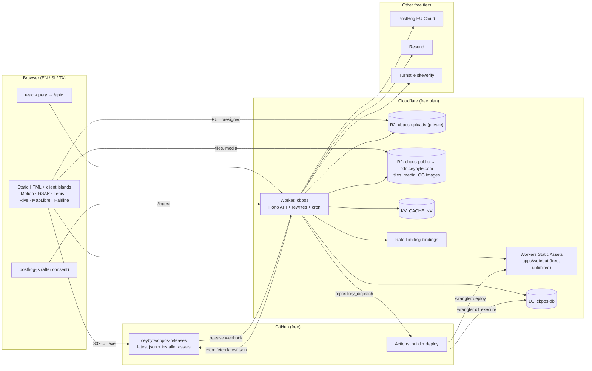
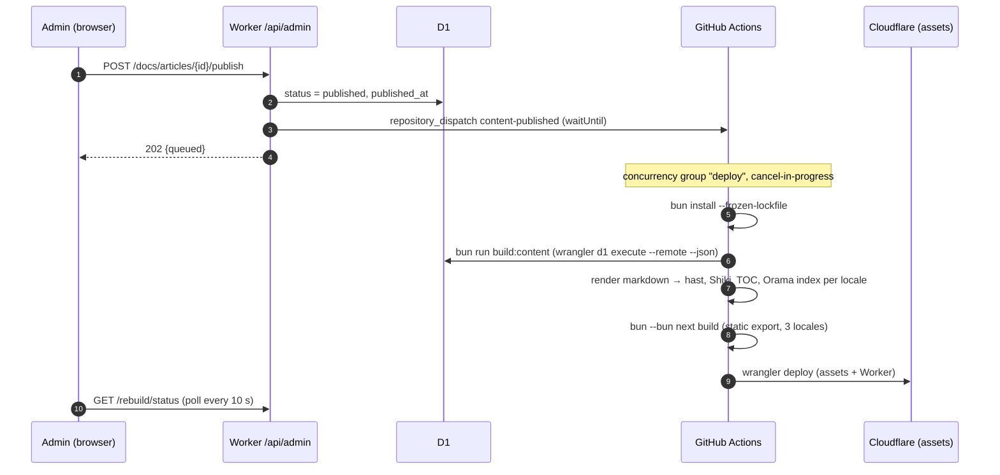
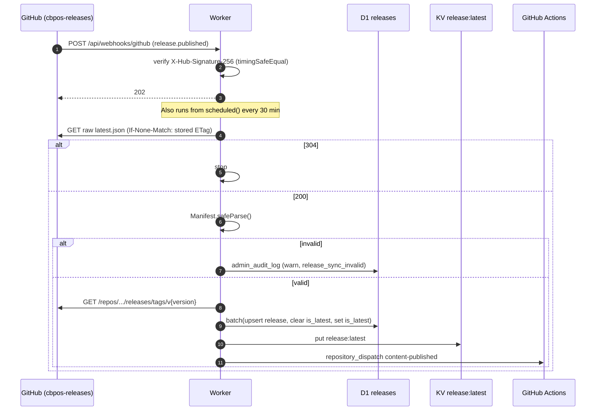
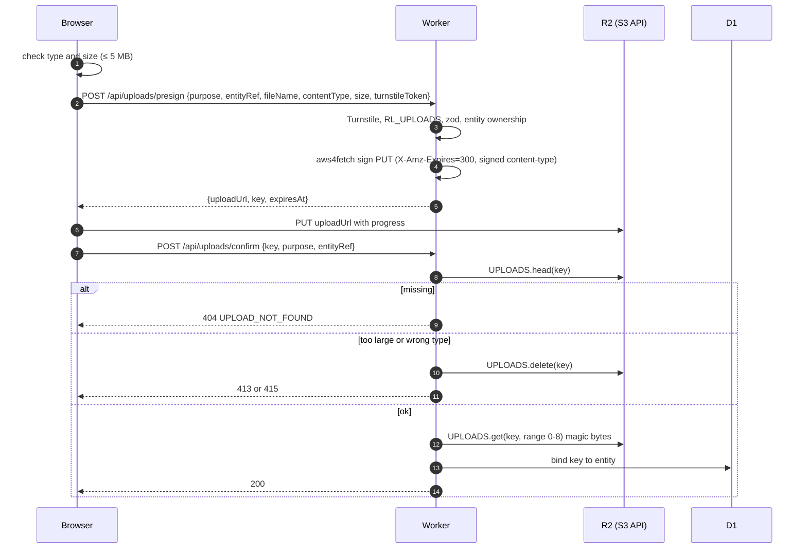
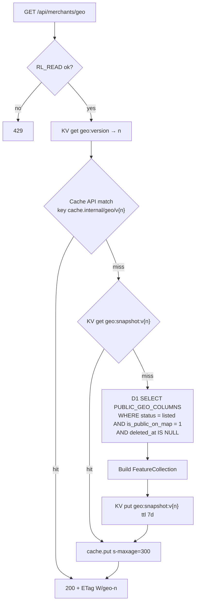

# 02 — Technical Requirements Document (TRD) · branch `free`

| | |
|---|---|
| Version | 2.0-free |
| Date | 2026-10-21 |
| Status | Approved for build |
| Branch | `free`: $0/month architecture. The VPS architecture is on `main` |
| Depends on | `00-CBPOS_FACTS.md` (product facts), `01-PRD.md` (requirements), `05-SCHEMA.md` (data) |

---

## 1. Architecture overview



### 1.1 Key decisions

| # | Decision | Why |
|---|---|---|
| D1 | **Every page is static** (`next build`, `output: "export"`), served by Workers Static Assets. Only `/api/*` and a few rewrites invoke the Worker | Static asset requests are free and unlimited. The free plan caps a Worker at 10 ms CPU per request, which server-rendering React would regularly exceed. Worker size (64 MiB) is no longer a constraint (verified 2026-10-21) |
| D2 | **One Hono Worker** serves the API, the routing rewrites and the cron jobs | One deploy, one set of bindings, cron in the same codebase. Hono's router is tiny and fast |
| D3 | **Content (docs, blog, release notes) is rendered at build time** in GitHub Actions under Bun. Admin "Publish" triggers a rebuild | Markdown + Shiki rendering would blow the 10 ms CPU budget inside the Worker. Builds are free on GitHub Actions |
| D4 | **Installer bytes never pass through the Worker.** `/api/download/latest` logs the event and returns `302` to the GitHub asset | Saves CPU and quota. GitHub's CDN serves large files reliably |
| D5 | **Passwordless auth** (email OTP + Google). No email+password | Password hashing (scrypt) needs far more than 10 ms CPU. OTP and OAuth need almost none |
| D6 | **Geo data from a KV snapshot + Cache API**, rebuilt on write | Map reads far outnumber writes. Keeps D1 reads near zero |
| D7 | **Presigned PUT to R2 + `head` verification** | R2 has no presigned POST policy (no `content-length-range`), so size and type are checked after upload |
| D8 | **MapLibre native clustering** (Supercluster inside the GeoJSON source) | No extra dependency. `clusterProperties` counts supporters |
| D9 | **Shop data never touches this system.** CB POS keeps data on the shop's PC. LAN Sync and PostgreSQL network mode run between the shop's own machines [G4], [H] | Keeps Ceybyte out of the custody chain for sales data |
| D10 | **Self-hosted Protomaps tiles** (`sri-lanka.pmtiles`) on a public R2 bucket behind `cdn.ceybyte.com` | CARTO basemaps need a paid licence for commercial use. A Sri Lanka extract is small, and Cloudflare caches range requests at the edge |
| D11 | **Bun for everything except the deployed Worker**: install, scripts, `next dev`/`next build`, unit tests, content build, tile build | Faster installs and builds, one tool. Production Worker code must run in `workerd` |

---

## 2. Runtime & deployment

### 2.1 Units

| Unit | Code | Runs on | Triggers |
|---|---|---|---|
| Static site | `apps/web` → `apps/web/out` | Workers Static Assets | Every request not matched by `run_worker_first` |
| `cbpos` Worker | `apps/api/src/index.ts` (Hono) | `workerd` | `run_worker_first` paths; cron `*/30 * * * *` (release sync, geo debounce) and `15 3 * * *` (cleanup, 08:45 Asia/Colombo) |
| `cbpos-www-redirect` Worker | `apps/www-redirect/src/index.ts` | `workerd` | Custom domain `www.ceybyte.com`: 301 to `https://ceybyte.com` with path and query. A separate Worker because `cbpos` serves static assets before any code runs, so it can't branch on hostname |
| Build | `.github/workflows/deploy.yml` | GitHub Actions (Ubuntu, Bun) | Push to `free`; `repository_dispatch` type `content-published` |

### 2.2 `apps/api/wrangler.jsonc`

```jsonc
{
  "$schema": "../../node_modules/wrangler/config-schema.json",
  "name": "cbpos",
  "main": "src/index.ts",
  "compatibility_date": "2026-09-01",
  "compatibility_flags": ["nodejs_compat"],
  "routes": [{ "pattern": "ceybyte.com", "custom_domain": true }],
  "assets": {
    "directory": "../web/out",
    "binding": "ASSETS",
    "html_handling": "auto-trailing-slash",
    "not_found_handling": "404-page",
    "run_worker_first": ["/", "/api/*", "/ingest/*", "/*/feedback/CB-*"]
  },
  "triggers": { "crons": ["*/30 * * * *", "15 3 * * *"] },
  "observability": { "enabled": true, "head_sampling_rate": 0.1 },

  "d1_databases": [
    { "binding": "DB", "database_name": "cbpos-db", "database_id": "<id>", "migrations_dir": "drizzle" }
  ],
  "r2_buckets": [
    { "binding": "UPLOADS", "bucket_name": "cbpos-uploads" },
    { "binding": "PUBLIC", "bucket_name": "cbpos-public" }
  ],
  "kv_namespaces": [{ "binding": "CACHE_KV", "id": "<id>" }],
  "ratelimits": [
    { "name": "RL_FORMS",   "namespace_id": "1001", "simple": { "limit": 5,   "period": 60 } },
    { "name": "RL_UPLOADS", "namespace_id": "1002", "simple": { "limit": 10,  "period": 60 } },
    { "name": "RL_VOTES",   "namespace_id": "1003", "simple": { "limit": 30,  "period": 60 } },
    { "name": "RL_AUTH",    "namespace_id": "1004", "simple": { "limit": 10,  "period": 60 } },
    { "name": "RL_READ",    "namespace_id": "1005", "simple": { "limit": 120, "period": 60 } }
  ],
  "vars": {
    "SITE_URL": "https://ceybyte.com",
    "CDN_URL": "https://cdn.ceybyte.com",
    "RELEASES_REPO": "ceybyte/cbpos-releases",
    "RELEASE_MANIFEST_URL": "https://raw.githubusercontent.com/ceybyte/cbpos-releases/main/latest.json",
    "SITE_REPO": "ceybyte/ceybyte.com",
    "R2_ACCOUNT_ID": "<account-id>",
    "TURNSTILE_SITE_KEY": "<public>",
    "POSTHOG_HOST": "https://eu.i.posthog.com",
    "DONATION_BANK_NAME": "<bank>",
    "DONATION_BANK_BRANCH": "<branch>",
    "DONATION_ACCOUNT_NAME": "<account name>",
    "DONATION_ACCOUNT_NUMBER": "<account number>",
    "WHATSAPP_COMMUNITY_URL": "https://chat.whatsapp.com/BS73D23VD74BbseKuoC1BM",
    "LOCALES_ENABLED": "en,si,ta",
    "ENVIRONMENT": "production",
    "EMAIL_FROM": "CB POS <no-reply@ceybyte.com>"
  }
}
```

- The `ratelimits` `period` must be `10` or `60` seconds. Longer windows use KV counters (§11).
- `run_worker_first` is the quota boundary. Everything else is free. Adding a pattern needs a PR note (`CLAUDE.md §5.2`).

### 2.3 Secrets (`wrangler secret put`; `.dev.vars` locally)

| Secret | Used by |
|---|---|
| `BETTER_AUTH_SECRET` | Session signing |
| `GOOGLE_CLIENT_ID`, `GOOGLE_CLIENT_SECRET` | Google OAuth |
| `RESEND_API_KEY` | OTP emails |
| `TURNSTILE_SECRET_KEY` | siteverify |
| `R2_ACCESS_KEY_ID`, `R2_SECRET_ACCESS_KEY` | Presigning (S3 token scoped to `cbpos-uploads`, Object Read & Write) |
| `GITHUB_WEBHOOK_SECRET` | HMAC for the releases webhook |
| `GITHUB_DISPATCH_TOKEN` | Fine-grained PAT, `contents:write` on `SITE_REPO` only, for `repository_dispatch` |
| `GITHUB_API_TOKEN` (optional) | Read-only, raises the GitHub API rate limit for release sync |
| `IP_HASH_PEPPER` | Daily IP-hash salt base |
| `CLAIM_TOKEN_SECRET` | HMAC for claim cookies |

GitHub Actions secrets: `CLOUDFLARE_API_TOKEN` (Workers, D1, R2, KV edit), `CLOUDFLARE_ACCOUNT_ID`.

### 2.4 Environments

| Env | URL | D1 | Deploy |
|---|---|---|---|
| local | `localhost:3000` (web, `/api` proxied) + `localhost:8787` (Worker) | `--local` (Miniflare) | — |
| preview | `cbpos-preview.hasendra.workers.dev` | `cbpos-db-preview` (R2 `cbpos-uploads-preview`, `cbpos-public-preview`) | `ci.yml` `preview` job on every PR and push to `free` |
| production | `ceybyte.com` | `cbpos-db` | Push to `free` or `content-published` dispatch |

---

## 3. Request routing

| Path | Served by | Notes |
|---|---|---|
| `/` | Worker | Reads `NEXT_LOCALE` cookie, then `Accept-Language` → `307` to `/en/`, `/si/` or `/ta/` |
| `/{locale}/**` | Static assets | Pre-rendered HTML. `auto-trailing-slash` handles `/x` ↔ `/x/` |
| `/{locale}/feedback/CB-{number}/` | Worker → `ASSETS.fetch("/{locale}/feedback/ticket/")` | Ticket IDs are created after the build. The shell reads the number from `location.pathname` |
| `/api/*` | Worker (Hono) | §5 |
| `/ingest/*` | Worker | PostHog reverse proxy (`fetch` to `eu.i.posthog.com`, strips cookies) |
| `/_next/static/*`, `/rive/*`, `/data/*`, `/search/*` | Static assets | Hashed or versioned. Long cache headers via `_headers` |
| `cdn.ceybyte.com/tiles/*`, `/media/*`, `/og/*` | R2 public bucket (custom domain) | Never touches the Worker. Cached at the edge |
| Anything else | `404.html` | One trilingual 404 page (EN/SI/TA text stacked), since the static 404 can't know the locale |

**Headers:** `apps/web/public/_headers` sets CSP and security headers for every static response (§12.3). The Worker sets the same headers on its own responses through Hono middleware.

---

## 4. Route structure (pages)

All pages are generated for `locale ∈ {en, si, ta}` at build time.

| Route | Screen (06) | Build-time data (`.content/*.json`) | Runtime data (`/api/*`) |
|---|---|---|---|
| `/{locale}/` | S01 Home | Latest release (version, size, hash), map teaser image | `GET /api/stats` (shops, districts covered). Falls back to hiding the numbers |
| `/{locale}/?download=1` | S02 Gate (modal) | Latest release | `POST /api/downloads` |
| `/{locale}/download/` | S02 no-JS page | Latest release | Form posts to `/api/downloads` (no-JS: `303` redirect to a static thank-you page) |
| `/{locale}/map/` | S03 Map | — | `GET /api/merchants/geo`, `GET /api/stats` |
| `/{locale}/docs/` | S04 | Category tree, start-here list | — |
| `/{locale}/docs/{cat}/{slug}/` | S05 | Rendered article (hast → JSX at build), TOC, prev/next | `POST /api/docs/feedback` |
| `/{locale}/docs/shortcuts/print/` | S05 variant | Keymap [B1] | — |
| `/{locale}/releases/` | S06 | All releases + notes | `GET /api/releases/latest` (shows a "newer version available" banner if the build is stale) |
| `/{locale}/feedback/` | S07 | — | `GET /api/feedback?…` |
| `/{locale}/feedback/new/` | S08 submit | Release versions | `GET /api/feedback/similar`, `POST /api/feedback`, uploads |
| `/{locale}/feedback/ticket/` (shell for `CB-*`) | S08 detail | — | `GET /api/feedback/{number}` |
| `/{locale}/donate/` | S09 | Bank details (from vars at build) | `GET /api/donations/summary`, `POST /api/donations`, uploads |
| `/{locale}/blog/`, `/{locale}/blog/{slug}/` | S10 | Posts | — |
| `/{locale}/blog/rss.xml` | — | Generated at build | — |
| `/{locale}/legal/{doc}/` | S11 | Legal text | — |
| `/{locale}/login/` | S12 | — | Better Auth client (`/api/auth/*`) |
| `/{locale}/dashboard/**` | S13 | — | `/api/me/*` (session-gated) |
| `/admin/**` | S14 | — | `/api/admin/*` (admin-gated) |
| `/sitemap.xml`, `/robots.txt` | — | Generated at build | — |

Static-export rules: no `cookies()`/`headers()`, no `revalidate`, no middleware. Locale-aware metadata (`hreflang`) is emitted per page at build.

---

## 5. API surface (Hono, `apps/api/src/routes`)

### 5.1 Public & merchant routes

| Method & path | Auth | Guards | Purpose |
|---|---|---|---|
| `POST /api/downloads` | public | Turnstile, `RL_FORMS` + hourly KV window, zod | Gate submit → merchant upsert, log, claim cookie, `cb_gate` cookie |
| `GET /api/download/latest?asset=exe&ref=` | public | `RL_READ` | Log `installer_download_started` (waitUntil) → `302` to the GitHub asset |
| `GET /api/releases/latest` | public | `RL_READ`, Cache API 300 s | Latest release JSON |
| `GET /api/stats` | public | Cache API 300 s | `{ districtsCovered, listedShops, supporters }` |
| `GET /api/merchants/geo` | public | `RL_READ`, KV + Cache API | Public GeoJSON (§10) |
| `POST /api/uploads/presign` | public or session | Turnstile or session, `RL_UPLOADS`, zod | Presigned PUT URL |
| `POST /api/uploads/confirm` | same | `RL_UPLOADS` | `head()` size/type check, magic bytes, bind to entity |
| `GET /api/feedback` | public | `RL_READ`, Cache API 60 s | Board list (filters, sort, page) |
| `GET /api/feedback/{number}` | public | `RL_READ`, Cache API 60 s | Public ticket fields |
| `GET /api/feedback/similar?q=` | public | `RL_READ` | Top 3 similar titles |
| `POST /api/feedback` | public | Turnstile, `RL_FORMS`, zod | Create ticket |
| `POST /api/feedback/{id}/vote` | public | `RL_VOTES`, voter-key dedupe | Toggle vote |
| `POST /api/docs/feedback` | public | `RL_VOTES` | "Was this helpful?" (stored in KV counters; PostHog event client-side) |
| `GET /api/donations/summary` | public | Cache API 600 s | Monthly approved total + supporters wall |
| `POST /api/donations` | public | Turnstile, `RL_FORMS`, zod | Create bank-transfer donation → reference + bank details |
| `POST /api/donations/{ref}/submit` | ref + `cb_dn_{ref}` cookie secret | `RL_FORMS` | Confirm slip (+ optional txn ref) → `pending_review` |
| `GET /api/donations/{ref}/status` | ref + cookie secret | `RL_READ` | Resume view |
| `GET/POST /api/auth/*` | — | `RL_AUTH` on sign-in and OTP send | Better Auth |
| `GET /api/me/listing` · `PATCH /api/me/listing` · `POST /api/me/listing/visibility` · `POST /api/me/claim` · `DELETE /api/me` | merchant | session | Dashboard |
| `GET /api/me/tickets` · `GET /api/me/donations` | merchant | session | Dashboard lists |
| `POST /api/webhooks/github` | GitHub | HMAC | Release published/edited/deleted → sync |

### 5.2 Admin routes (`/api/admin/*`, role `admin`)

| Group | Endpoints |
|---|---|
| Overview | `GET /overview` |
| Merchants | `GET /merchants`, `GET /merchants/{id}`, `POST /merchants/{id}/reveal` (audited), `PATCH /merchants/{id}` (status, supporter), `POST /merchants/{id}/link-user`, `GET /merchants.csv` (streamed, audited) |
| Donations | `GET /donations?status=`, `GET /donations/{id}/slip-url` (presigned GET, 120 s), `POST /donations/{id}/approve`, `POST /donations/{id}/reject` |
| Feedback | `GET /feedback`, `PATCH /feedback/{id}` (status, duplicate, release, response), `POST /feedback/{id}/screenshot-public` |
| Content | `GET/PUT /docs/categories`, `GET/PUT /docs/articles/{id}`, `POST /docs/articles/{id}/publish`, same for `/blog/posts`, `POST /media/presign` |
| Releases | `GET /releases`, `POST /releases/sync`, `PATCH /releases/{id}` (yank, notes) |
| Build | `POST /rebuild` (manual), `GET /rebuild/status` (latest workflow run via GitHub API) |
| Users | `GET /users`, `PATCH /users/{id}` (role, ban) via Better Auth admin plugin |
| Audit | `GET /audit` |

Every admin route: `requireRole("admin")` → zod → `db.batch` → `writeAudit()` → side effects (`bumpGeoVersion`, `triggerRebuild`). A non-admin gets `404`.

### 5.3 Error codes

| Code | HTTP | Meaning |
|---|---|---|
| `VALIDATION_FAILED` | 422 | zod failure. `error.fields` holds a per-field i18n key |
| `TURNSTILE_FAILED` | 403 | Token missing, invalid or expired |
| `RATE_LIMITED` | 429 | With `Retry-After` |
| `LOCATION_OUTSIDE_SRI_LANKA` | 422 | lat/lng outside the bounds |
| `INVALID_PHONE` | 422 | Not a Sri Lankan number |
| `FILE_TOO_LARGE` | 413 | > 5 MB after the head check |
| `FILE_TYPE_NOT_ALLOWED` | 415 | MIME, extension or magic bytes don't match |
| `UPLOAD_NOT_FOUND` | 404 | Confirm before the PUT finished |
| `NOT_FOUND` | 404 | Also returned for non-admins on `/api/admin/*` |
| `UNAUTHENTICATED` | 401 | |
| `FORBIDDEN` | 403 | Merchant routes only |
| `RELEASE_UNAVAILABLE` | 503 | No non-yanked release in KV, D1 or the build fallback |
| `SIGNATURE_INVALID` | 400 | Webhook HMAC mismatch |
| `ENV_MISCONFIGURED` | 500 | |
| `INTERNAL` | 500 | Logged with a request ID |

```ts
type ApiResult<T> =
  | { ok: true; data: T }
  | { ok: false; error: { code: ErrorCode; fields?: Record<string, string>; requestId: string } };
```

---

## 6. Build & content pipeline



- **`build:content`** (`scripts/build-content.ts`, Bun) runs read-only `SELECT`s through `wrangler d1 execute cbpos-db --remote --json` and writes `apps/web/.content/{docs,blog,releases,categories}.json`. No Worker CPU is used.
- **Rendering at build:** the unified pipeline (`remark-parse → remark-gfm → remark-directive → directive whitelist → remark-rehype → rehype-slug → rehype-autolink-headings → @shikijs/rehype → rehype-sanitize`) produces hast. Pages render it with `hast-util-to-jsx-runtime` and the Fumadocs component map. Tax articles get the disclaimer callout injected [C5].
- **Search:** Orama indexes per locale are saved to `apps/web/public/search/{locale}.json` (hashed name in a manifest). The `⌘K` dialog loads the index on first open.
- **Admin preview:** the editor renders Markdown in the browser with the same pipeline (lazy-loaded on `/admin` only). What admins preview is what ships.
- **Time to live:** about 3–5 minutes from Publish. Rapid publishes coalesce, because a new run cancels the one in progress.
- **Releases:** the release sync (§7) also dispatches a rebuild, so `/releases` and the homepage CTA show the new version. Until then, the runtime `GET /api/releases/latest` check and the `302` download endpoint already serve the new installer.
- **Minutes budget:** `ceybyte/CeyByte.com` is a public repo, so standard GitHub-hosted runners are free and unmetered. A build takes ~4 min.

---

## 7. GitHub release sync

### 7.1 `latest.json` contract (in `ceybyte/cbpos-releases@main`)

This file is generated by the CB POS release workflow and **read by the desktop app's updater** on every launch [A6], [A7]. The website only reads it. Its six keys must never be renamed or removed. Additive keys are coordinated through UR-08.

```json
{
  "version": "1.3.0",
  "release_date": "2026-09-27",
  "download_url": "https://github.com/ceybyte/cbpos-releases/releases/download/v1.3.0/CBPOSSetup-1.3.0.exe",
  "changelog": "",
  "min_version": "1.0.0",
  "sha256": "<64 hex chars>"
}
```

- `changelog` is empty today and `min_version` is unused by the app [A6]. Size and publish time come from `GET https://api.github.com/repos/ceybyte/cbpos-releases/releases/tags/v{version}`.
- One stable channel; one `.exe` asset (`CBPOSSetup-{version}.exe`); no portable zip [A3].
- SHA-256 is computed by the release CI. Our code never hashes the installer.

```ts
// packages/shared/src/schemas/manifest.ts
export const Manifest = z.object({
  version: z.string().regex(/^\d+\.\d+\.\d+$/),
  release_date: z.string().regex(/^\d{4}-\d{2}-\d{2}$/),
  download_url: z
    .string()
    .url()
    .startsWith("https://github.com/ceybyte/cbpos-releases/releases/download/")
    .regex(/\/CBPOSSetup-\d+\.\d+\.\d+\.exe$/),
  changelog: z.string().default(""),
  min_version: z.string().optional(),
  sha256: z.string().regex(/^[a-f0-9]{64}$/),
  size: z.number().int().positive().optional(),          // UR-08
  published_at: z.string().datetime().optional(),        // UR-08
  notes_url: z.string().url().optional(),                // UR-08
}).passthrough();
```

Sync rules:
- `download_url` must equal the GitHub asset's `browser_download_url`, or the sync is rejected with an audit warning.
- Release notes = admin-edited `notes_md`, else the manifest `changelog`, else the GitHub release body (a fixed template today; admins paste the `CHANGELOG.md` entry until UR-09).
- An invalid manifest never changes `is_latest`.

### 7.2 Sync sequence



- The webhook accepts only `X-GitHub-Event: release` with `action ∈ {published, edited, deleted}`. `deleted` marks the row `is_yanked = 1` and recomputes `is_latest`.
- Version comparison uses semver in code, not string sort.

### 7.3 Download endpoint

`GET /api/download/latest?asset=exe&ref={merchantPublicId?}`
1. Resolve the release: KV `release:latest` → D1 `is_latest = 1 AND is_yanked = 0` → `FALLBACK_RELEASE` (a constant written into the Worker at build time by `scripts/snapshot-release.ts`).
2. `waitUntil`: insert `merchant_logs` (`installer_download_started`, `release_id`, merchant via `ref`, `ip_hash`).
3. `302 Location: <download_url>`, `Cache-Control: no-store`.

---

## 8. Docs & blog

- **Storage:** Markdown in D1 (`docs_articles.body_md`, `blog_posts.body_md`). Directive whitelist: `:::callout{type=tip|warn|danger}`, `:kbd[F3]`, `::screenshot{src alt}`, `::video{src}`, `:::steps`.
- **Rendering:** at build only (§6). The `body_hast`, `toc_json` and `search_text` columns stay `NULL` on this branch; the build computes them.
- **Fumadocs:** `fumadocs-ui` layouts (`DocsLayout`, `DocsPage`, `DocsBody`, TOC) with a page tree built from `.content/categories.json` + `.content/docs.json` (`apps/web/src/features/docs/source.ts`). Missing translations render the English article with the fallback banner.
- **Media:** uploaded through `POST /api/admin/media/presign` into `cbpos-public` under `docs/` or `blog/`, served from `cdn.ceybyte.com/media/...`.
- **OG images:** generated at build with `satori` + `@resvg/resvg-js` under Bun, written to `apps/web/out/og/{locale}/{slug}.png`.

---

## 9. R2 presigned upload flow

### 9.1 Buckets & keys

| Bucket | Visibility | Prefixes |
|---|---|---|
| `cbpos-uploads` | **private**, no public domain | `slips/{donationId}/{uuid}.{ext}`, `crash-logs/{ticketId or draft-id}/{uuid}.{ext}`, `screenshots/{ticketId or draft-id}/{uuid}.{ext}` |
| `cbpos-public` | public via `cdn.ceybyte.com` | `tiles/sri-lanka.pmtiles`, `media/docs/…`, `media/blog/…`, `media/screenshots/{ticketId}/…` (copied on admin approval) |

`cbpos-uploads` CORS: `AllowedOrigins` `https://ceybyte.com`, `http://localhost:3000`, `http://localhost:8787`; `AllowedMethods` `PUT`; `AllowedHeaders` `content-type`; `MaxAgeSeconds` 3600. `cbpos-public` CORS allows `GET`/`HEAD` with `Range` from the site origins (PMTiles needs range requests).

### 9.2 Allowed uploads

| Purpose | MIME | Ext | Max |
|---|---|---|---|
| `donation_slip` | `image/jpeg`, `image/png`, `application/pdf` | jpg, jpeg, png, pdf | 5 MB |
| `crash_log` | `text/plain`, `application/zip`, `application/x-zip-compressed` | log, txt, zip | 5 MB |
| `ticket_screenshot` | `image/jpeg`, `image/png` | jpg, jpeg, png | 5 MB |
| `docs_media`, `blog_media` (admin) | `image/png`, `image/jpeg`, `image/webp`, `video/mp4` | — | 5 MB images, 50 MB video |

CB POS exports logs as `cbpos_logs.txt` [J1], so `text/plain` is the common case.

### 9.3 Sequence



```ts
// apps/api/src/lib/r2.ts
import { AwsClient } from "aws4fetch";

export async function presignPut(env: Env, key: string, contentType: string) {
  const r2 = new AwsClient({ accessKeyId: env.R2_ACCESS_KEY_ID, secretAccessKey: env.R2_SECRET_ACCESS_KEY, service: "s3", region: "auto" });
  const url = new URL(`https://${env.R2_ACCOUNT_ID}.r2.cloudflarestorage.com/cbpos-uploads/${key}`);
  url.searchParams.set("X-Amz-Expires", "300");
  const signed = await r2.sign(new Request(url, { method: "PUT", headers: { "content-type": contentType } }), { aws: { signQuery: true } });
  return signed.url;
}
```

Admins view private objects through presigned GET URLs (`X-Amz-Expires=120`) in a sandboxed `<iframe sandbox>` (PDF) or ``.

---

## 10. `/api/merchants/geo` caching

Response: `application/geo+json` FeatureCollection with `version`, `generatedAt` and features whose properties are exactly `PUBLIC_GEO_PROPERTIES` (`05-SCHEMA.md §7`). Coordinates rounded to 4 dp.



- `If-None-Match: W/"geo-{n}"` → `304`.
- `Cache-Control: public, max-age=60, s-maxage=300, stale-while-revalidate=86400`.
- Invalidation: every write that changes a public field calls `bumpGeoVersion()` (KV increment + eager snapshot in `waitUntil`). Worst-case staleness is KV propagation (~60 s).
- KV writes: 1,000/day free. Each bump is 2 writes. Above 300 bumps/day, bumps set `geo:dirty` and the 30-minute cron rebuilds.
- Above 5,000 features, switch to per-district responses.
- `/api/stats` reads KV `stats:v1`, refreshed on the same bump.

---

## 11. Rate limiting

**Identity:** `ipHash = sha256(CF-Connecting-IP + dailySalt)`, `dailySalt = sha256(IP_HASH_PEPPER + YYYY-MM-DD)`. A session user ID replaces it when present.

| Group | Binding | Limit | Extra |
|---|---|---|---|
| Gate, feedback create, donation create | `RL_FORMS` | 5 / 60 s | ≤ 10 per IP-hash per hour (KV counter, TTL 3600) |
| Upload presign/confirm | `RL_UPLOADS` | 10 / 60 s | — |
| Votes, docs feedback | `RL_VOTES` | 30 / 60 s | Vote dedupe table |
| Auth (OTP send, sign-in) | `RL_AUTH` | 10 / 60 s | Better Auth's own limiter is off (it stores raw IPs). OTPs allow 5 attempts and expire in 10 min |
| Public reads | `RL_READ` | 120 / 60 s | — |

Zone backstop: one free WAF rate-limiting rule on `POST /api/*` (block 10 s above 20 requests / 10 s per IP).

---

## 12. Bot defense & security

### 12.1 Turnstile
- Managed widget, `appearance: "interaction-only"`, `language: "auto"`, rendered lazily.
- Server verify: `POST https://challenges.cloudflare.com/turnstile/v0/siteverify` with `secret`, `response`, `remoteip`, `idempotency_key`. Accept only if `success`, `hostname ∈ {ceybyte.com, localhost}` and `action` matches (`gate`, `feedback`, `donation`, `upload`).
- Dev: Cloudflare test keys in `.dev.vars`.

### 12.2 Auth
- `createAuth(c.env)` per request: Drizzle adapter (`provider: "sqlite"`, `usePlural: true`), `admin({ defaultRole: "merchant", adminRoles: ["admin"] })`, `emailOTP` (Resend), Google. **`emailAndPassword` is disabled** (D5).
- `better-auth-cloudflare` provides the D1 wiring only (`autoDetectIpAddress: false`, `geolocationTracking: false`). **Sessions live in D1, not KV.** Better Auth trusts a KV session hit without checking D1, and KV can lag 60 s or more, so a banned or demoted user could keep a working session until it expires. A session lookup is one D1 read, well inside the budget, and the session middleware skips it when there's no session cookie.
- Better Auth's IP tracking and built-in rate limiter are off, because both store the raw IP. `RL_AUTH` guards `POST /api/auth/sign-in/*` and `/api/auth/email-otp/*`, and a database hook writes the daily IP hash (§11) into `sessions.ip_address`. `user_agent` is left empty.
- OTP emails come from `EMAIL_FROM` through Resend. Their text lives in `messages/*.json` (`email.otp.*`); a locale whose text still carries `[[TRANSLATE]]` gets the English email. Without `RESEND_API_KEY`, non-production environments log the code instead; production refuses to send.
- Cookie `__Secure-better-auth.session_token`, `HttpOnly; Secure; SameSite=Lax`, same origin as the site (no CORS).
- First admin: `bun scripts/make-admin.ts --email` (runs `wrangler d1 execute`).

### 12.3 Headers & CSP (`apps/web/public/_headers` + Worker middleware)

```
/*
  Content-Security-Policy: default-src 'self'; script-src 'self' 'unsafe-inline' 'unsafe-eval' https://challenges.cloudflare.com; style-src 'self' 'unsafe-inline'; img-src 'self' data: blob: https://cdn.ceybyte.com https://lh3.googleusercontent.com; font-src 'self'; connect-src 'self' https://cdn.ceybyte.com https://*.r2.cloudflarestorage.com; frame-src https://challenges.cloudflare.com; worker-src 'self' blob:; child-src blob:; form-action 'self'; frame-ancestors 'none'; base-uri 'self'; upgrade-insecure-requests
  Strict-Transport-Security: max-age=63072000; includeSubDomains; preload
  X-Content-Type-Options: nosniff
  Referrer-Policy: strict-origin-when-cross-origin
  Permissions-Policy: geolocation=(self), camera=(), microphone=(), payment=()
  Cross-Origin-Opener-Policy: same-origin
/_next/static/*
  Cache-Control: public, max-age=31536000, immutable
```

- Static export can't use per-request nonces, so `script-src` needs `'unsafe-inline'` for Next's inline bootstrap and `'unsafe-eval'` for MapLibre GL JS vector tile and style expression evaluation in Web Workers. Mitigations: no user HTML is ever rendered unsanitised (`rehype-sanitize`), no third-party scripts except Turnstile, and Trusted Types are planned (ADR-0011).
- Rive WASM is self-hosted. MapLibre needs `worker-src blob:`.

### 12.4 Webhooks
- **GitHub:** `X-Hub-Signature-256 = "sha256=" + HMAC_SHA256(GITHUB_WEBHOOK_SECRET, rawBody)`, compared with `crypto.subtle.timingSafeEqual`.
- **Payment gateways:** none in v1 (bank transfers verified by admins). A future gateway's webhook security goes in its ADR before any code.

### 12.5 Data protection
- IPs are only stored hashed (§11).
- `merchants.claim_token_hash` holds `sha256(token)`. The token lives only in the httpOnly cookie.
- Merchant CSV export is admin-only, audited and streamed (never stored).
- **Shop data never reaches us** (D9). No route accepts database URLs, passwords or LAN Sync secrets.

---

## 13. Observability & analytics

- Workers Logs (10% sampling). `apps/api/src/lib/log.ts` writes JSON `{ level, msg, requestId, route, code }` and drops keys matching `/phone|whatsapp|telegram|full_?name|email|contact|ip$/i`.
- `requestId` = `cf-ray`, returned in error envelopes.
- PostHog EU Cloud: `posthog-js` after consent, `api_host: "/ingest"`, `person_profiles: "identified_only"`, `session_recording.maskAllInputs: true`. Server events are sent with a `fetch` to `/capture` in `waitUntil`, with an allow-listed property set.
- Funnels and the event dictionary: `04-APP_FLOW.md §7`.
- Daily summary: the 08:45 cron posts counts (gate submissions, downloads, pending slips, open tickets) to an optional private webhook (`OPS_WEBHOOK_URL`).

---

## 14. Free-tier budget ($0/month)

Figures checked against Cloudflare's docs on 2026-10-21. Re-check in Phase 0.

| Service | Free allowance | Expected (10k visits/month) | Watch |
|---|---|---|---|
| Static asset requests | Free and unlimited | ~all page views | — |
| Worker requests (`run_worker_first` + API) | 100,000 / day | ~3,000 / day | > 60k/day |
| Worker CPU | 10 ms / request | API calls ≪ 5 ms | Any route p95 > 7 ms |
| Worker size | 64 MiB uncompressed (startup ≤ 1 s) | ~2.8 MiB (482 KiB gzip) after Phase 2, mostly Better Auth | Startup time in `wrangler deploy` output |
| D1 | 5 M rows read/day, 100 k rows written/day, 500 MB per DB | < 20 k reads/day | DB > 300 MB |
| KV | 100 k reads/day, 1 k writes/day | ~5 k reads, < 100 writes | Writes > 600/day |
| R2 | 10 GB, 1 M Class A, 10 M Class B / month; free egress | < 1 GB (tiles ~100–200 MB) | > 7 GB |
| Cron triggers | 5 per account | 2 | — |
| GitHub Actions | Free and unmetered on standard runners (public repo) | ~40 builds × 4 min | Concurrency only (20 jobs) |
| Turnstile | Unlimited | — | — |
| PostHog Cloud | 1 M events, 5 k replays / month | ~150 k events | > 700 k |
| Resend | 3,000 emails/month, 100/day | < 300 (OTP only) | > 80/day |

The only pre-approved escalation is Workers Paid ($5/month), and only if Worker requests or CPU limits are hit. Anything bigger means moving to the `main` (VPS) architecture.

---

## 15. Performance budgets

| Page | Initial JS (gz) | LCP p75 mobile | Notes |
|---|---|---|---|
| `/{locale}/` | ≤ 180 KB | ≤ 2.0 s | Static HTML from the edge. Hero capture is the LCP |
| `/{locale}/map/` | ≤ 120 KB + MapLibre (lazy) | ≤ 3.0 s | Panel and district grid render first |
| `/{locale}/docs/**` | ≤ 140 KB | ≤ 1.8 s | Search index lazy |
| Dashboard / admin | ≤ 250 KB | — | Client-rendered shells |

Fonts: `next/font/google` (self-hosted at build), `display: "swap"`, script subsets, only the active locale's script font preloaded.

---

## 16. Testing

| Level | Tool | Scope |
|---|---|---|
| Unit | `bun test` | `packages/shared`: money, phone, tax maths (round-half-even, [C1]/[C2] examples), sri-lanka, projections, manifest zod, HMAC |
| Contract | `bun test` | `geo.contract.test.ts`, error codes ↔ message keys |
| API integration | `vitest` + `@cloudflare/vitest-plugin` | Every route against local D1/R2/KV; webhook idempotency; rate limits; admin 404 |
| Build | `bun run build` in CI | Static export succeeds for 3 locales; no page uses dynamic APIs |
| E2E | Playwright against `bun run preview` | The 6 flows in `04-APP_FLOW.md` × 3 locales, Pixel 7 + desktop |
| A11y | `@axe-core/playwright` | Every screen, zero violations |
| Visual | Playwright screenshots | Sinhala/Tamil clipping on S01, S02, S05, S09 at 320/375/414/768 |
| Perf | Lighthouse CI | §15 budgets on `/en/`, `/si/`, `/ta/`, a docs page |

---

## 17. CI/CD (GitHub Actions)

1. **`ci.yml`** (PR): `oven-sh/setup-bun` → `bun install --frozen-lockfile` → lint → typecheck → test → `i18n:check` → `build` (against the preview D1) → `wrangler deploy --env preview` → Playwright → Lighthouse CI.
2. **`deploy.yml`** (push to `free`, or `repository_dispatch: content-published`): concurrency `deploy` with cancel-in-progress → `wrangler d1 migrations apply cbpos-db --remote` (push only) → `bun run build` → `wrangler deploy` → smoke tests (`/en/`, `/api/releases/latest`, `/api/merchants/geo`) → `wrangler rollback` on failure.
3. Production deploys are blocked while `[[TRANSLATE]]` markers exist in enabled locales.

---

## 18. ADR index (`docs/adr/`)

| ADR | Title |
|---|---|
| 0000 | Phase 0 verification results |
| 0001 | Static export + Hono Worker instead of OpenNext on the free plan |
| 0002 | Content in D1, rendered at build time |
| 0003 | Installer delivery by 302 to GitHub Releases |
| 0004 | Geo snapshot in KV with versioned Cache API keys |
| 0005 | Presigned PUT + head verification for R2 uploads |
| 0006 | Drizzle on D1 with a Postgres-portable schema; Convex documented only |
| 0007 | `@lucasmarkes/hairline` adoption and figure mapping |
| 0008 | Protomaps self-hosted tiles instead of CARTO |
| 0009 | Passwordless auth on the free plan |
| 0010 | Inter body font kept despite impeccable's generic-font finding |
| 0011 | CSP without nonces on static export; Trusted Types plan |
