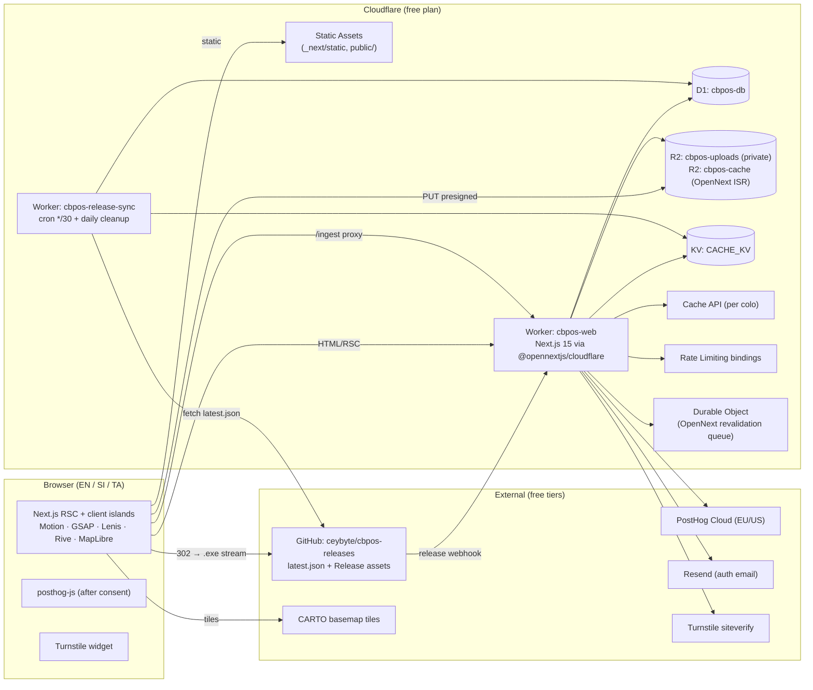
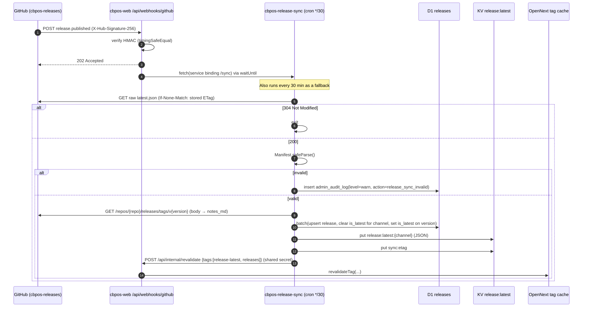
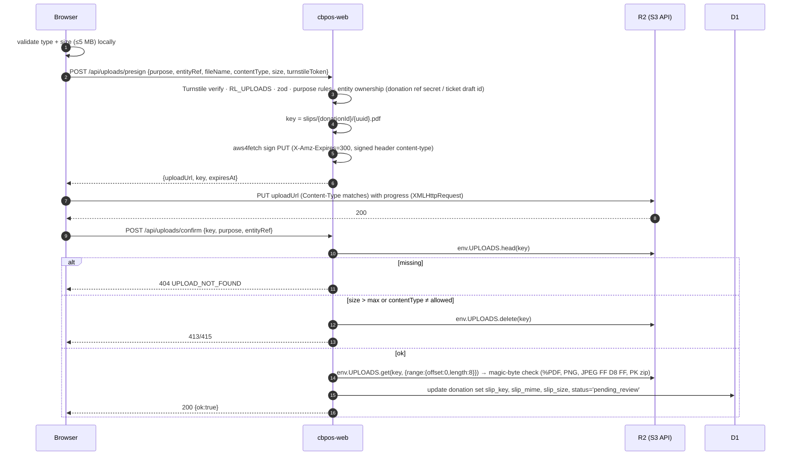
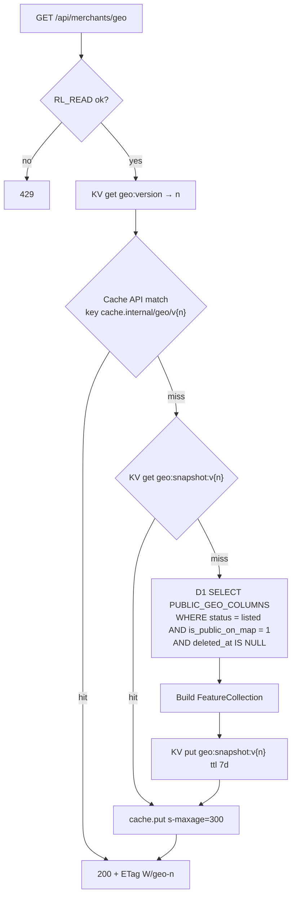

# 02 — Technical Requirements Document (TRD)

| | |
|---|---|
| Version | 1.0 |
| Date | 2026-10-21 |
| Status | Approved for build |
| Depends on | `01-PRD.md` (requirements), `05-SCHEMA.md` (data) |

---

## 1. Architecture overview



### 1.1 Key design decisions

| # | Decision | Why |
|---|---|---|
| D1 | **Cloudflare Workers + Static Assets via OpenNext**, not Cloudflare Pages | `@opennextjs/cloudflare` targets Workers. Pages' `next-on-pages` is deprecated for Next 15 App Router features. "Pages" in the brief is satisfied by Workers Static Assets serving all static files at zero CPU cost |
| D2 | **Installer bytes never pass through our Worker.** `/api/download/latest` logs the event and returns `302` to the GitHub asset | Saves Worker CPU, bandwidth and request duration. GitHub's CDN streams large files reliably |
| D3 | **Docs and blog content in D1 as Markdown, rendered with unified → `hast-util-to-jsx-runtime`** (no MDX eval) | The Workers runtime forbids `eval`/`new Function`, so runtime MDX can't work. Admin-editable content needs DB storage |
| D4 | **SSG/ISR for every public page**; SSR only for dashboard and admin | The free plan's 10 ms CPU limit per request. Cached pages cost almost no CPU |
| D5 | **Separate cron Worker** for release sync and retention jobs | Keeps the Next.js Worker bundle small. Cron triggers are simplest on a plain Worker |
| D6 | **Geo endpoint served from a KV snapshot + Cache API**, rebuilt on write | Map reads far outnumber writes. Keeps D1 reads near zero on the hot path |
| D7 | **Presigned PUT to R2 + server-side `head` verification** | R2 doesn't support presigned POST policies (no `content-length-range`), so size and type are enforced after upload |
| D8 | **MapLibre native clustering** instead of a separate `supercluster` import | MapLibre's GeoJSON source uses Supercluster internally. `clusterProperties` covers supporter counts without extra JS |
| D9 | **Shop data never touches this system.** CB-POS keeps data on the shop's PC, and its multi-till modes (LAN Sync, PostgreSQL network mode) run between the shop's own machines [G4], [H]. No route, binding or table touches them | Keeps Ceybyte out of the custody chain for sales data (PDPA, liability) and matches what the app actually does |

---

## 2. Runtime & deployment

### 2.1 Workers

| Worker | Entry | Purpose | Triggers |
|---|---|---|---|
| `cbpos-web` | `.open-next/worker.js` | Next.js app, APIs, webhooks | HTTP (`ceybyte.com/*`, `www.ceybyte.com/*` → 301 to apex) |
| `cbpos-release-sync` | `workers/release-sync/src/index.ts` | Sync `latest.json` → D1/KV; retention cleanup | Cron `*/30 * * * *` (sync), `15 3 * * *` (cleanup, 08:45 Asia/Colombo) |

### 2.2 `wrangler.jsonc` (cbpos-web)

```jsonc
{
  "$schema": "node_modules/wrangler/config-schema.json",
  "name": "cbpos-web",
  "main": ".open-next/worker.js",
  "compatibility_date": "2026-09-01",
  "compatibility_flags": ["nodejs_compat", "global_fetch_strictly_public"],
  "assets": { "directory": ".open-next/assets", "binding": "ASSETS" },
  "routes": [{ "pattern": "ceybyte.com", "custom_domain": true }],
  "observability": { "enabled": true, "head_sampling_rate": 0.1 },

  "d1_databases": [
    { "binding": "DB", "database_name": "cbpos-db", "database_id": "<id>", "migrations_dir": "drizzle" },
    { "binding": "NEXT_TAG_CACHE_D1", "database_name": "cbpos-next-tags", "database_id": "<id>" }
  ],
  "r2_buckets": [
    { "binding": "UPLOADS", "bucket_name": "cbpos-uploads" },
    { "binding": "NEXT_INC_CACHE_R2_BUCKET", "bucket_name": "cbpos-cache" }
  ],
  "kv_namespaces": [{ "binding": "CACHE_KV", "id": "<id>" }],
  "durable_objects": {
    "bindings": [{ "name": "NEXT_CACHE_DO_QUEUE", "class_name": "DOQueueHandler" }]
  },
  "migrations": [{ "tag": "v1", "new_sqlite_classes": ["DOQueueHandler"] }],
  "services": [{ "binding": "WORKER_SELF_REFERENCE", "service": "cbpos-web" }],

  "ratelimits": [
    { "name": "RL_FORMS",    "namespace_id": "1001", "simple": { "limit": 5,   "period": 60 } },
    { "name": "RL_UPLOADS",  "namespace_id": "1002", "simple": { "limit": 10,  "period": 60 } },
    { "name": "RL_VOTES",    "namespace_id": "1003", "simple": { "limit": 30,  "period": 60 } },
    { "name": "RL_AUTH",     "namespace_id": "1004", "simple": { "limit": 10,  "period": 60 } },
    { "name": "RL_READ",     "namespace_id": "1005", "simple": { "limit": 120, "period": 60 } }
  ],

  "vars": {
    "SITE_URL": "https://ceybyte.com",
    "RELEASES_REPO": "ceybyte/cbpos-releases",
    "RELEASE_MANIFEST_URL": "https://raw.githubusercontent.com/ceybyte/cbpos-releases/main/latest.json",
    "R2_ACCOUNT_ID": "<account-id>",
    "R2_BUCKET": "cbpos-uploads",
    "TURNSTILE_SITE_KEY": "<public>",
    "POSTHOG_KEY": "<public>",
    "POSTHOG_HOST": "https://eu.i.posthog.com",
    "MAP_TILES_URL": "pmtiles://https://tiles.ceybyte.com/sri-lanka.pmtiles",
    "DONATION_BANK_NAME": "<bank>",
    "DONATION_BANK_BRANCH": "<branch>",
    "DONATION_ACCOUNT_NAME": "<account name>",
    "DONATION_ACCOUNT_NUMBER": "<account number>",
    "LOCALES_ENABLED": "en,si,ta"
  }
}
```

> The `ratelimits` `period` must be `10` or `60` seconds. Longer windows (e.g. 10 minutes for the gate) are built from a 60 s binding plus a D1/KV counter (see §11).
> Check the OpenNext binding names (`NEXT_INC_CACHE_R2_BUCKET`, `NEXT_TAG_CACHE_D1`, `NEXT_CACHE_DO_QUEUE`, `WORKER_SELF_REFERENCE`) against the installed `@opennextjs/cloudflare` version during Phase 0.

### 2.3 Secrets (`wrangler secret put`, `.dev.vars` locally)

| Secret | Used by |
|---|---|
| `BETTER_AUTH_SECRET` | Auth session signing |
| `GOOGLE_CLIENT_ID`, `GOOGLE_CLIENT_SECRET` | Google OAuth |
| `RESEND_API_KEY` | Auth emails |
| `TURNSTILE_SECRET_KEY` | siteverify |
| `R2_ACCESS_KEY_ID`, `R2_SECRET_ACCESS_KEY` | Presigning R2 URLs (S3 API token scoped to `cbpos-uploads`, Object Read & Write) |
| `GITHUB_WEBHOOK_SECRET` | HMAC verification of release webhooks |
| `GITHUB_TOKEN` (optional, fine-grained, read-only public repo) | Raises the GitHub API rate limit for the sync worker |
| `IP_HASH_PEPPER` | Base for the daily IP-hash salt |
| `CLAIM_TOKEN_SECRET` | HMAC for claim cookies |
| `INTERNAL_SECRET` | Shared by `cbpos-web` and `cbpos-release-sync` for `/api/internal/*` calls |
| `POSTHOG_PERSONAL_API_KEY` (optional) | Server-side feature flags |

`src/lib/env.ts` validates all bindings and vars with zod on first access per request, and fails closed with a 500 `ENV_MISCONFIGURED`.

### 2.4 OpenNext config (`open-next.config.ts`)

```ts
import { defineCloudflareConfig } from "@opennextjs/cloudflare";
import r2IncrementalCache from "@opennextjs/cloudflare/overrides/incremental-cache/r2-incremental-cache";
import d1NextTagCache from "@opennextjs/cloudflare/overrides/tag-cache/d1-next-tag-cache";
import doQueue from "@opennextjs/cloudflare/overrides/queue/do-queue";

export default defineCloudflareConfig({
  incrementalCache: r2IncrementalCache,
  tagCache: d1NextTagCache,
  queue: doQueue,
});
```

`src/server/worker-entry.ts` re-exports `DOQueueHandler` as required by OpenNext.

### 2.5 Environments

| Env | URL | D1 | Deploy |
|---|---|---|---|
| local | `localhost:3000` (`pnpm dev`), `localhost:8787` (`pnpm preview`) | `--local` (Miniflare) | — |
| preview | `cbpos-web-preview.<acct>.workers.dev` | `cbpos-db-preview` | Every PR (GitHub Actions) |
| production | `ceybyte.com` | `cbpos-db` | Merge to `main` → migrations → deploy |

---

## 3. Request lifecycle & middleware

`src/middleware.ts` runs on every non-asset request:

1. **Skip** paths: `/_next/*`, `/api/*`, `/ingest/*`, `/media/*`, static files (matcher excludes them).
2. **`/admin/*`:** if there's no Better Auth session cookie → rewrite to `/404`. The full role check happens in `src/app/admin/layout.tsx` (server) and in every action.
3. **`/[locale]/dashboard/*`:** if there's no session cookie → redirect to `/{locale}/login?next=...`.
4. **i18n:** `next-intl` `createMiddleware(routing)` with `localePrefix: "always"` and `localeDetection: true` (only `/` is affected).
5. Headers: security headers (§12.3) are set here and in `next.config.ts` `headers()` for static responses.

Middleware must not query D1 (CPU and latency budget). It checks cookies only.

---

## 4. Route structure (pages)

All public routes live under `src/app/[locale]/`. `locale ∈ {en, si, ta}`.

| Route | Screen (06) | Feature | Render | Revalidate / tags |
|---|---|---|---|---|
| `/{locale}` | S01 Home | F-02 | SSG + ISR | tags `home-stats`, `release-latest`; 600 s |
| `/{locale}?download=1` | S02 Download Gate (modal) | F-03 | client island | — |
| `/{locale}/download` | S02 (no-JS full page) | F-03 | SSG | `release-latest` |
| `/{locale}/map` | S03 Map | F-04 | SSG shell + client map | `home-stats` |
| `/{locale}/docs` | S04 Docs Hub | F-05 | SSG + ISR | `docs` |
| `/{locale}/docs/[...slug]` | S05 Doc Article | F-05 | SSG (`generateStaticParams`) + ISR | `docs`, `doc:{translationKey}` |
| `/{locale}/docs/shortcuts/print` | S05 variant | F-05 | SSG | `docs` |
| `/{locale}/releases` | S06 Releases | F-06 | SSG + ISR | `releases` |
| `/{locale}/feedback` | S07 Feedback Board | F-07 | ISR | `feedback`; 120 s |
| `/{locale}/feedback/new` | S08 (submit) | F-07 | SSG | — |
| `/{locale}/feedback/[number]` | S08 Ticket Detail | F-07 | ISR | `ticket:{id}` |
| `/{locale}/donate` | S09 Donate | F-11 | SSG + ISR | `supporters`; 600 s |
| `/{locale}/blog` | S10 Blog Index | F-10 | SSG + ISR | `blog` |
| `/{locale}/blog/[slug]` | S10 Blog Post | F-10 | SSG + ISR | `blog`, `post:{translationKey}` |
| `/{locale}/blog/rss.xml` | — | F-10 | route handler, ISR | `blog` |
| `/{locale}/legal/[doc]` | S11 Legal | F-12 | SSG | — |
| `/{locale}/login` | S12 Auth | F-09 | SSG shell + client form | — |
| `/{locale}/dashboard` (+ `/listing`, `/tickets`, `/donations`, `/settings`) | S13 Dashboard | F-09 | dynamic SSR | — |
| `/admin` (+ `/merchants`, `/donations`, `/feedback`, `/docs`, `/blog`, `/releases`, `/users`, `/audit`) | S14 Admin | F-08 | dynamic SSR | — |
| `/sitemap.xml`, `/robots.txt` | — | SEO | route handlers, ISR | `docs`, `blog` |
| `/not-found`, `error.tsx` | system | — | static | — |

---

## 5. API surface

### 5.1 Route handlers

| Method & path | Auth | Guards | Purpose |
|---|---|---|---|
| `POST /api/downloads` | public | Turnstile, `RL_FORMS` + 10-min window, zod | Download gate submit → merchant upsert, log, claim token |
| `GET /api/download/latest?channel=stable&asset=exe&ref=` | public | `RL_READ` | Log `installer_download_started` (waitUntil) → `302` to GitHub asset |
| `GET /api/releases/latest?channel=stable` | public | `RL_READ`, edge cache 300 s | Latest release JSON |
| `GET /api/merchants/geo` | public | `RL_READ`, KV + Cache API | Public GeoJSON (§10) |
| `GET /api/stats` | public | edge cache 300 s | `{ districtsCovered, listedShops, supporters }` |
| `GET /api/docs/search-index?locale=si` | public | edge cache, versioned | Orama index JSON for `⌘K` |
| `POST /api/uploads/presign` | public or session | Turnstile token *or* session, `RL_UPLOADS`, zod | Presigned PUT URL for slip / crash log / screenshot |
| `POST /api/uploads/confirm` | same | `RL_UPLOADS` | `head()` verify size and type, bind object to entity |
| `POST /api/feedback` | public | Turnstile, `RL_FORMS`, zod | Create ticket |
| `GET /api/feedback/similar?q=` | public | `RL_READ` | Top 3 similar titles |
| `POST /api/feedback/[id]/vote` | public | `RL_VOTES`, voter-hash dedupe | Toggle vote |
| `POST /api/donations` | public | Turnstile, `RL_FORMS`, zod | Create a `bank_transfer` donation → reference code + bank details |
| `POST /api/donations/[ref]/submit` | public (ref + secret) | `RL_FORMS` | Confirm the uploaded slip (+ optional bank txn reference) → `pending_review` |
| `GET /api/donations/[ref]/status` | public (ref + `cb_dn_{ref}` cookie secret) | `RL_READ` | Resume view on `/donate?ref=…`: returns `status` only |
| `POST /api/webhooks/github` | GitHub | `X-Hub-Signature-256` HMAC | On `release` `published`/`edited`/`deleted` → sync |
| `POST /api/internal/revalidate` | `X-Internal-Secret` | constant-time compare | `revalidateTag()` for tags sent by the cron worker |
| `GET/POST /api/auth/[...all]` | — | `RL_AUTH` on sign-in/up | Better Auth handler |
| `GET /media/[...key]` | public | Allow-list prefixes `docs/`, `blog/`, `screenshots/public/` | Serve public R2 objects with immutable cache headers |
| `/ingest/[...path]` | — | — | PostHog reverse proxy (rewrite in `next.config.ts`) |

### 5.2 Server Actions (session-bound)

| Action file | Actions | Role |
|---|---|---|
| `src/features/merchants/actions.ts` | `updateMyListing`, `setMyVisibility`, `deleteMyListing`, `claimListing` | merchant |
| `src/features/admin/merchants.actions.ts` | `setMerchantStatus`, `setSupporter`, `linkMerchantToUser`, `exportMerchantsCsv` | admin |
| `src/features/admin/donations.actions.ts` | `approveDonation`, `rejectDonation`, `getSlipUrl` | admin |
| `src/features/admin/feedback.actions.ts` | `setTicketStatus`, `markDuplicate`, `respond`, `markScreenshotSafe` | admin |
| `src/features/admin/content.actions.ts` | `saveDocArticle`, `publishDocArticle`, `saveDocCategory`, `saveBlogPost`, `publishBlogPost`, `rebuildSearchIndex` | admin |
| `src/features/admin/releases.actions.ts` | `forceSync`, `setYanked`, `upsertManualRelease` | admin |

Every action: `const session = await requireSession(role)` → zod parse → mutation via `db.batch` → `writeAudit()` (admin) → `revalidateTag(...)` → return a typed result.

### 5.3 Error codes

| Code | HTTP | Meaning |
|---|---|---|
| `VALIDATION_FAILED` | 422 | zod failure. `error.fields` holds a per-field i18n key |
| `TURNSTILE_FAILED` | 403 | Token missing, invalid or expired |
| `RATE_LIMITED` | 429 | Includes a `Retry-After` header |
| `LOCATION_OUTSIDE_SRI_LANKA` | 422 | lat/lng outside the bounds |
| `INVALID_PHONE` | 422 | Not a valid Sri Lankan number |
| `FILE_TOO_LARGE` | 413 | > 5 MB after the head check |
| `FILE_TYPE_NOT_ALLOWED` | 415 | MIME/extension mismatch or not allowed |
| `UPLOAD_NOT_FOUND` | 404 | Confirm called before the PUT finished |
| `NOT_FOUND` | 404 | |
| `UNAUTHENTICATED` | 401 | |
| `FORBIDDEN` | 404 for `/admin`, 403 otherwise | |
| `RELEASE_UNAVAILABLE` | 503 | No non-yanked release in D1, KV or the build fallback |
| `SIGNATURE_INVALID` | 400 | Webhook signature mismatch |
| `ENV_MISCONFIGURED` | 500 | |
| `INTERNAL` | 500 | Logged with a request ID |

Response envelope:

```ts
type ApiResult<T> =
  | { ok: true; data: T }
  | { ok: false; error: { code: ErrorCode; fields?: Record<string, string>; requestId: string } };
```

---

## 6. Rendering & caching matrix

| Layer | What | TTL / invalidation |
|---|---|---|
| Static Assets | `_next/static/*`, `public/*`, fonts | Immutable, hashed filenames |
| OpenNext ISR (R2 + D1 tag cache) | Marketing, docs, blog, releases, legal HTML/RSC | `revalidateTag()` from admin actions, the release sync and merchant writes; time-based fallbacks per §4 |
| Cache API (`caches.default`) | `/api/merchants/geo`, `/api/releases/latest`, `/api/stats`, search index | Versioned keys; `s-maxage` 60–300 s; purge = bump version |
| KV | `geo:snapshot`, `geo:version`, `release:latest`, `docs:index:{locale}:{version}`, `stats:v1` | Written on change (≪ 1,000 writes/day) |
| Browser | API JSON `Cache-Control: public, max-age=30, stale-while-revalidate=300` | — |

**Budget rule:** no public GET route may do more than one D1 query on a cache miss, and the cache-miss rate must stay below 5% (monitored via Workers Analytics).

---

## 7. GitHub release sync

### 7.1 `latest.json` contract (in `ceybyte/cbpos-releases@main`)

This file is generated by the CB-POS release workflow and **read by the desktop app's updater** on every launch [A6], [A7]. The website only reads it. Its six keys must never be renamed or removed. Additive keys are coordinated through UR-08.

```json
{
  "version": "1.3.0",
  "release_date": "2026-09-27",
  "download_url": "https://github.com/ceybyte/cbpos-releases/releases/download/v1.3.0/CBPOSSetup-1.3.0.exe",
  "changelog": "",
  "min_version": "1.0.0",
  "sha256": "<64 hex chars>"
}
```

- URL: `https://raw.githubusercontent.com/ceybyte/cbpos-releases/main/latest.json` (the same URL the app uses).
- `changelog` is empty today and `min_version` is unused by the app [A6]. The installer has no size or publish timestamp in the manifest, so the sync also calls `GET https://api.github.com/repos/ceybyte/cbpos-releases/releases/tags/v{version}` for `published_at`, `id`, `body` and the asset's `size` and `name`.
- One stable channel; one `.exe` asset; no portable zip [A3].
- SHA-256 is computed by the release CI. Our code never hashes the installer.

zod schema (`src/features/releases/manifest.ts`, shared by every runtime):

```ts
export const Manifest = z.object({
  version: z.string().regex(/^\d+\.\d+\.\d+$/),
  release_date: z.string().regex(/^\d{4}-\d{2}-\d{2}$/),
  download_url: z
    .string()
    .url()
    .startsWith("https://github.com/ceybyte/cbpos-releases/releases/download/")
    .regex(/\/CBPOSSetup-\d+\.\d+\.\d+\.exe$/),
  changelog: z.string().default(""),
  min_version: z.string().optional(),
  sha256: z.string().regex(/^[a-f0-9]{64}$/),
  // UR-08 additive keys, accepted when present
  size: z.number().int().positive().optional(),
  published_at: z.string().datetime().optional(),
  notes_url: z.string().url().optional(),
}).passthrough();

export const GithubReleaseAsset = z.object({ name: z.string(), size: z.number().int().positive(), browser_download_url: z.string().url() });
```

Sync rules:
- `download_url` must equal the GitHub asset's `browser_download_url`, and the asset name must match. If not, reject and audit-log a warning.
- Release notes = admin-edited `notes_md` if present, else the manifest `changelog`, else the GitHub release body (a fixed template today, so admins paste the `CHANGELOG.md` entry until UR-09).
- An invalid manifest never changes `is_latest`.

### 7.2 Sync sequence



- The webhook only accepts `X-GitHub-Event: release` with `action ∈ {published, edited, deleted}`. Other events get `204`.
- `/api/internal/revalidate` requires the `X-Internal-Secret` header (`INTERNAL_SECRET`, shared by both Workers) and is not routed publicly through middleware.
- `deleted` → mark the matching row `is_yanked = 1`, then recompute `is_latest`.
- Version ordering uses semver comparison in code, not string sort.

### 7.3 Download endpoint

`GET /api/download/latest?channel=stable&asset=exe&ref={merchantPublicId?}`

1. Resolve the release: KV `release:latest:stable` → fallback D1 `releases where is_latest=1 and channel=? and is_yanked=0` → fallback build-time constant `FALLBACK_RELEASE` (written by `scripts/snapshot-release.ts` during `pnpm build`).
2. `ctx.waitUntil(insert merchant_logs {event:'installer_download_started', release_id, merchant_id via ref lookup, ip_hash})`. Also send the PostHog server event `installer_download_started` (no PII).
3. Return `302 Location: <exe_url>` (the manifest's `download_url`) with `Cache-Control: no-store`.

---

## 8. Docs & blog rendering pipeline

```
body_md (D1)
  → remark-parse → remark-gfm → remark-directive → remarkCbDirectives (whitelist → mdast nodes)
  → remark-rehype → rehype-slug → rehype-autolink-headings → rehype-shiki (precomputed at publish) 
  → hast → sanitize (rehype-sanitize with custom schema)
  → hast-util-to-jsx-runtime(components = { Callout, Kbd, Screenshot, Steps, Video, a: LocaleLink, img: R2Image })
```

- **Rendering at publish time:** the admin "Publish" action renders Markdown to a hast JSON (`body_hast` column) and extracts the TOC (`toc_json`) and plain text (`search_text`). Page renders only run `hast-util-to-jsx-runtime` over the stored hast, so CPU stays low. Shiki highlighting happens at publish (inside the Server Action, which runs dynamically), never on a page view.
- **Fumadocs integration:** use `fumadocs-ui` layouts (`DocsLayout`, `DocsPage`, `DocsBody`, `DocsTitle`, TOC) with a page tree built from `docs_categories` + `docs_articles` via a custom `source` adapter (`src/features/docs/source.ts`) that returns Fumadocs `PageTree.Root`.
- **Search:** at publish, rebuild the locale's Orama index (`@orama/orama` `create` + `insertMultiple` + `save`) → KV `docs:index:{locale}:{n}` and bump `docs:index-version:{locale}`. The client search dialog (Fumadocs `SearchDialog` with a static client adapter) fetches `/api/docs/search-index?locale=si&v={n}` on first open (immutable cache) and searches in-browser. The English index loads as a secondary source for fallbacks.
- **Blog:** same pipeline. `reading_minutes = ceil(words / 200)` (for `si`/`ta`, count by whitespace tokens with a divisor of 150).

---

## 9. R2 presigned upload flow

### 9.1 Buckets & keys

| Bucket | Visibility | Prefixes |
|---|---|---|
| `cbpos-uploads` | **private**; no public r2.dev domain | `slips/{donationId}/{uuid}.{ext}`, `crash-logs/{ticketId}/{uuid}.{ext}`, `screenshots/private/{ticketId}/{uuid}.{ext}`, `screenshots/public/{ticketId}/{uuid}.{ext}` (copied on admin approval), `docs/{articleId}/{uuid}.{ext}`, `blog/{postId}/{uuid}.{ext}`, `og/{locale}/{slug}.png`, `tmp/{uuid}` (lifecycle: delete after 1 day) |
| `cbpos-cache` | private | OpenNext ISR cache |

Bucket CORS (`cbpos-uploads`):

```json
[{
  "AllowedOrigins": ["https://ceybyte.com", "http://localhost:3000", "http://localhost:8787"],
  "AllowedMethods": ["PUT"],
  "AllowedHeaders": ["content-type"],
  "MaxAgeSeconds": 3600
}]
```

Lifecycle rule: `tmp/` expires after 1 day. Unconfirmed uploads are deleted by the daily cleanup cron.

### 9.2 Allowed uploads

| Purpose | MIME | Ext | Max |
|---|---|---|---|
| `donation_slip` | `image/jpeg`, `image/png`, `application/pdf` | jpg, jpeg, png, pdf | 5 MB |
| `crash_log` | `text/plain`, `application/zip`, `application/x-zip-compressed` | log, txt, zip | 5 MB |
| `ticket_screenshot` | `image/jpeg`, `image/png` | jpg, jpeg, png | 5 MB |
| `docs_media`, `blog_media` (admin) | `image/png`, `image/jpeg`, `image/webp`, `video/mp4` | — | 5 MB images / 50 MB video |

### 9.3 Sequence



Presigning (`src/server/r2.ts`):

```ts
import "server-only";
import { AwsClient } from "aws4fetch";

export async function presignPut(env: CloudflareEnv, key: string, contentType: string) {
  const r2 = new AwsClient({
    accessKeyId: env.R2_ACCESS_KEY_ID,
    secretAccessKey: env.R2_SECRET_ACCESS_KEY,
    service: "s3",
    region: "auto",
  });
  const url = new URL(
    `https://${env.R2_ACCOUNT_ID}.r2.cloudflarestorage.com/${env.R2_BUCKET}/${key}`,
  );
  url.searchParams.set("X-Amz-Expires", "300");
  const signed = await r2.sign(new Request(url, { method: "PUT", headers: { "content-type": contentType } }), {
    aws: { signQuery: true },
  });
  return signed.url;
}
```

Admins read private objects through presigned **GET** URLs (`X-Amz-Expires=120`) generated by `getSlipUrl`. The admin UI opens them in a sandboxed `<iframe sandbox>` (PDF) or ``.

---

## 10. `/api/merchants/geo` edge caching

### 10.1 Response

`Content-Type: application/geo+json`

```json
{
  "type": "FeatureCollection",
  "version": 418,
  "generatedAt": "2026-10-21T04:12:00Z",
  "features": [
    {
      "type": "Feature",
      "geometry": { "type": "Point", "coordinates": [80.3647, 7.4863] },
      "properties": {
        "id": "m_7Kq3P9",
        "shopName": "Perera Stores",
        "category": "grocery",
        "district": "kurunegala",
        "city": "Kurunegala",
        "isSupporter": true,
        "since": "2026-08"
      }
    }
  ]
}
```

The properties whitelist is defined once in `05-SCHEMA.md §7` and in code as `PUBLIC_GEO_PROPERTIES`. Coordinates are rounded to 4 dp.

### 10.2 Layered read path



- **Conditional requests:** if `If-None-Match` equals `W/"geo-{n}"`, return `304`.
- **Response headers:** `Cache-Control: public, max-age=60, s-maxage=300, stale-while-revalidate=86400`. `Vary: Accept-Encoding` only (no cookies, so the response is identical for every user).
- **Invalidation:** any write that changes a public field (gate submit with `is_public_on_map`, a listing edit, an admin status or supporter change, a delete) calls `bumpGeoVersion()`. That increments `geo:version` in KV, writes the new snapshot eagerly in `waitUntil`, and calls `revalidateTag('home-stats')`. The old Cache API entries expire on their own, and new requests use the new key immediately. Other colos pick up the change on their next KV read, so worst-case staleness is KV propagation (≈60 s), which meets AC-04.4.
- **Write budget:** KV free tier allows 1,000 writes/day. Each bump costs 2 writes, so it supports about 450 public listing changes/day before debounce. Above 300 bumps/day, `bumpGeoVersion` coalesces: it writes at most once per 60 s using a `geo:dirty` flag checked by the cron worker.
- **Size:** 10,000 merchants × ~180 bytes ≈ 1.8 MB raw / ~250 KB gzip, under KV's 25 MiB value limit. If it exceeds 5,000 features, switch to per-district tiles (`/api/merchants/geo?district=…`). This is noted as a scaling trigger.

---

## 11. Rate limiting

**Identity key:** `ipHash = sha256(CF-Connecting-IP + dailySalt)`, where `dailySalt = sha256(IP_HASH_PEPPER + YYYY-MM-DD)`. A session user ID is used instead when present.

| Endpoint group | Binding | Limit | Extra window |
|---|---|---|---|
| Gate submit, feedback create, donation create | `RL_FORMS` | 5 / 60 s | ≤ 10 per IP-hash per hour (KV counter `rl:h:{ipHash}:{hour}`, TTL 3600; only incremented after the 60 s check passes) |
| Upload presign/confirm | `RL_UPLOADS` | 10 / 60 s | — |
| Votes | `RL_VOTES` | 30 / 60 s | Dedupe table |
| Auth sign-in/up/OTP | `RL_AUTH` | 10 / 60 s | Better Auth's built-in `rateLimit` (storage: `secondary-storage` in KV) |
| Public reads (geo, releases, stats, download) | `RL_READ` | 120 / 60 s | — |

Implementation (`src/server/ratelimit.ts`):

```ts
export async function limit(binding: RateLimit, key: string) {
  const { success } = await binding.limit({ key });
  if (!success) throw new ApiError("RATE_LIMITED", 429, { retryAfter: 60 });
}
```

**Zone-level backstop:** one Cloudflare WAF rate-limiting rule (the free plan includes one): `http.request.uri.path wildcard "/api/*" and http.request.method eq "POST"` → block for 10 s when more than 20 requests per 10 s come from one IP.

---

## 12. Bot defense & security

### 12.1 Turnstile
- Widget mode: **managed**, `appearance: "interaction-only"`, `language: "auto"` (Turnstile follows the browser language; Sinhala and Tamil coverage isn't guaranteed, and the widget is interaction-only, so it rarely shows text). Render it lazily when the form becomes visible.
- Server verify (`src/server/turnstile.ts`): `POST https://challenges.cloudflare.com/turnstile/v0/siteverify` with `secret`, `response`, `remoteip`, and an `idempotency_key` (uuid). Accept only if `success && hostname ∈ {ceybyte.com, localhost}` and the `action` matches the form (`gate`, `feedback`, `donation`, `upload`).
- Tokens are single-use and expire after 300 s. The client resets the widget on any 4xx.
- Local and dev: Cloudflare's test keys (`1x00000000000000000000AA` site / `1x0000000000000000000000000000000AA` secret) via `.dev.vars`.

### 12.2 Auth
- `better-auth` per request: `createAuth(env)` with `drizzleAdapter(db, { provider: "sqlite", usePlural: true, schema })`, `plugins: [admin({ defaultRole: "merchant", adminRoles: ["admin"] }), emailOTP({...}), nextCookies()]`, `socialProviders.google`, `advanced.useSecureCookies: true`, `session.cookieCache.enabled: true (maxAge 300)`.
- `better-auth-cloudflare` (`withCloudflare`) supplies D1 wiring and the KV secondary storage for sessions and rate limits.
- Session cookie: `__Secure-better-auth.session_token`, `HttpOnly; Secure; SameSite=Lax`.
- Admin bootstrap: `scripts/make-admin.ts --email` (run with `wrangler d1 execute`) is the only way to create the first admin.

### 12.3 Headers & CSP

```
Content-Security-Policy:
  default-src 'self';
  script-src 'self' 'nonce-{n}' https://challenges.cloudflare.com;
  style-src 'self' 'unsafe-inline';
  img-src 'self' data: blob: https://*.basemaps.cartocdn.com https://avatars.githubusercontent.com;
  font-src 'self';
  connect-src 'self' https://*.r2.cloudflarestorage.com https://*.basemaps.cartocdn.com https://basemaps.cartocdn.com https://tiles.basemaps.cartocdn.com;
  frame-src https://challenges.cloudflare.com;
  worker-src 'self' blob:;
  child-src blob:;
  form-action 'self';
  frame-ancestors 'none';
  base-uri 'self';
  upgrade-insecure-requests
Strict-Transport-Security: max-age=63072000; includeSubDomains; preload
X-Content-Type-Options: nosniff
Referrer-Policy: strict-origin-when-cross-origin
Permissions-Policy: geolocation=(self), camera=(), microphone=(), payment=()
Cross-Origin-Opener-Policy: same-origin
```

- PostHog runs through `/ingest` (same origin), so it needs no CSP entry.
- Rive's WASM is self-hosted under `/rive/` (`RuntimeLoader.setWasmUrl`), so it needs no CDN.
- MapLibre needs `worker-src blob:`.

### 12.4 Webhook verification
- **GitHub:** `X-Hub-Signature-256 = "sha256=" + HMAC_SHA256(GITHUB_WEBHOOK_SECRET, rawBody)`, compared in constant time with `crypto.subtle.timingSafeEqual`.
- **Payment gateways:** none in v1 (donations are bank transfers verified by an admin). Whichever gateway is chosen later must have its webhook signature verification, idempotency key and CSP entries specified in its ADR before any code is written.

### 12.5 Data protection
- IPs are hashed (§11). Raw IPs are never stored.
- `merchants.claim_token_hash` holds `sha256(token)`. The token itself is only in the httpOnly cookie and in the response body shown once.
- CSV export of merchants is admin-only, audited, and streamed (never stored in R2).

---

## 13. Observability & analytics

- **Workers Logs** (observability enabled, 10% head sampling). A structured JSON logger in `src/server/log.ts` emits `{ level, msg, requestId, route, code }` and **never** PII fields. A lint rule blocks logging objects that contain `phone|whatsapp|telegram|email`.
- **Request ID:** `cf-ray` is reused as `requestId` and returned in error envelopes.
- **PostHog:**
  - `posthog-js` initialised after consent, with `api_host: "/ingest"`, `ui_host: "https://eu.posthog.com"`, `person_profiles: "identified_only"`, `session_recording: { maskAllInputs: true }`, `capture_pageview: "history_change"`.
  - Server events (download started, webhook outcomes) go through `posthog-node` with `flushAt: 1` inside `waitUntil`.
- **Funnel** (event names are fixed and also used in `04-APP_FLOW.md`):
  `cta_download_clicked{source}` → `download_gate_opened` → `download_gate_step1_completed` → `download_gate_submitted{district, category, public}` → `installer_download_started{version}` → `what_next_viewed` → `claim_listing_clicked`.
- **Alerts** (free): the daily cron counts `merchant_logs` and `donations.pending_review` and posts a summary to a private Discord/Telegram webhook (optional secret `OPS_WEBHOOK_URL`).

---

## 14. Free-tier budget ($0/month)

| Service | Free allowance (verify at Phase 0) | Expected at 10k visits/mo | Trigger to revisit |
|---|---|---|---|
| Workers requests | 100,000 / day | ~6,000 / day | > 60k/day sustained |
| Workers CPU | 10 ms / invocation | SSG/ISR pages < 5 ms | Any route p95 > 8 ms → optimise or move to Workers Paid ($5) |
| Worker size | 3 MiB gzip (free) | Target ≤ 2.5 MiB | CI `bundle:check` fails > 2.8 MiB |
| D1 | 5 M rows read/day, 100 k rows written/day, 500 MB per database (5 GB per account) | < 50 k reads/day, < 50 MB | Reads > 1 M/day or DB > 300 MB |
| KV | 100 k reads/day, 1 k writes/day | ~10 k reads, < 100 writes | Writes > 600/day |
| R2 | 10 GB, 1 M Class A, 10 M Class B / month | < 1 GB | > 7 GB |
| Durable Objects (SQLite-backed) | Free plan allowance | Revalidation queue only | — |
| Cron triggers | 5 per account | 2 | — |
| Turnstile | Unlimited | — | — |
| PostHog | 1 M events, 5 k replays / month | ~150 k events | > 700 k events → sample replays |
| Resend | 3,000 emails / month, 100 / day | < 300 | > 80/day |
| GitHub Releases | Free public bandwidth | — | — |
| CARTO basemaps | Free with attribution, subject to their terms | ~10 k map loads | Terms change → OpenFreeMap / Protomaps on R2 |

Upgrading to Workers Paid ($5/mo) is the **only** pre-approved paid escalation, and it needs an ADR recording the metric that triggered it.

---

## 15. Performance budgets

| Page | Initial JS (gz) | LCP p75 mobile | Notes |
|---|---|---|---|
| `/{locale}` | ≤ 180 KB | ≤ 2.5 s | Hero poster image is the LCP. Rive hydrates after idle |
| `/{locale}/map` | ≤ 120 KB + MapLibre (~220 KB, lazy) | ≤ 3.0 s | Skeleton grid + district list render first |
| `/{locale}/docs/*` | ≤ 140 KB | ≤ 2.0 s | Search index lazy |
| Dashboard / admin | ≤ 250 KB | — | Not public |

Fonts: `next/font/google` with `display: "swap"` and subsets (`latin` for Inter/Geist/JetBrains Mono, `sinhala`, `tamil`). Only the active locale's script font is preloaded.

---

## 16. Testing strategy

| Level | Tool | Scope |
|---|---|---|
| Unit | vitest | `money`, `phone`, `tax` display maths, `sri-lanka` (bounds, nearest city), masking projections, manifest zod, slip magic-byte check, GitHub HMAC |
| Contract | vitest | `geo.contract.test.ts` (whitelist), API envelopes, error codes ↔ message keys |
| Integration | vitest + Miniflare (`@cloudflare/vitest-pool-workers`) | Route handlers against local D1/R2/KV; webhook idempotency |
| E2E | Playwright against `pnpm preview` | The 6 flows in `04-APP_FLOW.md` × 3 locales; mobile (Pixel 7) + desktop |
| A11y | `@axe-core/playwright` | Every screen; zero violations |
| Visual | Playwright screenshots | Sinhala/Tamil clipping checks on S01, S02, S05, S09 |
| Perf | Lighthouse CI | `/en`, `/si`, `/ta`, `/si/docs/...` against §15 budgets |

---

## 17. CI/CD (GitHub Actions)

1. **`ci.yml`** (every PR): install → lint → typecheck → test → i18n:check → `opennextjs-cloudflare build` → `bundle:check` → Playwright (preview) → Lighthouse CI → `wrangler deploy --env preview`.
2. **`deploy.yml`** (push to `main`): the CI steps → `wrangler d1 migrations apply cbpos-db --remote` → `pnpm deploy` → `pnpm --filter release-sync deploy` → smoke test (`/en`, `/api/releases/latest`, `/api/merchants/geo` 200) → on failure, `wrangler rollback`.
3. Secrets in GitHub: `CLOUDFLARE_API_TOKEN` (Workers, D1, R2, KV edit), `CLOUDFLARE_ACCOUNT_ID`.
4. The production deploy is blocked while `[[TRANSLATE]]` markers exist in enabled locales.

---

## 18. ADR index (to be written in `docs/adr/`)

| ADR | Title |
|---|---|
| 0001 | Workers + OpenNext instead of Pages |
| 0002 | Docs content in D1 rendered without eval |
| 0003 | Installer delivery by 302 to GitHub Releases |
| 0004 | Geo snapshot in KV with versioned Cache API keys |
| 0005 | Presigned PUT + head verification for R2 uploads |
| 0006 | Drizzle on D1 with a Postgres-portable schema; Convex as a documented alternative |
