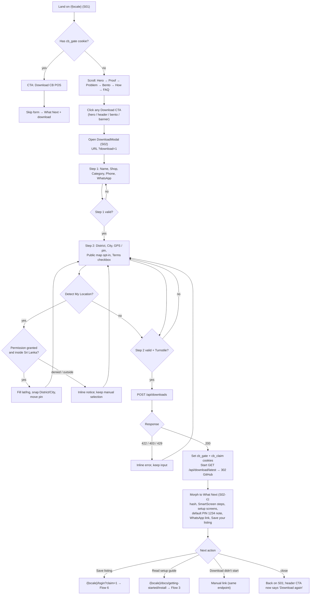
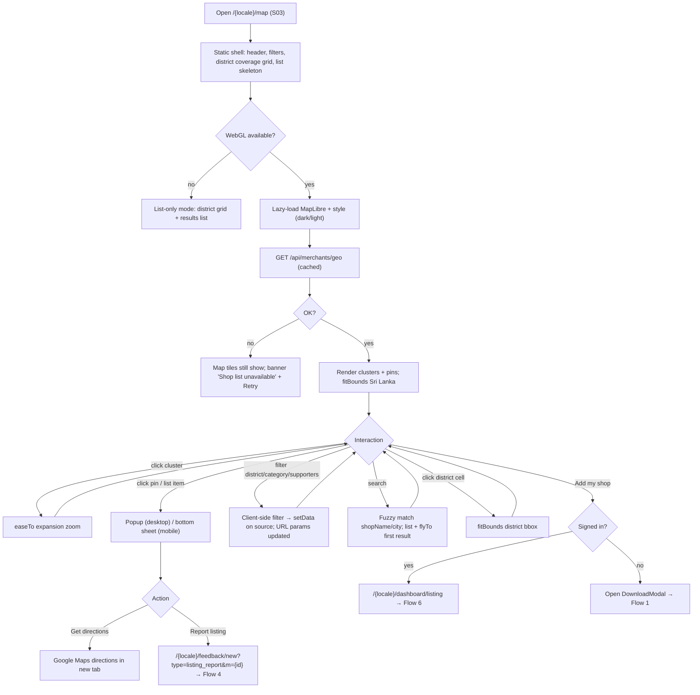
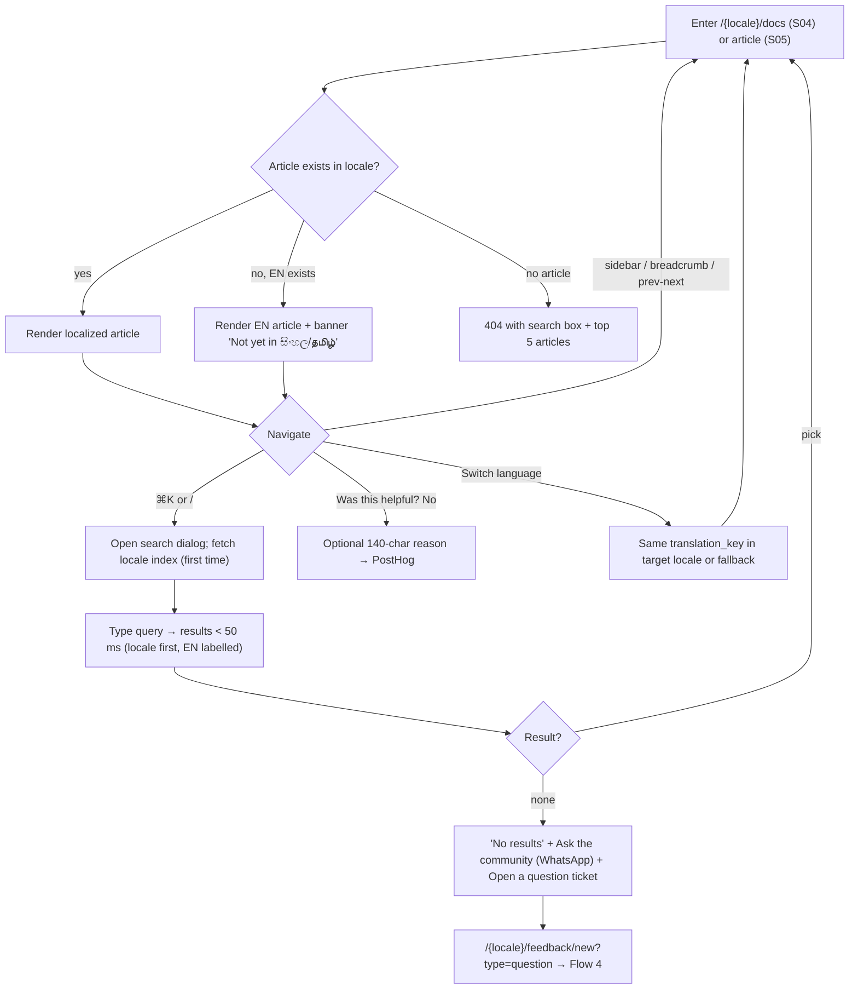
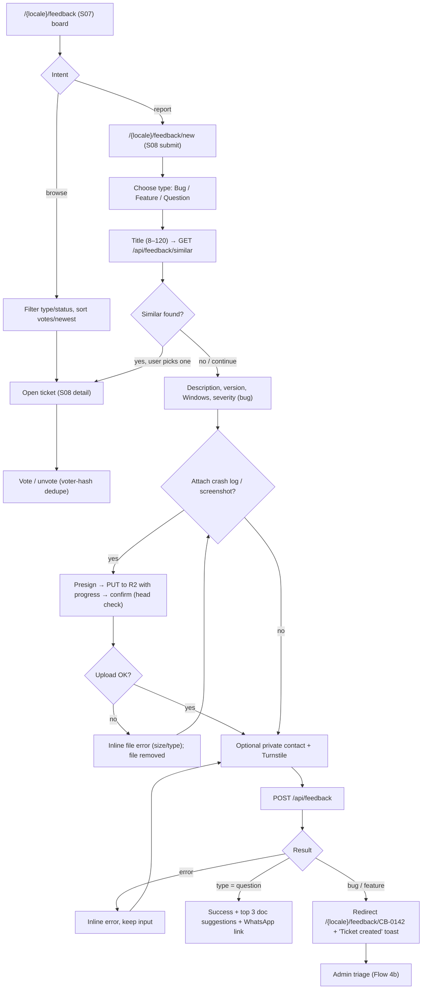
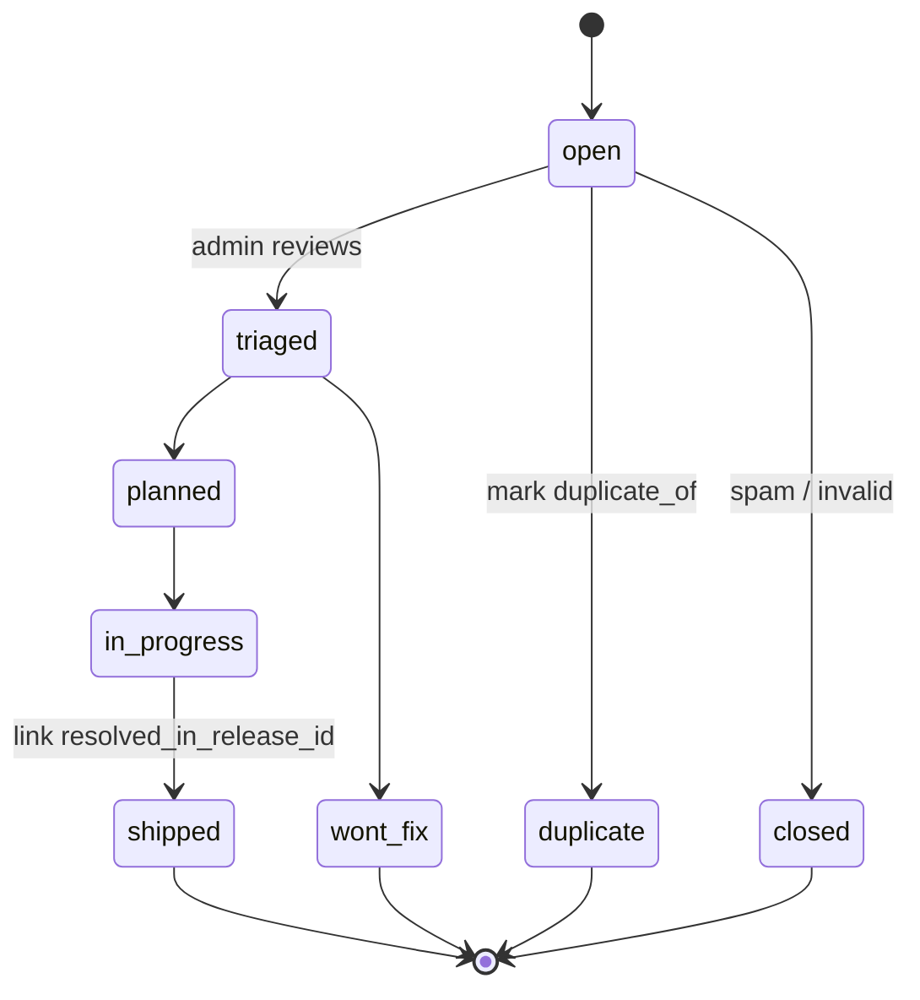
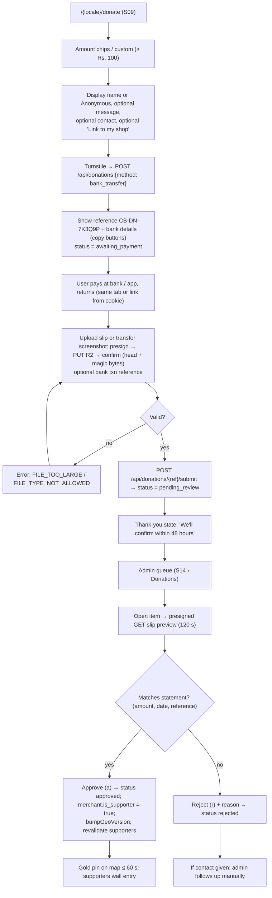
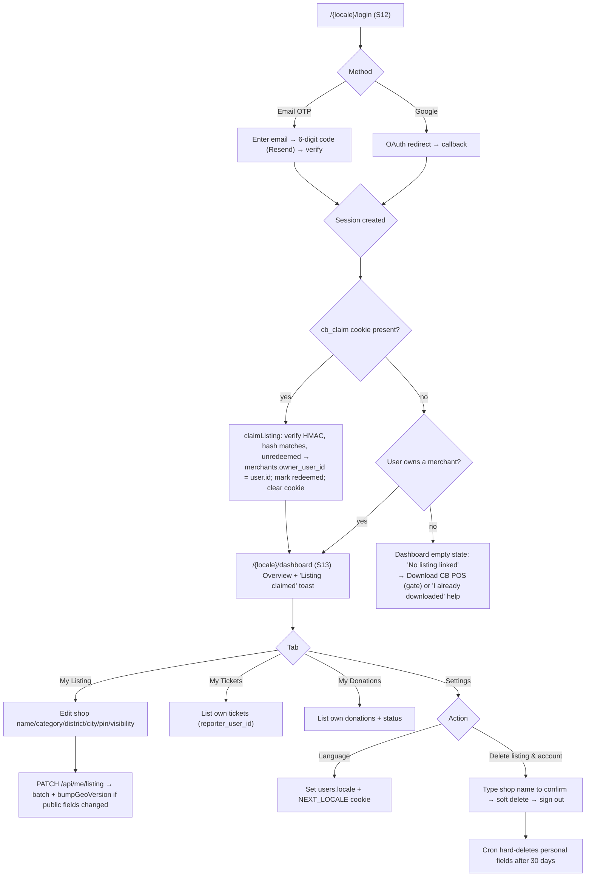

# 04 — Application Flows & User Journeys

| | |
|---|---|
| Version | 1.0 |
| Date | 2026-10-21 |
| Status | Approved for build |
| Depends on | `01-PRD.md` (features), `02-TRD.md` (APIs), `06-SCREEN_BLUEPRINTS_AND_COPY.md` (screens S01–S14) |

This document defines the six primary journeys end to end: entry points, every step, every system response, every state and error path, and the analytics events fired. Each flow has an E2E spec under `e2e/flows/` that runs in `en`, `si` and `ta`.

---

## 0. Conventions

- **Screen IDs** (`S01`…`S14`) refer to `06-SCREEN_BLUEPRINTS_AND_COPY.md §2`.
- **Error codes** refer to `02-TRD.md §5.3`. The user-facing text for each code lives in `messages/*.json` under `errors.<CODE>`.
- **Events** are PostHog event names (snake_case). Properties never contain phone, WhatsApp, Telegram, full name, email or IP. Events fire only after analytics consent, except the server-side events marked `(server)`, which carry no personal data.
- **Universal states** every screen must implement:

| State | Rule |
|---|---|
| Loading | Skeleton matching the final layout (no spinners for page loads). Buttons show inline spinners |
| Empty | Statement + one action (`03-DESIGN §8.13`) |
| Error (recoverable) | Inline message near the cause + a retry action. Input is never cleared |
| Error (fatal) | `error.tsx` with "Reload" and "Go home", plus the `requestId` in mono for support |
| Offline (browser) | `navigator.onLine === false` → a top banner "You're offline. CB POS works offline — this website doesn't." Forms keep their state and disable submit |
| Rate limited | "Too many attempts. Try again in {seconds}s." Submit disabled with a countdown |

---

## Flow 1 — Visitor → Download (F-02, F-03, F-06)

**Goal:** a first-time visitor downloads the installer and knows exactly what to do next.
**Entry points:** organic search (`/si`, `/ta`, `/en`), WhatsApp share links (`/si?download=1`), installer referrals (`?ref=installer-{code}` stored as a PostHog property), and the Releases page.

### 1.1 Step table

| # | Screen | User action | System response | Event |
|---|---|---|---|---|
| 1 | S01 | Lands | Static HTML from the edge; locale from URL. Live stats load from `/api/stats` | `$pageview` |
| 2 | S01 | Clicks a Download CTA | Opens the modal (dialog ≥ md / Vaul < md), pushes `?download=1`, pauses Lenis, focuses the first field | `cta_download_clicked {source: hero\|header\|bento\|banner\|releases}`, `download_gate_opened` |
| 3 | S02-a | Fills Step 1 | Field validation on blur, phone normalised live, values persisted to `sessionStorage` | — |
| 4 | S02-a | Continue (`Enter`) | Validates all of Step 1. On success, slides to Step 2 (direction-aware) | `download_gate_step1_completed {category}` |
| 5 | S02-b | Picks District | City list filters. Mini-map flies to the district centroid | — |
| 6 | S02-b | Detect My Location | `navigator.geolocation.getCurrentPosition({enableHighAccuracy:true, timeout:10000})`. Bounds check. Nearest city from `lk-cities.json` (haversine) → sets district/city/pin | `gate_location_detected {result: ok\|denied\|outside\|timeout}` |
| 7 | S02-b | Drags pin | Clamped to bounds. lat/lng updated (6 dp stored, 4 dp public). District is **not** auto-changed on drag (the user's choice wins) | — |
| 8 | S02-b | Ticks the public map opt-in (optional) and the terms (required) | Download button enabled once the form is valid. Turnstile resolves invisibly | — |
| 9 | S02-b | Download CB POS | `POST /api/downloads` with Turnstile token. Button loading. Rest of the form `inert` | — |
| 10 | — | — | Server: Turnstile → RL → zod → phone dedupe → `db.batch` (merchant insert or reuse + `merchant_logs`) → `bumpGeoVersion()` if public → response `{ downloadUrl, release, claimToken }` | `download_gate_submitted {district, category, public}` (server mirrors it without PII) |
| 11 | S02 | — | Sets cookies. Triggers the download via a hidden iframe-free `<a href=downloadUrl download>` click (falls back to `location.assign`) | `installer_download_started {version}` (server) |
| 12 | S02-c | Sees What Next | Layout morph + Rive check. Focus moves to the "Download started" heading | `what_next_viewed` |
| 13 | S02-c | Copies the hash | Clipboard + aria-live "Hash copied" | `hash_copied` |
| 14 | S02-c | WhatsApp community | Opens `https://chat.whatsapp.com/BS73D23VD74BbseKuoC1BM` in a new tab (`rel="noopener"`) | `whatsapp_community_clicked` |
| 15 | S02-c | Save your listing | → `/{locale}/login?claim=1` | `claim_listing_clicked` |

### 1.2 Edge cases

| Case | Behaviour |
|---|---|
| Phone already registered | Same success response. Server logs a new `download_gate_submitted` on the existing merchant and **does not** overwrite their data. The claim token is re-issued only if the old one was never redeemed |
| User closes the modal mid-form | If dirty: confirm "Leave? Your details stay on this device for this visit." Data stays in `sessionStorage` |
| Browser Back while the modal is open | Closes the modal (history entry from `?download=1`) |
| No JS | CTA `href="/{locale}/download"` (full-page form, Turnstile non-invisible) |
| Release unavailable (`503 RELEASE_UNAVAILABLE`) | Gate still saves the merchant. What Next shows "Download is temporarily unavailable — we saved your details. Try the Releases page in a few minutes." + link |
| Mobile Safari blocks a programmatic download after an async call | What Next shows a large "Tap to download" primary button (same URL) as the guaranteed path. Auto-start is best effort |
| The user is on Android/iOS (can't run `.exe`) | Step 2 button reads "Download CB POS" but What Next leads with "Send this to your PC": a share sheet (`navigator.share`) with the Releases URL, plus copy link. The download still starts |
| GPS accuracy > 1 km | Notice "Location is approximate — drag the pin to your shop." |

### 1.3 Acceptance (E2E `e2e/flows/01-visitor-download.spec.ts`)
- Completes in all three locales. Asserts `302` to a `github.com/ceybyte/cbpos-releases/releases/download/` URL.
- Asserts that `merchants.is_public_on_map` defaults to false.
- Keyboard-only run: Tab/Enter/Space reach and complete every control.

---

## Flow 2 — Map Explorer (F-04)

**Goal:** a visitor explores CB POS adoption, finds shops nearby, or adds their own.
**Entry points:** homepage telemetry teaser (S01 §2), header "Map", footer, "Add my shop" links, shared links `/{locale}/map?d=kandy` or `?m={publicId}`.

### 2.1 Step table

| # | User action | System response | Event |
|---|---|---|---|
| 1 | Opens `/map` | Shell renders instantly. Map JS loads after first paint. Geo JSON request runs in parallel with the map style | `$pageview`, `map_loaded {ms, features}` |
| 2 | Pans/zooms | Viewport-bound list updates (debounced 150 ms, `map.queryRenderedFeatures` on the unclustered layer + cluster leaves) | — |
| 3 | Clicks a cluster | `getClusterExpansionZoom` → `easeTo` | — |
| 4 | Clicks a pin | Popup: name, category, city, district, since, supporter badge, directions. URL `?m={id}` | `map_pin_opened {supporter}` |
| 5 | Filters | Client-side filter (no new request). URL reflects filters for sharing | `map_filtered {district?, category?, supportersOnly}` |
| 6 | Search | Matches within the loaded features. `Enter` flies to the first result | `map_searched {resultCount}` |
| 7 | Add my shop | Branches on session | `map_add_shop_clicked {signedIn}` |

### 2.2 States & edge cases

| Case | Behaviour |
|---|---|
| Zero public merchants (pre-launch) | Map renders Sri Lanka with the coverage grid all dark: "Be the first CB POS shop on the map." + Download CTA |
| `?m={id}` points to a hidden/deleted merchant | Ignored silently. Map opens at the default view |
| Tile provider failure | Fall back to the `MAP_STYLE_*` alternative URL once. If that also fails, list-only mode |
| Light/dark switch while open | `map.setStyle(next, { diff: true })` and re-add sources/layers on `style.load` |
| Keyboard user | Skip link → results list. `Enter` on an item = flyTo + open popup. `Esc` closes the popup and returns focus to the item |
| Reduced motion | `jumpTo` instead of `flyTo`/`easeTo` |

### 2.3 Acceptance (E2E `e2e/flows/02-map-explorer.spec.ts`)
- Network assertion: the geo response JSON has no keys outside the public whitelist.
- An admin hides a seeded merchant → within 60 s (KV version bump) the pin is absent.

---

## Flow 3 — Docs Navigation (F-05)

**Goal:** a merchant solves a setup or how-to problem without contacting support.
**Entry points:** What Next "Read setup guide", header "Docs", search engines (`/si/docs/...`), `⌘K` from any docs page. The app has no help links today [J2]. When UR-07 ships, its Help menu opens `https://ceybyte.com/{locale}/docs?utm_source=app&v={version}`, and the docs hub reads `v` to show a "You're on v{version}" note.

### 3.1 Step table

| # | User action | System response | Event |
|---|---|---|---|
| 1 | Opens the docs hub | Category grid (10) + "Start here" (Install, Get past SmartScreen, First sale, Connect a receipt printer) + search | `$pageview` |
| 2 | Opens an article | Static HTML rendered at build. TOC on the right (xl), collapsible on top (mobile). `app_version_min` badge | `doc_viewed {slug, locale, fallback}` |
| 3 | `⌘K` / `Ctrl+K` / `/` | Dialog opens. The index (static `/search/{locale}.json` built with the site, ~100–300 KB) loads once and is cached by the browser | `docs_search_opened` |
| 4 | Types | Orama search, typo tolerance 1, boost title ×3, headings ×2 | `docs_searched {qLength, results}` (never the raw query if it looks like a phone number) |
| 5 | Opens a result | Navigates. Search closes. Focus moves to the article `<h1>` | `docs_search_result_clicked {rank}` |
| 6 | Rates the article | Yes/No (+ optional reason) | `doc_feedback {slug, helpful}` |
| 7 | Copies a code/shortcut block | Clipboard + toast "Copied" | — |
| 8 | Print shortcut sheet | `/docs/shortcuts/print` → `window.print()` (A4 CSS) | `shortcuts_printed` |

### 3.2 Edge cases
- **A Tax-category article** always renders the tax-disclaimer callout at the top (injected by the renderer, not by authors).
- **Index fetch fails:** the dialog shows "Search is unavailable offline" and lists the category links.
- **Deep link to a heading (`#printer-not-found`):** scroll with header offset and briefly highlight the heading (azure left border 1.2 s).

### 3.3 Acceptance (E2E `e2e/flows/03-docs.spec.ts`)
- `⌘K` opens search in all locales. A Sinhala query returns `si` results ranked above `en` fallbacks.
- A missing `ta` translation shows the English article with the Tamil banner and `hreflang` links.

---

## Flow 4 — Bug / Feature Ticket Submission (F-07)

**Goal:** a user reports a bug or requests a feature in under 2 minutes, avoiding duplicates, and can follow its status.
**Entry points:** header/footer "Feedback", docs "Open a question ticket", map "Report listing", What Next "Something wrong?", and the `cbpos-releases` README, which today sends bugs to GitHub Issues [J2] and will point here instead. The app's "Report a bug" link (`/{locale}/feedback/new?type=bug&v={version}&os={winver}`) arrives with UR-07; the form already accepts those query params.

### 4.1 Upload ordering
Ticket attachments are uploaded **before** the ticket exists. The client creates a draft ID (`crypto.randomUUID()`) that is sent with the presign request (`entityRef: {kind: "ticket_draft", id}`). Keys go under `crash-logs/draft-{id}/…`. On `POST /api/feedback` with the same draft ID, the server moves the confirmed keys to `crash-logs/{ticketId}/…` (R2 copy + delete in `waitUntil`) and stores them on the ticket. The daily cron deletes unclaimed `draft-*` objects older than 24 h.

### 4.2 Step table

| # | User action | System response | Event |
|---|---|---|---|
| 1 | Opens new ticket | Query params prefill type, version and OS. Version select lists releases (newest first) + "Other / don't know". The help text says where to find the version: Settings › Admin Tools shows `v{version}` [A9] | `ticket_form_opened {type, source}` |
| 2 | Types the title | Debounced 400 ms → `/api/feedback/similar` → ≤ 3 suggestions with vote counts | `ticket_similar_shown {count}` |
| 3 | Picks a suggestion | Navigates to it, offers "Vote for this" | `ticket_duplicate_avoided` |
| 4 | Attaches a file | Client checks type/size → presign → PUT with progress → confirm | `ticket_attachment_uploaded {kind}` |
| 5 | Submits | Turnstile → RL → zod → insert ticket (`public_number` from `MAX+1` in a batch) | `ticket_submitted {type, severity?, hasAttachment}` |
| 6 | Views the ticket | Public fields only. Status timeline. "Follow on this page" (no email in v1) | — |
| 7 | Votes | `POST /vote` → toggles, optimistic UI, reverts on error | `ticket_voted {direction}` |

### 4.3 Flow 4b — Admin triage (S14 › Feedback)

- Each transition writes `admin_audit_log`. Board and ticket responses are edge-cached for 60 s, so changes show within a minute.
- `shipped` requires picking a release. The public ticket shows "Fixed in v1.4.3" linking to the Releases page.
- Screenshots stay private until "Mark screenshot safe" copies them to `screenshots/public/`.

### 4.4 Acceptance (E2E `e2e/flows/04-feedback.spec.ts`)
- Bug with a 1 MB log → public ticket page shows no log link and no contact.
- A 6 MB screenshot is rejected client-side. A forged 6 MB PUT is rejected at confirm (`413`).
- Double vote from the same context → count changes by 1 only.

---

## Flow 5 — Bank Slip Donation & Admin Approval (F-11, F-08)

**Goal:** a supporter donates by bank transfer, uploads the slip, and (if linked to a shop) gets the gold pin after admin approval.

### 5.1 Step table

| # | Actor | Action | System | Event |
|---|---|---|---|---|
| 1 | Donor | Opens `/donate` | Pitch, bank-transfer donation card, transparency block (monthly total), supporters wall | `donate_viewed` |
| 2 | Donor | Picks an amount | Form validation. Amount in integer cents | `donate_amount_selected {amountBand}` |
| 3 | Donor | "Link to my shop" | If signed in: own merchant auto-selected. Otherwise: enter the listing phone. Matched server-side; the response never says whether it matched | — |
| 4 | Donor | Create donation | `POST /api/donations` → `{ referenceCode, donationId, submitSecret }`. The secret is kept in an httpOnly cookie `cb_dn_{ref}` (14 days) and also shown as a resume link | `donation_created {method, amountBand}` |
| 5 | Donor | Transfers the money (online banking, banking app, CEFT, or branch deposit) | — (outside the site) | — |
| 6 | Donor | Uploads the slip or screenshot, optionally types the bank txn reference | Presign (`purpose: donation_slip`, ref + secret) → PUT → confirm | `donation_slip_uploaded` |
| 7 | Donor | Confirms | Status `pending_review` | `donation_submitted {method}` |
| 8 | Admin | Opens the queue (`g d`) | Oldest first. Shows amount, reference, date, name, slip preview | — |
| 9 | Admin | Approve `a` / Reject `r` | `db.batch`: donation status + `reviewed_by/at` + merchant supporter flag + audit log. `bumpGeoVersion()`, refresh `stats:v1`; the supporters wall is fetched at runtime | `donation_reviewed {result}` (server) |

`amountBand` buckets: `<1k`, `1k–5k`, `5k–25k`, `>25k`. The exact amount never goes to analytics.

### 5.2 Future payment methods
Bank transfer is the only method in v1. When a payment gateway (card and/or LankaQR) is chosen through an ADR, it gets its own branch in this flow. Gateway payments that are confirmed by a verified webhook may skip admin review, but must still go through `recomputeSupporter`.

### 5.3 Edge cases

| Case | Behaviour |
|---|---|
| Donor leaves before uploading | The donation stays `awaiting_payment`. The resume link `/donate?ref=CB-DN-…` (+ cookie secret) restores the upload step. Cron marks `awaiting_payment` older than 14 days as `cancelled` |
| Same slip uploaded twice | Allowed (replaces `slip_key`; the old object is deleted) while `pending_review` |
| Link-to-shop phone doesn't match | The donation proceeds without a merchant link. The admin can link manually during review |
| Merchant already a supporter | Approval keeps `supporter_since` (the earliest date) |
| Rejected donation that had a link | The supporter flag is untouched unless no other approved donations exist for that merchant (then it's cleared) |
| Money returned to the donor after approval (bank reversal or donor request) | Admin sets the status to `refunded` with a note. Supporter flag recomputed |

### 5.4 Acceptance (E2E `e2e/flows/05-donation.spec.ts`)
- Full bank-slip path with a seeded admin approving → the merchant's geo feature has `isSupporter: true`.
- Nothing public changes while the donation is `pending_review`. A renamed `.exe` uploaded as a `.pdf` is rejected (`FILE_TYPE_NOT_ALLOWED`).

---

## Flow 6 — Authenticated Merchant Dashboard (F-09)

**Goal:** a shop owner signs in, claims their listing, and manages visibility and details.
**Entry points:** What Next "Save your listing", header avatar/"Sign in", map "Add my shop" (signed in), emails (OTP), `/dashboard` deep links.

### 6.1 Step table

| # | User action | System response | Event |
|---|---|---|---|
| 1 | Opens `/login?claim=1` | Shows "Create an account to manage your map listing" context | `auth_viewed {claim}` |
| 2 | Signs up / in | Better Auth sets the session cookie. RL_AUTH applies | `auth_completed {method}` (PostHog `identify(user.id)`; no email as a property) |
| 3 | — | Claim attempted server-side in the post-auth hook (`databaseHooks.session.create.after`) | `listing_claimed` (server) |
| 4 | Edits the listing | Optimistic form. Server validates bounds and enums. Audit not needed (owner action) but `merchant_logs` `listing_updated` is written | `listing_updated {fields}` (names only) |
| 5 | Toggles map visibility | Immediate. Geo version bumped | `listing_visibility_changed {public}` |
| 6 | Deletes | Confirm dialog (type shop name). `deleted_at` set, `is_public_on_map=false`, sessions revoked | `account_deleted` |

### 6.2 Access rules
- Every dashboard query is scoped `WHERE owner_user_id = session.user.id`. No ID from the client is trusted.
- If the admin set the listing to `hidden`, edits save but the status stays `hidden`. The banner says "Your listing is under review."
- A banned user (`users.banned`) is signed out with the message "Account disabled — contact support."

### 6.3 Acceptance (E2E `e2e/flows/06-dashboard.spec.ts`)
- Gate → sign up on the same browser → listing visible in the dashboard without admin action.
- A user can't fetch or mutate another merchant by crafting API requests with another listing's ID (expect `NOT_FOUND`).
- Delete → pin gone from the map ≤ 60 s. Login fails afterwards.

---

## 7. Analytics event dictionary

| Event | Fired by | Properties (never PII) |
|---|---|---|
| `cta_download_clicked` | client | `source` |
| `download_gate_opened` | client | `source` |
| `download_gate_step1_completed` | client | `category` |
| `gate_location_detected` | client | `result` |
| `download_gate_submitted` | client + server | `district`, `category`, `public` |
| `installer_download_started` | server | `version`, `channel`, `asset` |
| `what_next_viewed` | client | — |
| `hash_copied` | client | `asset` |
| `whatsapp_community_clicked` | client | `location` |
| `claim_listing_clicked` | client | — |
| `map_loaded` | client | `ms`, `features` |
| `map_pin_opened` | client | `supporter` |
| `map_filtered` | client | `district?`, `category?`, `supportersOnly` |
| `map_searched` | client | `resultCount` |
| `map_add_shop_clicked` | client | `signedIn` |
| `doc_viewed` | client | `slug`, `locale`, `fallback` |
| `docs_search_opened` / `docs_searched` / `docs_search_result_clicked` | client | `qLength`, `results`, `rank` |
| `doc_feedback` | client | `slug`, `helpful` |
| `shortcuts_printed` | client | — |
| `ticket_form_opened` / `ticket_similar_shown` / `ticket_duplicate_avoided` / `ticket_attachment_uploaded` / `ticket_submitted` / `ticket_voted` | client | `type`, `source`, `count`, `kind`, `severity`, `hasAttachment`, `direction` |
| `donate_viewed` / `donate_amount_selected` / `donation_created` / `donation_slip_uploaded` / `donation_submitted` | client | `method`, `amountBand` |
| `donation_reviewed` | server | `result`, `method` |
| `auth_viewed` / `auth_completed` | client | `claim`, `method` |
| `listing_claimed` | server | — |
| `listing_updated` / `listing_visibility_changed` / `account_deleted` | client | `fields`, `public` |
| `theme_changed` / `locale_changed` | client | `theme` / `from`, `to` |

**Funnels configured in PostHog:**
1. *Download:* `cta_download_clicked → download_gate_opened → download_gate_step1_completed → download_gate_submitted → installer_download_started`, broken down by `$current_url` locale.
2. *Claim:* `what_next_viewed → claim_listing_clicked → auth_completed → listing_claimed`.
3. *Donate:* `donate_viewed → donation_created → donation_submitted`.
