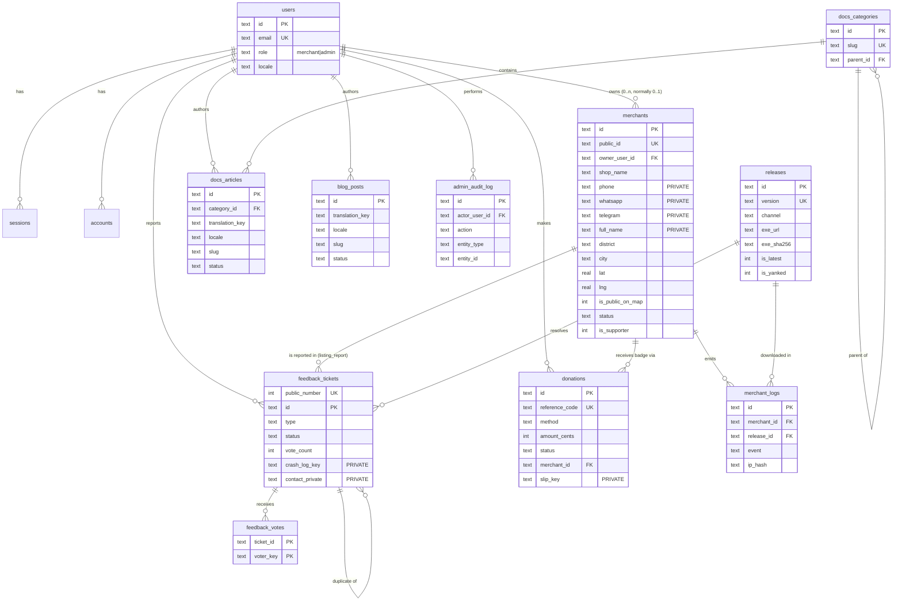
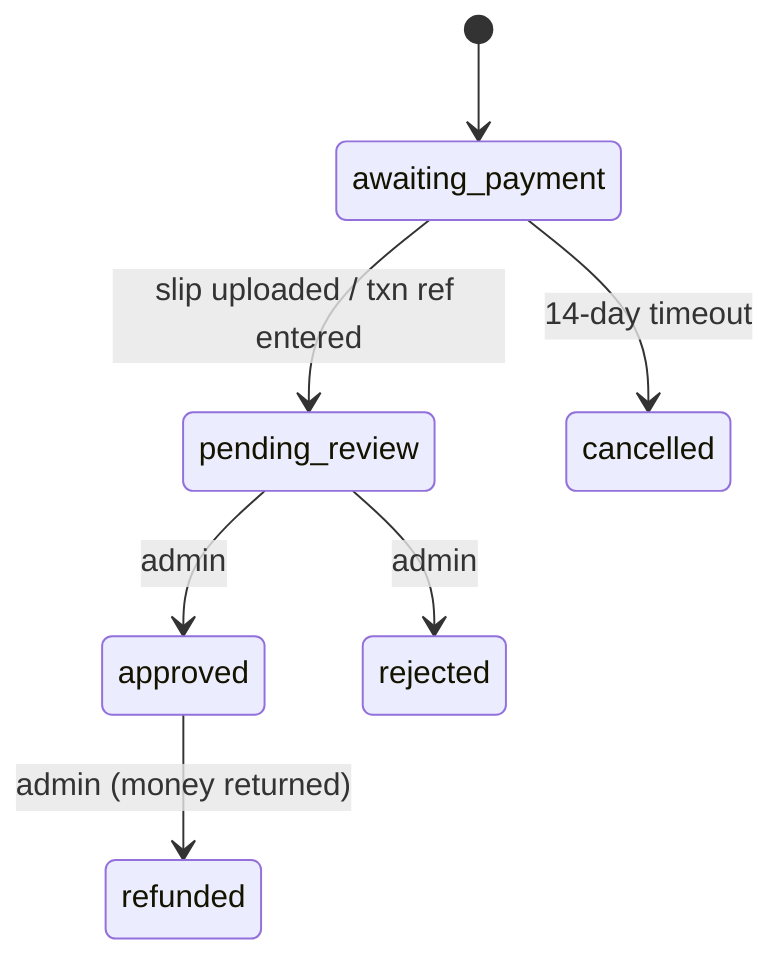

# 05 — Data Schema (Drizzle ORM · D1/SQLite · Postgres-portable)

| | |
|---|---|
| Version | 1.0 |
| Date | 2026-10-21 |
| Status | Approved for build. **Highest-precedence doc** (see `CLAUDE.md §0`) |
| Code | `src/lib/enums.ts`, `src/server/db/schema.ts`, `src/server/db/relations.ts`, `src/server/db/projections.ts` |
| Migrations | `drizzle/` via `pnpm db:generate`; applied with `wrangler d1 migrations apply` |

---

## 1. Conventions

| Rule | Detail |
|---|---|
| Table names | snake_case plural (`merchants`, `feedback_tickets`) |
| Column names | snake_case in SQL, camelCase keys in TypeScript |
| Primary keys | `text` UUID v4 from `crypto.randomUUID()`, generated in the app |
| Public IDs | Separate short IDs for anything shown in URLs or public JSON (`m_7Kq3P9`, `CB-0142`, `CB-DN-7K3Q9P`). Internal UUIDs never leave the server in public responses |
| Timestamps | `integer` with `{ mode: "timestamp_ms" }` → JS `Date`. Set by the app (`$defaultFn`/`$onUpdateFn`), never by SQL defaults |
| Booleans | `integer` with `{ mode: "boolean" }` |
| Money | `amount_cents` integer, LKR. `Rs. 1,250.00` = `125000` |
| Enums | `text` with a TypeScript `enum` option + zod at the boundary + `CHECK` for the critical ones |
| JSON | `text` with `{ mode: "json" }` + `$type<T>()`, always parsed through zod on read for untrusted shapes |
| Soft delete | `deleted_at` on `merchants` only. Everything else hard-deletes or uses status |
| Foreign keys | Declared. D1 enforces foreign keys. `onDelete` is explicit on every FK |
| Batch limits | D1 allows at most 100 bound parameters per statement. Chunk bulk inserts (`chunk(rows, Math.floor(100 / columnsPerRow))`) |

---

## 2. Shared enums — `src/lib/enums.ts`

Isomorphic (imported by zod schemas, UI and DB).

```ts
export const LOCALES = ["en", "si", "ta"] as const;
export type Locale = (typeof LOCALES)[number];

export const ROLES = ["merchant", "admin"] as const;

export const PROVINCES = {
  western: ["colombo", "gampaha", "kalutara"],
  central: ["kandy", "matale", "nuwara-eliya"],
  southern: ["galle", "matara", "hambantota"],
  northern: ["jaffna", "kilinochchi", "mannar", "vavuniya", "mullaitivu"],
  eastern: ["batticaloa", "ampara", "trincomalee"],
  "north-western": ["kurunegala", "puttalam"],
  "north-central": ["anuradhapura", "polonnaruwa"],
  uva: ["badulla", "monaragala"],
  sabaragamuwa: ["ratnapura", "kegalle"],
} as const;

export const DISTRICTS = [
  "ampara", "anuradhapura", "badulla", "batticaloa", "colombo",
  "galle", "gampaha", "hambantota", "jaffna", "kalutara",
  "kandy", "kegalle", "kilinochchi", "kurunegala", "mannar",
  "matale", "matara", "monaragala", "mullaitivu", "nuwara-eliya",
  "polonnaruwa", "puttalam", "ratnapura", "trincomalee", "vavuniya",
] as const; // exactly 25
export type District = (typeof DISTRICTS)[number];

export const BUSINESS_CATEGORIES = [
  "grocery",          // Grocery / kade
  "minimart",         // Mini-mart / supermarket
  "pharmacy",
  "hardware",
  "bookshop",         // Bookshop & stationery
  "textile",          // Textile & fashion
  "electronics",      // Mobile & electronics
  "bakery",           // Bakery & sweets
  "cosmetics",
  "agro",             // Agro, fertilizer & seeds
  "wholesale",        // Wholesale & distribution
  "restaurant",       // Café / takeaway (retail counter)
  "other",
] as const;

export const MERCHANT_STATUSES = ["listed", "hidden", "rejected"] as const;
export const LOCATION_SOURCES = ["gps", "pin", "city_centroid"] as const;

export const MERCHANT_LOG_EVENTS = [
  "download_gate_submitted",
  "installer_download_started",
  "listing_claimed",
  "listing_updated",
  "visibility_changed",
  "status_changed",
  "supporter_granted",
  "supporter_revoked",
  "deleted",
] as const;

export const RELEASE_CHANNELS = ["stable", "beta"] as const;
export const RELEASE_SOURCES = ["github_sync", "manual"] as const;

export const CONTENT_STATUSES = ["draft", "published", "archived"] as const;
export const BLOG_STATUSES = ["draft", "scheduled", "published", "archived"] as const;

export const TICKET_TYPES = ["bug", "feature", "question", "listing_report"] as const;
export const TICKET_STATUSES = [
  "open", "triaged", "planned", "in_progress", "shipped", "closed", "duplicate", "wont_fix",
] as const;
export const TICKET_SEVERITIES = ["crash", "blocks_billing", "wrong_output", "cosmetic"] as const;

// v1 is bank transfer only. A future gateway adds a value here (+ migration) via ADR.
export const DONATION_METHODS = ["bank_transfer"] as const;
export const DONATION_STATUSES = [
  "awaiting_payment", "pending_review", "approved", "rejected", "cancelled", "refunded",
] as const;

export const AUDIT_LEVELS = ["info", "warn"] as const;

/** Geographic bounds used for validation, CHECK constraints and map maxBounds. */
export const SRI_LANKA_BOUNDS = { minLat: 5.8, maxLat: 10.0, minLng: 79.5, maxLng: 82.0 } as const;
```

---

## 3. Entity-relationship diagram



---

## 4. Drizzle schema — `src/server/db/schema.ts`

```ts
import "server-only";
import { sql } from "drizzle-orm";
import {
  sqliteTable, text, integer, real, index, uniqueIndex, primaryKey, check,
  type AnySQLiteColumn,
} from "drizzle-orm/sqlite-core";
import {
  ROLES, LOCALES, DISTRICTS, BUSINESS_CATEGORIES, MERCHANT_STATUSES, LOCATION_SOURCES,
  MERCHANT_LOG_EVENTS, RELEASE_CHANNELS, RELEASE_SOURCES, CONTENT_STATUSES, BLOG_STATUSES,
  TICKET_TYPES, TICKET_STATUSES, TICKET_SEVERITIES, DONATION_METHODS, DONATION_STATUSES,
  AUDIT_LEVELS,
} from "@/lib/enums";

/* ---------- column helpers ---------- */
const pk = () => text("id").primaryKey().$defaultFn(() => crypto.randomUUID());
const createdAt = () =>
  integer("created_at", { mode: "timestamp_ms" }).notNull().$defaultFn(() => new Date());
const updatedAt = () =>
  integer("updated_at", { mode: "timestamp_ms" })
    .notNull()
    .$defaultFn(() => new Date())
    .$onUpdateFn(() => new Date());
const ts = (name: string) => integer(name, { mode: "timestamp_ms" });
const bool = (name: string) => integer(name, { mode: "boolean" });

/* =====================================================================
 * AUTH (Better Auth core + admin plugin). Field keys must match Better
 * Auth's expected names; column names are snake_case.
 * Configure: drizzleAdapter(db, { provider: "sqlite", usePlural: true, schema })
 * ===================================================================== */

export const users = sqliteTable(
  "users",
  {
    id: pk(),
    name: text("name").notNull(),
    email: text("email").notNull(),
    emailVerified: bool("email_verified").notNull().default(false),
    image: text("image"),
    // admin plugin
    role: text("role", { enum: ROLES }).notNull().default("merchant"),
    banned: bool("banned").notNull().default(false),
    banReason: text("ban_reason"),
    banExpires: ts("ban_expires"),
    // additionalFields
    locale: text("locale", { enum: LOCALES }).notNull().default("en"),
    createdAt: createdAt(),
    updatedAt: updatedAt(),
  },
  (t) => [uniqueIndex("users_email_uq").on(t.email)],
);

export const sessions = sqliteTable(
  "sessions",
  {
    id: pk(),
    token: text("token").notNull(),
    userId: text("user_id").notNull().references(() => users.id, { onDelete: "cascade" }),
    expiresAt: ts("expires_at").notNull(),
    ipAddress: text("ip_address"), // Better Auth field. We store the ip_hash value here, never the raw IP
    userAgent: text("user_agent"),
    impersonatedBy: text("impersonated_by"),
    createdAt: createdAt(),
    updatedAt: updatedAt(),
  },
  (t) => [uniqueIndex("sessions_token_uq").on(t.token), index("sessions_user_idx").on(t.userId)],
);

export const accounts = sqliteTable(
  "accounts",
  {
    id: pk(),
    userId: text("user_id").notNull().references(() => users.id, { onDelete: "cascade" }),
    accountId: text("account_id").notNull(),
    providerId: text("provider_id").notNull(), // "credential" | "google"
    accessToken: text("access_token"),
    refreshToken: text("refresh_token"),
    idToken: text("id_token"),
    accessTokenExpiresAt: ts("access_token_expires_at"),
    refreshTokenExpiresAt: ts("refresh_token_expires_at"),
    scope: text("scope"),
    password: text("password"), // Better Auth scrypt hash (credential provider only)
    createdAt: createdAt(),
    updatedAt: updatedAt(),
  },
  (t) => [
    uniqueIndex("accounts_provider_uq").on(t.providerId, t.accountId),
    index("accounts_user_idx").on(t.userId),
  ],
);

export const verifications = sqliteTable(
  "verifications",
  {
    id: pk(),
    identifier: text("identifier").notNull(),
    value: text("value").notNull(),
    expiresAt: ts("expires_at").notNull(),
    createdAt: createdAt(),
    updatedAt: updatedAt(),
  },
  (t) => [index("verifications_identifier_idx").on(t.identifier)],
);

/* =====================================================================
 * MERCHANTS (download gate + map directory)
 * ===================================================================== */

export const merchants = sqliteTable(
  "merchants",
  {
    id: pk(),
    publicId: text("public_id").notNull(), // "m_" + 6 base58 chars; used in public JSON + URLs
    ownerUserId: text("owner_user_id").references(() => users.id, { onDelete: "set null" }),

    // PRIVATE contact & identity: never in public projections (§7)
    fullName: text("full_name").notNull(),
    phone: text("phone").notNull(),      // E.164 +94XXXXXXXXX
    whatsapp: text("whatsapp"),          // E.164 +947XXXXXXXX
    telegram: text("telegram"),          // @handle (dashboard only, optional)

    // Public listing fields
    shopName: text("shop_name").notNull(),
    category: text("category", { enum: BUSINESS_CATEGORIES }).notNull(),
    district: text("district", { enum: DISTRICTS }).notNull(),
    city: text("city").notNull(),
    lat: real("lat").notNull(), // stored at 6 dp; public output rounded to 4 dp
    lng: real("lng").notNull(),
    locationSource: text("location_source", { enum: LOCATION_SOURCES }).notNull(),

    isPublicOnMap: bool("is_public_on_map").notNull().default(false),
    status: text("status", { enum: MERCHANT_STATUSES }).notNull().default("listed"),

    isSupporter: bool("is_supporter").notNull().default(false),
    supporterSince: ts("supporter_since"),

    // Consent & claim
    termsVersion: text("terms_version").notNull(),   // e.g. "2026-10-01"
    termsAcceptedAt: ts("terms_accepted_at").notNull(),
    claimTokenHash: text("claim_token_hash"),        // sha256(token); token only in cookie
    claimRedeemedAt: ts("claim_redeemed_at"),

    preferredLocale: text("preferred_locale", { enum: LOCALES }).notNull().default("en"),

    createdAt: createdAt(),
    updatedAt: updatedAt(),
    deletedAt: ts("deleted_at"),
  },
  (t) => [
    uniqueIndex("merchants_public_id_uq").on(t.publicId),
    uniqueIndex("merchants_phone_active_uq").on(t.phone).where(sql`${t.deletedAt} IS NULL`),
    index("merchants_owner_idx").on(t.ownerUserId),
    index("merchants_map_idx").on(t.status, t.isPublicOnMap, t.deletedAt),
    index("merchants_district_idx").on(t.district),
    check("merchants_lat_lk", sql`${t.lat} BETWEEN 5.8 AND 10.0`),
    check("merchants_lng_lk", sql`${t.lng} BETWEEN 79.5 AND 82.0`),
  ],
);

export const merchantLogs = sqliteTable(
  "merchant_logs",
  {
    id: pk(),
    merchantId: text("merchant_id").references(() => merchants.id, { onDelete: "cascade" }),
    releaseId: text("release_id").references(() => releases.id, { onDelete: "set null" }),
    event: text("event", { enum: MERCHANT_LOG_EVENTS }).notNull(),
    meta: text("meta", { mode: "json" }).$type<Record<string, string | number | boolean | null>>(),
    ipHash: text("ip_hash"),          // sha256(ip + daily salt), never the raw IP
    country: text("country"),         // request.cf.country (ISO-2)
    uaFamily: text("ua_family"),      // "chrome-android", "edge-windows"; never the full UA
    createdAt: createdAt(),
  },
  (t) => [
    index("merchant_logs_merchant_idx").on(t.merchantId, t.createdAt),
    index("merchant_logs_event_idx").on(t.event, t.createdAt),
  ],
);

/* =====================================================================
 * RELEASES (synced from ceybyte/cbpos-releases latest.json)
 * ===================================================================== */

export const releases = sqliteTable(
  "releases",
  {
    id: pk(),
    version: text("version").notNull(),             // semver "1.4.2"
    channel: text("channel", { enum: RELEASE_CHANNELS }).notNull().default("stable"),
    title: text("title").notNull(),
    notesMd: text("notes_md").notNull().default(""),
    notesHast: text("notes_hast", { mode: "json" }).$type<unknown>(),
    minOs: text("min_os").notNull(),
    publishedAt: ts("published_at").notNull(),

    exeName: text("exe_name").notNull(),
    exeUrl: text("exe_url").notNull(),
    exeSize: integer("exe_size").notNull(),
    exeSha256: text("exe_sha256").notNull(),
    zipName: text("zip_name"),
    zipUrl: text("zip_url"),
    zipSize: integer("zip_size"),
    zipSha256: text("zip_sha256"),

    isLatest: bool("is_latest").notNull().default(false),
    isYanked: bool("is_yanked").notNull().default(false),
    source: text("source", { enum: RELEASE_SOURCES }).notNull().default("github_sync"),
    githubReleaseId: integer("github_release_id"),
    syncedAt: ts("synced_at"),
    createdAt: createdAt(),
    updatedAt: updatedAt(),
  },
  (t) => [
    uniqueIndex("releases_version_channel_uq").on(t.version, t.channel),
    uniqueIndex("releases_latest_per_channel_uq").on(t.channel).where(sql`${t.isLatest} = 1`),
    index("releases_published_idx").on(t.publishedAt),
    check("releases_exe_sha", sql`length(${t.exeSha256}) = 64`),
  ],
);

/* =====================================================================
 * DOCS (Fumadocs UI, content in D1)
 * Categories are locale-independent (titles per locale in columns, as the
 * set is small and fixed at 3 locales). Articles are one row per locale,
 * grouped by translation_key. Slugs are shared across locales so that
 * /en/docs/x/y ↔ /si/docs/x/y.
 * ===================================================================== */

export const docsCategories = sqliteTable(
  "docs_categories",
  {
    id: pk(),
    slug: text("slug").notNull(), // "getting-started"
    parentId: text("parent_id").references((): AnySQLiteColumn => docsCategories.id, { onDelete: "set null" }),
    titleEn: text("title_en").notNull(),
    titleSi: text("title_si").notNull(),
    titleTa: text("title_ta").notNull(),
    descriptionEn: text("description_en").notNull().default(""),
    descriptionSi: text("description_si").notNull().default(""),
    descriptionTa: text("description_ta").notNull().default(""),
    icon: text("icon").notNull().default("BookOpen"), // Lucide icon name (whitelisted in UI)
    sortOrder: integer("sort_order").notNull().default(0),
    createdAt: createdAt(),
    updatedAt: updatedAt(),
  },
  (t) => [uniqueIndex("docs_categories_slug_uq").on(t.slug), index("docs_categories_sort_idx").on(t.parentId, t.sortOrder)],
);

export type TocItem = { depth: 2 | 3; id: string; text: string };

export const docsArticles = sqliteTable(
  "docs_articles",
  {
    id: pk(),
    translationKey: text("translation_key").notNull(), // stable group id shared by en/si/ta rows
    locale: text("locale", { enum: LOCALES }).notNull(),
    categoryId: text("category_id").notNull().references(() => docsCategories.id, { onDelete: "restrict" }),
    slug: text("slug").notNull(), // "install"; shared across locales in the group
    title: text("title").notNull(),
    summary: text("summary").notNull().default(""),
    bodyMd: text("body_md").notNull(),
    bodyHast: text("body_hast", { mode: "json" }).$type<unknown>(),   // rendered at publish
    tocJson: text("toc_json", { mode: "json" }).$type<TocItem[]>(),
    searchText: text("search_text"),                                   // plain text for the Orama index
    status: text("status", { enum: CONTENT_STATUSES }).notNull().default("draft"),
    sortOrder: integer("sort_order").notNull().default(0),
    appVersionMin: text("app_version_min"), // "1.4.0"
    authorId: text("author_id").references(() => users.id, { onDelete: "set null" }),
    publishedAt: ts("published_at"),
    createdAt: createdAt(),
    updatedAt: updatedAt(),
  },
  (t) => [
    uniqueIndex("docs_articles_path_uq").on(t.locale, t.categoryId, t.slug),
    uniqueIndex("docs_articles_translation_uq").on(t.translationKey, t.locale),
    index("docs_articles_listing_idx").on(t.locale, t.status, t.categoryId, t.sortOrder),
  ],
);

/* =====================================================================
 * FEEDBACK TRACKER
 * ===================================================================== */

export const feedbackTickets = sqliteTable(
  "feedback_tickets",
  {
    id: pk(),
    publicNumber: integer("public_number").notNull(), // displayed as CB-0142
    draftId: text("draft_id"),                        // client draft uuid used for pre-uploads
    type: text("type", { enum: TICKET_TYPES }).notNull(),
    title: text("title").notNull(),
    bodyMd: text("body_md").notNull(),
    appVersion: text("app_version"),      // "1.4.2" | "unknown"
    windowsVersion: text("windows_version"),
    severity: text("severity", { enum: TICKET_SEVERITIES }),
    status: text("status", { enum: TICKET_STATUSES }).notNull().default("open"),
    isPublic: bool("is_public").notNull().default(true), // false for question, listing_report, spam
    voteCount: integer("vote_count").notNull().default(0),

    // PRIVATE
    crashLogKey: text("crash_log_key"),
    screenshotKey: text("screenshot_key"),
    contactPrivate: text("contact_private"),

    // PUBLIC after admin approval
    screenshotPublicKey: text("screenshot_public_key"),

    reporterUserId: text("reporter_user_id").references(() => users.id, { onDelete: "set null" }),
    reportedMerchantId: text("reported_merchant_id").references(() => merchants.id, { onDelete: "set null" }),
    duplicateOfId: text("duplicate_of_id").references((): AnySQLiteColumn => feedbackTickets.id, { onDelete: "set null" }),
    resolvedInReleaseId: text("resolved_in_release_id").references(() => releases.id, { onDelete: "set null" }),

    adminResponseMd: text("admin_response_md"),
    adminRespondedAt: ts("admin_responded_at"),
    createdAt: createdAt(),
    updatedAt: updatedAt(),
  },
  (t) => [
    uniqueIndex("feedback_public_number_uq").on(t.publicNumber),
    uniqueIndex("feedback_draft_uq").on(t.draftId),
    index("feedback_board_idx").on(t.isPublic, t.type, t.status, t.voteCount),
    index("feedback_reporter_idx").on(t.reporterUserId),
    check("feedback_title_len", sql`length(${t.title}) BETWEEN 8 AND 120`),
  ],
);

export const feedbackVotes = sqliteTable(
  "feedback_votes",
  {
    ticketId: text("ticket_id").notNull().references(() => feedbackTickets.id, { onDelete: "cascade" }),
    voterKey: text("voter_key").notNull(), // "u:{userId}" or "a:{sha256(ipHash+uaFamily+pepper)}"
    createdAt: createdAt(),
  },
  (t) => [primaryKey({ columns: [t.ticketId, t.voterKey] })],
);

/* =====================================================================
 * DONATIONS
 * ===================================================================== */

export const donations = sqliteTable(
  "donations",
  {
    id: pk(),
    referenceCode: text("reference_code").notNull(), // "CB-DN-7K3Q9P"
    method: text("method", { enum: DONATION_METHODS }).notNull(),
    amountCents: integer("amount_cents").notNull(),
    currency: text("currency").notNull().default("LKR"),

    displayName: text("display_name"),           // null when anonymous
    isAnonymous: bool("is_anonymous").notNull().default(false),
    publicMessage: text("public_message"),       // ≤ 140 chars, shown only if messageApproved
    messageApproved: bool("message_approved").notNull().default(false),
    showAmountPublicly: bool("show_amount_publicly").notNull().default(false),

    // PRIVATE
    contactPrivate: text("contact_private"),
    submitSecretHash: text("submit_secret_hash").notNull(), // sha256 of secret in cb_dn_{ref} cookie
    slipKey: text("slip_key"),
    slipMime: text("slip_mime"),
    slipSize: integer("slip_size"),
    txnReference: text("txn_reference"),         // optional bank transaction reference typed by donor

    merchantId: text("merchant_id").references(() => merchants.id, { onDelete: "set null" }),
    userId: text("user_id").references(() => users.id, { onDelete: "set null" }),

    status: text("status", { enum: DONATION_STATUSES }).notNull().default("awaiting_payment"),
    reviewedBy: text("reviewed_by").references(() => users.id, { onDelete: "set null" }),
    reviewedAt: ts("reviewed_at"),
    rejectionReason: text("rejection_reason"),
    createdAt: createdAt(),
    updatedAt: updatedAt(),
  },
  (t) => [
    uniqueIndex("donations_reference_uq").on(t.referenceCode),
    index("donations_queue_idx").on(t.status, t.createdAt),
    index("donations_merchant_idx").on(t.merchantId, t.status),
    check("donations_amount_min", sql`${t.amountCents} >= 10000`), // Rs. 100.00
  ],
);

/* =====================================================================
 * BLOG
 * ===================================================================== */

export const blogPosts = sqliteTable(
  "blog_posts",
  {
    id: pk(),
    translationKey: text("translation_key").notNull(),
    locale: text("locale", { enum: LOCALES }).notNull(),
    slug: text("slug").notNull(), // shared across locales in the group
    title: text("title").notNull(),
    excerpt: text("excerpt").notNull(),
    bodyMd: text("body_md").notNull(),
    bodyHast: text("body_hast", { mode: "json" }).$type<unknown>(),
    tocJson: text("toc_json", { mode: "json" }).$type<TocItem[]>(),
    coverImageKey: text("cover_image_key"), // R2 blog/{postId}/...
    coverAlt: text("cover_alt"),
    ogImageKey: text("og_image_key"),
    tags: text("tags", { mode: "json" }).$type<string[]>().notNull().default(sql`'[]'`),
    status: text("status", { enum: BLOG_STATUSES }).notNull().default("draft"),
    readingMinutes: integer("reading_minutes").notNull().default(1),
    seoTitle: text("seo_title"),
    seoDescription: text("seo_description"),
    authorId: text("author_id").references(() => users.id, { onDelete: "set null" }),
    publishedAt: ts("published_at"),
    createdAt: createdAt(),
    updatedAt: updatedAt(),
  },
  (t) => [
    uniqueIndex("blog_posts_path_uq").on(t.locale, t.slug),
    uniqueIndex("blog_posts_translation_uq").on(t.translationKey, t.locale),
    index("blog_posts_listing_idx").on(t.locale, t.status, t.publishedAt),
  ],
);

/* =====================================================================
 * ADMIN AUDIT LOG (supporting table, required by F-08)
 * ===================================================================== */

export const adminAuditLog = sqliteTable(
  "admin_audit_log",
  {
    id: pk(),
    actorUserId: text("actor_user_id").references(() => users.id, { onDelete: "set null" }), // null = system/cron
    level: text("level", { enum: AUDIT_LEVELS }).notNull().default("info"),
    action: text("action").notNull(),          // "donation.approve", "merchant.status", "release_sync_invalid"
    entityType: text("entity_type").notNull(), // "donation" | "merchant" | "ticket" | "doc" | "post" | "release" | "user"
    entityId: text("entity_id"),
    diff: text("diff", { mode: "json" }).$type<{ before?: unknown; after?: unknown; note?: string }>(),
    createdAt: createdAt(),
  },
  (t) => [
    index("audit_entity_idx").on(t.entityType, t.entityId),
    index("audit_created_idx").on(t.createdAt),
  ],
);
```

> **Default note:** `tags` uses `default(sql\`'[]'\`)`, a SQL literal rather than a function call, so it's portable. It's the only SQL-side default in the schema.

### 4.1 Relations — `src/server/db/relations.ts`

```ts
import { relations } from "drizzle-orm";
import * as s from "./schema";

export const usersRelations = relations(s.users, ({ many }) => ({
  merchants: many(s.merchants),
  sessions: many(s.sessions),
  accounts: many(s.accounts),
  tickets: many(s.feedbackTickets),
  donations: many(s.donations, { relationName: "donor" }),
}));

export const merchantsRelations = relations(s.merchants, ({ one, many }) => ({
  owner: one(s.users, { fields: [s.merchants.ownerUserId], references: [s.users.id] }),
  logs: many(s.merchantLogs),
  donations: many(s.donations),
}));

export const merchantLogsRelations = relations(s.merchantLogs, ({ one }) => ({
  merchant: one(s.merchants, { fields: [s.merchantLogs.merchantId], references: [s.merchants.id] }),
  release: one(s.releases, { fields: [s.merchantLogs.releaseId], references: [s.releases.id] }),
}));

export const docsCategoriesRelations = relations(s.docsCategories, ({ one, many }) => ({
  parent: one(s.docsCategories, { fields: [s.docsCategories.parentId], references: [s.docsCategories.id], relationName: "tree" }),
  children: many(s.docsCategories, { relationName: "tree" }),
  articles: many(s.docsArticles),
}));

export const docsArticlesRelations = relations(s.docsArticles, ({ one }) => ({
  category: one(s.docsCategories, { fields: [s.docsArticles.categoryId], references: [s.docsCategories.id] }),
  author: one(s.users, { fields: [s.docsArticles.authorId], references: [s.users.id] }),
}));

export const feedbackTicketsRelations = relations(s.feedbackTickets, ({ one, many }) => ({
  votes: many(s.feedbackVotes),
  resolvedIn: one(s.releases, { fields: [s.feedbackTickets.resolvedInReleaseId], references: [s.releases.id] }),
  reporter: one(s.users, { fields: [s.feedbackTickets.reporterUserId], references: [s.users.id] }),
}));

export const donationsRelations = relations(s.donations, ({ one }) => ({
  merchant: one(s.merchants, { fields: [s.donations.merchantId], references: [s.merchants.id] }),
  donor: one(s.users, { fields: [s.donations.userId], references: [s.users.id], relationName: "donor" }),
}));
```

### 4.2 Client factory — `src/server/db/index.ts`

```ts
import "server-only";
import { drizzle } from "drizzle-orm/d1";
import { getCloudflareContext } from "@opennextjs/cloudflare";
import * as schema from "./schema";
import * as relations from "./relations";

export async function getDb() {
  const { env } = await getCloudflareContext({ async: true });
  return drizzle(env.DB, { schema: { ...schema, ...relations } });
}
export type Db = Awaited<ReturnType<typeof getDb>>;
```

### 4.3 `drizzle.config.ts`

```ts
import { defineConfig } from "drizzle-kit";
export default defineConfig({
  dialect: "sqlite",
  schema: "./src/server/db/schema.ts",
  out: "./drizzle",
  driver: "d1-http", // only for drizzle-kit studio against remote; migrations go through wrangler
  dbCredentials: {
    accountId: process.env.CLOUDFLARE_ACCOUNT_ID!,
    databaseId: process.env.CLOUDFLARE_D1_ID!,
    token: process.env.CLOUDFLARE_D1_TOKEN!,
  },
});
```

---

## 5. Table reference

### 5.1 `merchants`

| Column | Type | Null | Visibility | Notes |
|---|---|---|---|---|
| id | text uuid | no | internal | PK |
| public_id | text | no | **public** | `m_` + 6 base58, unique |
| owner_user_id | text → users | yes | owner, admin | Set by claim |
| full_name | text | no | owner, admin | 2–80 chars |
| phone | text | no | owner, admin | E.164; unique among non-deleted |
| whatsapp | text | yes | owner, admin | E.164 mobile |
| telegram | text | yes | owner, admin | `@handle`, dashboard only |
| shop_name | text | no | **public** | 2–100 chars |
| category | text enum | no | **public** | `BUSINESS_CATEGORIES` |
| district | text enum | no | **public** | `DISTRICTS` |
| city | text | no | **public** | From `lk-cities.json` or free text (≤ 60) |
| lat / lng | real | no | **public (rounded 4 dp)** | CHECK in Sri Lanka bounds |
| location_source | text enum | no | admin | gps / pin / city_centroid |
| is_public_on_map | bool | no | owner, admin | Default **false** (opt-in) |
| status | text enum | no | owner, admin | listed / hidden / rejected |
| is_supporter | bool | no | **public** | From approved donations |
| supporter_since | ts | yes | owner, admin | Public only as a month via `since` |
| terms_version / terms_accepted_at | text / ts | no | owner, admin | Consent record |
| claim_token_hash | text | yes | **never exposed** | sha256 |
| claim_redeemed_at | ts | yes | admin | |
| preferred_locale | text enum | no | owner, admin | From the gate locale |
| created_at / updated_at / deleted_at | ts | — | `created_at` public as `since` (YYYY-MM) | |

### 5.2 `merchant_logs`
Append-only. Retained 18 months, then deleted by the cleanup cron. `ip_hash` rotates daily (salted), so it can't be joined across days.

### 5.3 `releases`
One row per (version, channel). The partial unique index guarantees at most one `is_latest` row per channel. The sync worker flips `is_latest` in a single `db.batch([...])`: clear the old flag, then set the new one.

### 5.4 `docs_categories`, `docs_articles`
- An article is reachable at `/{locale}/docs/{category.slug}/{article.slug}`. Nested categories prepend parent slugs.
- Publishing sets `status='published'`, `published_at` (first time only), `body_hast`, `toc_json` and `search_text`.
- Fallback lookup: `WHERE translation_key = ? AND locale IN (?, 'en') ORDER BY locale = ? DESC LIMIT 1`.

### 5.5 `feedback_tickets`, `feedback_votes`
- `public_number` is assigned at insert: `INSERT … SELECT COALESCE(MAX(public_number), 0) + 1 FROM feedback_tickets`, inside the same batch. D1 serialises writes per database, so this is race-safe.
- `vote_count` is denormalised and updated in the same batch as the vote insert or delete (`UPDATE … SET vote_count = vote_count ± 1`).

### 5.6 `donations`
- `reference_code`: `CB-DN-` + 6 chars from `ABCDEFGHJKMNPQRSTUVWXYZ23456789` (no ambiguous characters).
- State machine:



- The supporter flag is **derived**: `is_supporter = EXISTS(approved donation for merchant)`. `recomputeSupporter(merchantId)` runs on every donation status change.

### 5.7 `blog_posts`
`scheduled` posts become visible when `published_at <= now`. The listing query uses `status IN ('published','scheduled') AND published_at <= ?`. The cron revalidates the `blog` tag hourly so scheduled posts appear.

### 5.8 `admin_audit_log`
Append-only. Kept indefinitely (small). `diff.before`/`diff.after` **must not** include `phone`, `whatsapp`, `telegram` or `full_name` values. The writer helper replaces them with `"[redacted]"`.

---

## 6. Postgres portability

The schema avoids SQLite-only features so it can move to Postgres (e.g. Neon or Supabase) with a mechanical rewrite of `sqlite-core` to `pg-core`, should D1 limits be outgrown.

| SQLite (D1) | Postgres equivalent | Rule that keeps it portable |
|---|---|---|
| `text` uuid PK | `uuid` PK | IDs generated in the app |
| `integer {mode:"timestamp_ms"}` | `timestamp with time zone` | App-side defaults only |
| `integer {mode:"boolean"}` | `boolean` | — |
| `real` (lat/lng) | `double precision` (or PostGIS `geography(Point)`) | No spatial SQL in queries. Bounds filtering is in app code or simple BETWEEN |
| `text {mode:"json"}` | `jsonb` | JSON is never queried inside SQL. It's parsed in the app |
| `text {enum}` + CHECK | `pgEnum` or `text` + CHECK | Enum values are in `src/lib/enums.ts` only |
| Partial unique index `.where(sql…)` | Same (Postgres supports partial indexes) | Predicates use only `IS NULL` / `= 1` (rewrite `= 1` → `= true`) |
| `db.batch([...])` | `db.transaction(async tx => …)` | All multi-write logic goes through `src/server/db/tx.ts` `runAtomic(db, ops)`, which picks batch or transaction per driver |
| `COALESCE(MAX(n),0)+1` | Same, or a sequence | — |

**Forbidden in queries:** `json_extract`, `strftime`, `unixepoch`, `ROWID`, `INSERT OR REPLACE` (use `onConflictDoUpdate`), `GLOB`, `LIKE` without `lower()` on both sides (Postgres `LIKE` is case-sensitive).

Example: `merchants` in `pg-core` (reference only):

```ts
import { pgTable, uuid, text, doublePrecision, boolean, timestamp, uniqueIndex, index, check } from "drizzle-orm/pg-core";
import { sql } from "drizzle-orm";

export const merchants = pgTable("merchants", {
  id: uuid("id").primaryKey().$defaultFn(() => crypto.randomUUID()),
  publicId: text("public_id").notNull(),
  ownerUserId: uuid("owner_user_id"),
  fullName: text("full_name").notNull(),
  phone: text("phone").notNull(),
  whatsapp: text("whatsapp"),
  telegram: text("telegram"),
  shopName: text("shop_name").notNull(),
  category: text("category").notNull(),
  district: text("district").notNull(),
  city: text("city").notNull(),
  lat: doublePrecision("lat").notNull(),
  lng: doublePrecision("lng").notNull(),
  locationSource: text("location_source").notNull(),
  isPublicOnMap: boolean("is_public_on_map").notNull().default(false),
  status: text("status").notNull().default("listed"),
  isSupporter: boolean("is_supporter").notNull().default(false),
  supporterSince: timestamp("supporter_since", { withTimezone: true }),
  termsVersion: text("terms_version").notNull(),
  termsAcceptedAt: timestamp("terms_accepted_at", { withTimezone: true }).notNull(),
  claimTokenHash: text("claim_token_hash"),
  claimRedeemedAt: timestamp("claim_redeemed_at", { withTimezone: true }),
  preferredLocale: text("preferred_locale").notNull().default("en"),
  createdAt: timestamp("created_at", { withTimezone: true }).notNull().$defaultFn(() => new Date()),
  updatedAt: timestamp("updated_at", { withTimezone: true }).notNull().$defaultFn(() => new Date()),
  deletedAt: timestamp("deleted_at", { withTimezone: true }),
}, (t) => [
  uniqueIndex("merchants_public_id_uq").on(t.publicId),
  uniqueIndex("merchants_phone_active_uq").on(t.phone).where(sql`${t.deletedAt} IS NULL`),
  index("merchants_map_idx").on(t.status, t.isPublicOnMap, t.deletedAt),
  check("merchants_lat_lk", sql`${t.lat} BETWEEN 5.8 AND 10.0`),
  check("merchants_lng_lk", sql`${t.lng} BETWEEN 79.5 AND 82.0`),
]);
```

---

## 7. Public data masking rules

### 7.1 Visibility matrix

| Field | Public map (`/api/merchants/geo`) | Public pages (feedback, supporters) | Merchant owner (dashboard) | Admin | Analytics (PostHog) | Logs |
|---|---|---|---|---|---|---|
| merchants.public_id | ✅ as `id` | — | ✅ | ✅ | ❌ | ✅ |
| merchants.shop_name | ✅ | ✅ (supporters wall, if linked and not anonymous) | ✅ | ✅ | ❌ | ❌ |
| merchants.category / district / city | ✅ | — | ✅ | ✅ | ✅ (category, district) | ✅ |
| merchants.lat / lng | ✅ rounded 4 dp | ❌ | ✅ 6 dp | ✅ 6 dp | ❌ | ❌ |
| merchants.is_supporter | ✅ | ✅ | ✅ | ✅ | ❌ | ❌ |
| merchants.created_at | ✅ as `since` `YYYY-MM` | — | ✅ | ✅ | ❌ | ❌ |
| merchants.full_name | ❌ | ❌ | ✅ | ✅ | ❌ | ❌ |
| merchants.phone / whatsapp / telegram | ❌ | ❌ | ✅ | ✅ | ❌ | ❌ |
| merchants.owner_user_id / claim_* / terms_* / status / location_source | ❌ | ❌ | status only | ✅ | ❌ | ❌ |
| merchant_logs.ip_hash | ❌ | ❌ | ❌ | ✅ (aggregate views only) | ❌ | ❌ |
| feedback_tickets public fields (`public_number`, type, title, body_md, app_version, windows_version, severity, status, vote_count, admin_response_md, created_at) | — | ✅ when `is_public` | ✅ own | ✅ | type, severity | ✅ ids |
| feedback_tickets.crash_log_key / screenshot_key / contact_private / reporter_user_id | — | ❌ | ✅ own (not contact of others) | ✅ | ❌ | ❌ |
| feedback_tickets.screenshot_public_key | — | ✅ | ✅ | ✅ | ❌ | ❌ |
| donations.display_name (if not anonymous), month, method icon | — | ✅ supporters wall | ✅ own | ✅ | ❌ | ❌ |
| donations.amount_cents | — | Only if `show_amount_publicly`; aggregate monthly total always | ✅ own | ✅ | band only | ❌ |
| donations.public_message | — | Only if `message_approved` | ✅ own | ✅ | ❌ | ❌ |
| donations.contact_private / slip_* / txn_reference / submit_secret_hash | — | ❌ | status only | ✅ (slip via presigned GET) | ❌ | ❌ |
| users.email | — | ❌ | ✅ own | ✅ | ❌ | ❌ |
| users.name | — | ❌ (tickets show "Community member") | ✅ | ✅ | ❌ | ❌ |

### 7.2 Enforcement — `src/server/db/projections.ts`

```ts
import "server-only";
import { and, eq, isNull } from "drizzle-orm";
import { merchants } from "./schema";

/** The ONLY columns allowed in public geo output. Contract-tested. */
export const PUBLIC_GEO_COLUMNS = {
  publicId: merchants.publicId,
  shopName: merchants.shopName,
  category: merchants.category,
  district: merchants.district,
  city: merchants.city,
  lat: merchants.lat,
  lng: merchants.lng,
  isSupporter: merchants.isSupporter,
  createdAt: merchants.createdAt,
} as const;

export const PUBLIC_GEO_PROPERTIES = [
  "id", "shopName", "category", "district", "city", "isSupporter", "since",
] as const;

export const publicMapWhere = and(
  eq(merchants.status, "listed"),
  eq(merchants.isPublicOnMap, true),
  isNull(merchants.deletedAt),
);

const round4 = (n: number) => Math.round(n * 1e4) / 1e4;

export function toGeoFeature(r: {
  publicId: string; shopName: string; category: string; district: string; city: string;
  lat: number; lng: number; isSupporter: boolean; createdAt: Date;
}) {
  return {
    type: "Feature" as const,
    geometry: { type: "Point" as const, coordinates: [round4(r.lng), round4(r.lat)] as [number, number] },
    properties: {
      id: r.publicId,
      shopName: r.shopName,
      category: r.category,
      district: r.district,
      city: r.city,
      isSupporter: r.isSupporter,
      since: r.createdAt.toISOString().slice(0, 7),
    },
  };
}
```

Query: `db.select(PUBLIC_GEO_COLUMNS).from(merchants).where(publicMapWhere)`.

### 7.3 Guard rails
1. **Contract test** `src/server/db/geo.contract.test.ts`: builds features from a fixture that contains every merchant column, then asserts `Object.keys(feature.properties)` equals `PUBLIC_GEO_PROPERTIES` exactly and that the serialised JSON contains no `+94`, `phone`, `whatsapp`, `telegram` or `fullName`.
2. **Lint rule** `no-bare-merchant-select`: flags `db.select().from(merchants)` and `db.query.merchants.findMany()` without `columns` outside `src/features/admin/**` and `src/features/merchants/owner.ts`.
3. **Log redaction:** `src/server/log.ts` drops keys matching `/phone|whatsapp|telegram|full_?name|email|contact|ip$/i`.
4. **PostHog:** contact inputs carry `data-ph-no-capture`, `maskAllInputs: true`, and server events are built from an allow-list of property names.
5. **R2:** the bucket is private. Public media is served only through `/media/[...key]` with a prefix allow-list (`docs/`, `blog/`, `screenshots/public/`, `og/`).

---

## 8. Convex reactive schema (documented alternative)

Not installed. If an ADR adopts Convex (e.g. for real-time admin queues or live map updates), this schema mirrors §4 one-to-one. Better Auth would then use `@convex-dev/better-auth`. Conventions: `_id`/`_creationTime` replace `id`/`createdAt`, timestamps are `number` (ms), and money stays integer cents.

```ts
// convex/schema.ts
import { defineSchema, defineTable } from "convex/server";
import { v } from "convex/values";
import {
  DISTRICTS, BUSINESS_CATEGORIES, MERCHANT_STATUSES, LOCATION_SOURCES, MERCHANT_LOG_EVENTS,
  RELEASE_CHANNELS, RELEASE_SOURCES, CONTENT_STATUSES, BLOG_STATUSES, TICKET_TYPES,
  TICKET_STATUSES, TICKET_SEVERITIES, DONATION_METHODS, DONATION_STATUSES, LOCALES, AUDIT_LEVELS,
} from "../src/lib/enums";

const lit = <T extends readonly string[]>(xs: T) =>
  v.union(...xs.map((x) => v.literal(x))) as ReturnType<typeof v.union>;

export default defineSchema({
  merchants: defineTable({
    publicId: v.string(),
    ownerUserId: v.optional(v.string()),
    fullName: v.string(),
    phone: v.string(),
    whatsapp: v.optional(v.string()),
    telegram: v.optional(v.string()),
    shopName: v.string(),
    category: lit(BUSINESS_CATEGORIES),
    district: lit(DISTRICTS),
    city: v.string(),
    lat: v.number(),
    lng: v.number(),
    locationSource: lit(LOCATION_SOURCES),
    isPublicOnMap: v.boolean(),
    status: lit(MERCHANT_STATUSES),
    isSupporter: v.boolean(),
    supporterSince: v.optional(v.number()),
    termsVersion: v.string(),
    termsAcceptedAt: v.number(),
    claimTokenHash: v.optional(v.string()),
    claimRedeemedAt: v.optional(v.number()),
    preferredLocale: lit(LOCALES),
    updatedAt: v.number(),
    deletedAt: v.optional(v.number()),
  })
    .index("by_publicId", ["publicId"])
    .index("by_phone", ["phone"])
    .index("by_owner", ["ownerUserId"])
    .index("by_map", ["status", "isPublicOnMap", "deletedAt"]),

  merchantLogs: defineTable({
    merchantId: v.optional(v.id("merchants")),
    releaseId: v.optional(v.id("releases")),
    event: lit(MERCHANT_LOG_EVENTS),
    meta: v.optional(v.record(v.string(), v.union(v.string(), v.number(), v.boolean(), v.null()))),
    ipHash: v.optional(v.string()),
    country: v.optional(v.string()),
    uaFamily: v.optional(v.string()),
  }).index("by_merchant", ["merchantId"]).index("by_event", ["event"]),

  releases: defineTable({
    version: v.string(),
    channel: lit(RELEASE_CHANNELS),
    title: v.string(),
    notesMd: v.string(),
    minOs: v.string(),
    publishedAt: v.number(),
    exe: v.object({ name: v.string(), url: v.string(), size: v.number(), sha256: v.string() }),
    zip: v.optional(v.object({ name: v.string(), url: v.string(), size: v.number(), sha256: v.string() })),
    isLatest: v.boolean(),
    isYanked: v.boolean(),
    source: lit(RELEASE_SOURCES),
    githubReleaseId: v.optional(v.number()),
    syncedAt: v.optional(v.number()),
  }).index("by_version_channel", ["version", "channel"]).index("by_latest", ["channel", "isLatest"]),

  docsCategories: defineTable({
    slug: v.string(),
    parentId: v.optional(v.id("docsCategories")),
    title: v.object({ en: v.string(), si: v.string(), ta: v.string() }),
    description: v.object({ en: v.string(), si: v.string(), ta: v.string() }),
    icon: v.string(),
    sortOrder: v.number(),
  }).index("by_slug", ["slug"]),

  docsArticles: defineTable({
    translationKey: v.string(),
    locale: lit(LOCALES),
    categoryId: v.id("docsCategories"),
    slug: v.string(),
    title: v.string(),
    summary: v.string(),
    bodyMd: v.string(),
    bodyHast: v.optional(v.any()),
    toc: v.optional(v.array(v.object({ depth: v.number(), id: v.string(), text: v.string() }))),
    searchText: v.optional(v.string()),
    status: lit(CONTENT_STATUSES),
    sortOrder: v.number(),
    appVersionMin: v.optional(v.string()),
    authorId: v.optional(v.string()),
    publishedAt: v.optional(v.number()),
    updatedAt: v.number(),
  })
    .index("by_path", ["locale", "categoryId", "slug"])
    .index("by_translation", ["translationKey", "locale"])
    .searchIndex("search_body", { searchField: "searchText", filterFields: ["locale", "status"] }),

  feedbackTickets: defineTable({
    publicNumber: v.number(),
    draftId: v.optional(v.string()),
    type: lit(TICKET_TYPES),
    title: v.string(),
    bodyMd: v.string(),
    appVersion: v.optional(v.string()),
    windowsVersion: v.optional(v.string()),
    severity: v.optional(lit(TICKET_SEVERITIES)),
    status: lit(TICKET_STATUSES),
    isPublic: v.boolean(),
    voteCount: v.number(),
    crashLogKey: v.optional(v.string()),
    screenshotKey: v.optional(v.string()),
    screenshotPublicKey: v.optional(v.string()),
    contactPrivate: v.optional(v.string()),
    reporterUserId: v.optional(v.string()),
    reportedMerchantId: v.optional(v.id("merchants")),
    duplicateOfId: v.optional(v.id("feedbackTickets")),
    resolvedInReleaseId: v.optional(v.id("releases")),
    adminResponseMd: v.optional(v.string()),
    adminRespondedAt: v.optional(v.number()),
    updatedAt: v.number(),
  })
    .index("by_number", ["publicNumber"])
    .index("by_board", ["isPublic", "type", "status"])
    .searchIndex("search_title", { searchField: "title", filterFields: ["isPublic", "type"] }),

  feedbackVotes: defineTable({
    ticketId: v.id("feedbackTickets"),
    voterKey: v.string(),
  }).index("by_ticket_voter", ["ticketId", "voterKey"]),

  donations: defineTable({
    referenceCode: v.string(),
    method: lit(DONATION_METHODS),
    amountCents: v.number(),
    currency: v.literal("LKR"),
    displayName: v.optional(v.string()),
    isAnonymous: v.boolean(),
    publicMessage: v.optional(v.string()),
    messageApproved: v.boolean(),
    showAmountPublicly: v.boolean(),
    contactPrivate: v.optional(v.string()),
    submitSecretHash: v.string(),
    slip: v.optional(v.object({ key: v.string(), mime: v.string(), size: v.number() })),
    txnReference: v.optional(v.string()),
    merchantId: v.optional(v.id("merchants")),
    userId: v.optional(v.string()),
    status: lit(DONATION_STATUSES),
    reviewedBy: v.optional(v.string()),
    reviewedAt: v.optional(v.number()),
    rejectionReason: v.optional(v.string()),
    updatedAt: v.number(),
  })
    .index("by_reference", ["referenceCode"])
    .index("by_queue", ["status"])
    .index("by_merchant", ["merchantId", "status"]),

  blogPosts: defineTable({
    translationKey: v.string(),
    locale: lit(LOCALES),
    slug: v.string(),
    title: v.string(),
    excerpt: v.string(),
    bodyMd: v.string(),
    bodyHast: v.optional(v.any()),
    coverImageKey: v.optional(v.string()),
    coverAlt: v.optional(v.string()),
    ogImageKey: v.optional(v.string()),
    tags: v.array(v.string()),
    status: lit(BLOG_STATUSES),
    readingMinutes: v.number(),
    seoTitle: v.optional(v.string()),
    seoDescription: v.optional(v.string()),
    authorId: v.optional(v.string()),
    publishedAt: v.optional(v.number()),
    updatedAt: v.number(),
  }).index("by_path", ["locale", "slug"]).index("by_listing", ["locale", "status", "publishedAt"]),

  adminAuditLog: defineTable({
    actorUserId: v.optional(v.string()),
    level: lit(AUDIT_LEVELS),
    action: v.string(),
    entityType: v.string(),
    entityId: v.optional(v.string()),
    diff: v.optional(v.any()),
  }).index("by_entity", ["entityType", "entityId"]),
});
```

Masking rules (§7) apply equally to Convex: public `query` functions return the same `PUBLIC_GEO_PROPERTIES` shape, and contact fields are readable only in `internalQuery` or admin-checked queries.

---

## 9. Seed data — `scripts/seed.ts`

| Data | Source | Rows |
|---|---|---|
| Docs categories | The 9 categories in PRD F-05 with EN titles. SI/TA titles marked `[[TRANSLATE]]` until provided | 9 |
| Docs articles | "Install CB-POS", "Windows SmartScreen", "First sale", "Keyboard shortcuts", "VAT 18% backward calculation", "SSCL 2.5% setting", "Connect a thermal printer", "Backups" (EN) | 8 |
| Releases | One fixture release `0.0.0-dev` (local only) pointing at a test asset | 1 |
| Merchants (local/preview only) | 60 synthetic shops across all 25 districts with random coordinates inside district bboxes, fake phones `+9470000xxxx`, 10% supporters | 60 |
| Admin user | From `SEED_ADMIN_EMAIL` | 1 |

Production is **never** seeded with synthetic merchants. `seed.ts` refuses to run when `--remote` is passed without `--allow-production-content`, and even then seeds only docs categories and articles.

---

## 10. Retention & deletion jobs (cron `15 3 * * *`)

| Job | Rule |
|---|---|
| Merchant hard delete | `deleted_at < now − 30 d` → overwrite `full_name='[deleted]'`, `shop_name='[deleted]'`, `phone='deleted:' || id` (keeps the unique index satisfied and can never match an E.164 lookup), null `whatsapp`, `telegram`, `claim_token_hash`, snap `lat/lng` to the district centroid; keep the row for log integrity |
| Merchant logs | Delete `created_at < now − 18 months` |
| Abandoned donations | `awaiting_payment` and `created_at < now − 14 d` → `cancelled` |
| Upload drafts | Delete R2 `crash-logs/draft-*`, `screenshots/private/draft-*` older than 24 h, plus unreferenced `slips/*` older than 14 d |
| Rejected slips | Delete the R2 object 90 days after `rejected` (keep the DB row) |
| Verifications | Delete expired `verifications` rows |
| Geo snapshot debounce | If `geo:dirty` → rebuild the snapshot and bump the version |
