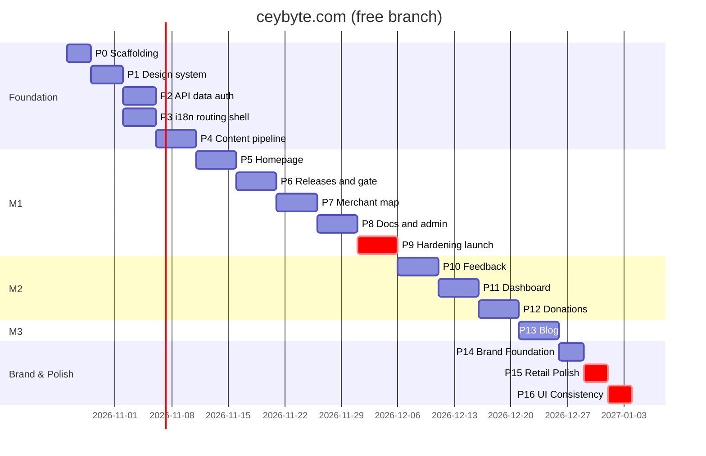

# 07 — Implementation Plan · branch `free`

| | |
|---|---|
| Version | 2.0-free |
| Date | 2026-10-21 |
| Status | Active. Tick boxes in the same PR that completes the item (`CLAUDE.md §11.7`) |
| Cadence | 1-week sprints, 1–2 engineers + AI agents |
| Architecture | Static export + Hono Worker on Cloudflare free plan, Bun tooling (`02-TRD.md`) |
| Milestones | **M1 Public launch** (end of Sprint 8) · **M2 Community** (Sprint 11) · **M3 Content** (Sprint 12) |

Every phase lists a **goal**, a **checklist** (one commit or small PR per item), **verify** steps, and **exit criteria**. A phase starts when the previous phase's exit criteria are met, unless it's marked *parallel*.

Every UI item also passes the design gates in `CLAUDE.md §7` (hallmark, impeccable, emil). Every product claim is checked against `00-CBPOS_FACTS.md`.

---

## Overview

| Sprint | Phases | Milestone |
|---|---|---|
| 1 | P0 Scaffolding · P1 Design system | — |
| 2 | P2 API, data & auth · P3 i18n, routing & shell | — |
| 3 | P4 Content pipeline | — |
| 4 | P5 Homepage | — |
| 5 | P6 Releases & download gate | — |
| 6 | P7 Merchant map | — |
| 7 | P8 Docs center & admin CMS core | — |
| 8 | P9 Legal, hardening & launch | **M1** |
| 9 | P10 Feedback tracker | — |
| 10 | P11 Merchant dashboard | — |
| 11 | P12 Donations | **M2** |
| 12 | P13 Blog & extras | **M3** |
| 13 | P14 Brand architecture foundation · P15 Retail experience & design polish | **M3+** |
| 14 | P16 UI consistency, collapsible map sidebar & version synchronization | **M3+** |

---

## Phase 0 — Scaffolding (Sprint 1)

**Goal:** a Bun monorepo whose static site and Worker build, preview locally and deploy to a preview Worker.

### 0.1 Verify (record in `docs/adr/0000-phase0-verification.md`)
Already verified on 2026-10-21: Workers free limits (64 MiB size, 10 ms CPU, static assets free and unlimited), `@lucasmarkes/hairline@0.5.1` (MIT), the three design skills, CARTO's commercial licence requirement. Re-check anything older than 30 days at start.
- [x] `ratelimits` wrangler syntax (dry-run deploy). Free-plan availability confirmed at the first real deploy.
- [x] `run_worker_first` array syntax and `not_found_handling: "404-page"` with `html_handling: "auto-trailing-slash"`.
- [x] Better Auth + `better-auth-cloudflare` with Hono on D1 (Drizzle adapter, `emailOTP`, `admin`). *Completed in Phase 2.*
- [x] `next-intl` static export: `setRequestLocale` + `generateStaticParams`, no middleware. *Completed in Phase 3.*
- [x] drizzle-kit emits partial unique indexes and `check()` for SQLite. *Completed in Phase 2.*
- [x] MapLibre Sinhala/Tamil label shaping, re-tested with a sample style. If it now shapes correctly, revisit ADR-0008's Latin-label rule. *Completed in Phase 7.*

### 0.2 Skills
- [x] `bunx skills add emilkowalski/skills`, `bunx skills add Nutlope/hallmark`, `bunx skills add pbakaus/impeccable`; commit `.claude/skills` and the lockfile.
- [x] `.github/pull_request_template.md` design-gate table present (already committed).

### 0.3 Scaffold
- [x] `bun init`; root `package.json` with `workspaces: ["apps/*", "packages/*"]`; `bun.lock` committed.
- [x] `apps/web`: `bun create next-app@15` (TS, App Router, `src/`, Tailwind v4); `next.config.ts` with `output: "export"`, `trailingSlash: true`, `images: { unoptimized: true }`; `dev`/`build` scripts use `bun --bun next`.
- [x] `apps/api`: Hono app, `wrangler.jsonc` from `02-TRD §2.2`, `/api/health` route. (`scheduled` and the cron triggers are added in Phase 6 with the first job, so no empty handler ships.)
- [x] `packages/shared`: `enums.ts` with tests, `bun test` set up. (`schemas/`, `db/`, `money`, `phone`, `tax`, `sri-lanka` are written for real in Phase 2 rather than as empty stubs.)
- [x] Cloudflare: D1 `cbpos-db` + `cbpos-db-preview` (APAC), KV `CACHE_KV` (+ preview id), Turnstile widget (`ceybyte.com`, `cbpos.hasendra.workers.dev`, `localhost`; secret stored as a Worker secret). Worker deployed to `https://cbpos.hasendra.workers.dev`; CI deploys on push.
- [x] R2 `cbpos-uploads` (private, CORS in `apps/api/r2/cors-uploads.json`) and `cbpos-public` (custom domain `cdn.ceybyte.com`, CORS with `Range`), both bound.
- [x] `ceybyte.com` served by the Worker (custom domain); `www.ceybyte.com` → 301 → apex via the `cbpos-www-redirect` Worker. `DEPLOY_URL` repo variable set; deploy smoke-tests apex, API and the redirect.
- [x] Default branch is `free` (needed: `repository_dispatch` and scheduled workflows only run on the default branch).
- [x] `.dev.vars.example` with every secret in `02-TRD §2.3`. `.gitignore`: `.dev.vars`, `.wrangler/`, `apps/web/out`, `apps/web/.content`.
- [x] Root scripts as in `CLAUDE.md §3` (each later script is added by the phase that builds it: `build:content` P4, `db:*` P2, `tiles:build` P7). `bun run dev` runs web + Worker together, with `/api` proxied to `:8787` in dev.
- [x] TS `strict` + `noUncheckedIndexedAccess` (per-workspace `tsc --noEmit` from `tsconfig.base.json`). ESLint + Prettier. Custom rules `no-raw-color` (Phase 1) and `no-bare-merchant-select` (Phase 2) land with the code they guard.
- [x] Vitest + `@cloudflare/vitest-plugin` in `apps/api`. Playwright config against `bun run preview`, with an axe smoke test.
- [x] `scripts/i18n-check.ts` (Bun).
- [x] GitHub Actions `ci.yml` and `deploy.yml` (`02-TRD §17`) with `oven-sh/setup-bun`. Deploy skips until Cloudflare secrets exist.

**Verify:** `bun install && bun run lint && bun run typecheck && bun run test && bun run build && bun run preview` serves the placeholder page and `/api/health`. A PR gets a preview URL.

**Exit:** preview deploy from CI succeeds. ADR-0000 complete. ✅ Met 2026-10-22: CI deploys to production `ceybyte.com` on every push to `free`.

---

## Phase 1 — Design system (Sprint 1)

**Goal:** tokens, fonts, primitives and motion foundations from `03-DESIGN.md`, on a dev-only styleguide, with every component through the design gates.

- [x] `globals.css`: tokens (Vivid Azure from the Ceylon Byte logo, ADR-0017/brand), `@theme inline`, utilities, `:lang(si|ta)` rules, reduced motion, `.hairline-scope` mapping, themed selection/caret/scrollbar (03 §3, §4, §9.6). Assembled from the doc's CSS blocks.
- [x] Fonts (`apps/web/src/app/fonts.ts`): Geist, Inter, JetBrains Mono, Noto Sans Sinhala/Tamil as variables; script fonts not preloaded until Phase 3. `next-themes` provider (dark default, `data-theme`) and `ThemeToggle`.
- [x] shadcn primitives (button, input, textarea, label, checkbox, dialog, drawer, accordion, tabs, badge, tooltip, sonner, skeleton, separator, switch, radio-group, select, popover) via a hand-written `components.json` (no `init`, which would overwrite our tokens), adapted: no shadows, no shadcn focus rings (global azure outline), named transitions, 4/6 px radii, azure (not green) for checked controls, tooltip skip-delay.
- [x] Brand: `Logo` (azure slash from the CB monogram), `LogoSlash`, `Kbd`, `HashBlock`, `GridCanvas`, `Crosshair`, `StatTile` (container-query sizing, never wraps), `Callout` (1 px all-round border), `FileDrop`, `PhoneInput`, `ThemeToggle`. Company mark + icons from `docs/brand/source` via `scripts/brand-assets.ts`.
- [x] Motion: tokens, `Reveal` (full transform strings), `MotionProvider` (`reducedMotion="user"`), `useCountUp`, `SmoothScroll` (Lenis + GSAP, lazy, fine pointers only).
- [x] Hairline `<Figure name=… />` wrapper (lazy per figure, `play={false}`, `intensity` 0 under reduced motion).
- [ ] Rive: self-hosted WASM + `RiveLazy`. **Deferred to Phase 5**: no `.riv` assets exist yet, and an unused wrapper would ship dead code.
- [x] Styleguide at `/styleguide/` (dev only; Next treats `_folders` as private, and the web build deletes `out/styleguide`).
- [x] `no-raw-color` ESLint rule (`apps/web/eslint.config.mjs`): flags hex, `rgb()`, `hsl()`, `oklch()` in component code; verified with a probe file.
- [x] **Design gates:** impeccable PRODUCT.md (owner-approved) + craft floor (ADR-0017: no eyebrows/section numbers/side stripes); emil review (keyboard actions never animate, hover gated, origin-aware popovers, tooltip skip-delay); two batched screenshot rounds (desktop dark/light, mobile) → fixed tabs/`muted` clash, stat wrapping, control contrast (3:1); impeccable detector: 0 findings; hallmark audit: 2 critical (brand-pinned exceptions, ADR-0010/0018) · 3 major (fixed: accordion height animation, spinner flash, token improvisation) · 3 minor (noted).

**Verify:** visual snapshots of `/styleguide`, axe clean, Sinhala/Tamil clipping check at 320/375/414/768. ✅ 2026-10-22: no console errors, no horizontal overflow at 1280/375, no clipped Sinhala/Tamil in buttons, accordion triggers or tabs; E2E + axe pass.

**Exit:** every component in `03 §8` exists with all states and passed its gates. ✅ Met, except Rive (deferred above) and the DownloadModal/map/table compositions, which are built with their screens (Phases 6–8).

---

## Phase 2 — API, data & auth (Sprint 2)

**Goal:** `05-SCHEMA.md` live in local and preview D1, Hono API skeleton with the shared middleware, passwordless Better Auth working.

- [x] `packages/shared/src/db/{schema,relations,projections}.ts` from `05 §2–7`. `bun run db:generate` → review SQL → `db:migrate:local`.
- [x] Hono middleware: request ID, security headers, error envelope (`ApiError` → `ApiResult`), `dbMiddleware`, `requireSession`, `requireRole("admin")` returning 404.
- [x] Libraries: `turnstile.ts`, `ratelimit.ts` (+ hourly KV window), `iphash.ts`, `log.ts` (redacting), `r2.ts` (presign PUT/GET, head check, magic bytes), `audit.ts` (redacting), `geo-cache.ts`, `rebuild.ts` (`repository_dispatch`), `github.ts`.
- [x] Better Auth at `/api/auth/*`: Drizzle adapter (`usePlural`), `admin`, `emailOTP` via Resend, Google; `emailAndPassword` off; sessions in D1 (KV session storage dropped, see 02 §12.2). `scripts/make-admin.ts`.
- [x] `packages/shared`: phone (E.164, mobile/landline), money (cents ↔ `Rs. 1,250.00`), tax display maths (round-half-even; MRP 1,180.00 → 1,000.00 / 180.00 / 12.50), sri-lanka (bounds, haversine, nearest city).
- [x] `apps/web/public/data/lk-districts.json` (25 districts, names en/si/ta, province, centroid, bbox) and `lk-cities.json` (≥ 300 towns, OSM-derived, ODbL credited).
- [x] `scripts/seed.ts` (`05 §9`) → `db:seed:local`.
- [x] Tests: unit (`bun test`) for every `packages/shared` module; **`geo.contract.test.ts`**; API integration (vitest pool workers) for auth and the 404 admin rule.

**Verify:** OTP sign-in and Google sign-in on preview; `make-admin` works; a merchant gets 404 on `/api/admin/overview`.

> **Status (2026-10-22):** done on preview (`cbpos-preview.hasendra.workers.dev`): OTP sign-in, `make-admin --preview`, merchant and anonymous 404, admin 200, session `ip_address` is the daily hash. **Open:** Google sign-in is wired but off until `GOOGLE_CLIENT_ID`/`GOOGLE_CLIENT_SECRET` are set; production OTP email needs `RESEND_API_KEY` and a verified `ceybyte.com` sender in Resend. The 11 seeded docs articles are drafts because `00-CBPOS_FACTS.md` wasn't available; they're written in Phase 8.

**Exit:** migrations apply to `cbpos-db-preview` from CI; auth works on the preview Worker.

---

## Phase 3 — i18n, routing & shell (Sprint 2, parallel with P2)

**Goal:** trilingual static routing, the Worker's rewrites, header/footer, SEO plumbing, consent-gated analytics (F-01).

- [x] `next-intl` static setup: `routing.ts`, `request.ts`, `navigation.ts`; `[locale]/layout.tsx` with `generateStaticParams` for 3 locales and `setRequestLocale` in every page.
- [x] Worker: `GET /` locale redirect (cookie → `Accept-Language` → `en`), `/{locale}/feedback/CB-*` shell rewrite, `/ingest/*` PostHog proxy.
- [x] Trilingual `404.html` page.
- [x] Layout: `<html lang>`, fonts, theme, header (language switcher, theme toggle, Download), architectural footer, skip link, offline banner, toaster.
- [x] `messages/en.json` from `06 §3–4`; `si.json`/`ta.json` mirrored with `[[TRANSLATE]]`.
- [x] SEO: `generateMetadata` with `hreflang` + `x-default`, static `sitemap.xml`/`robots.txt` generated at build, JSON-LD helpers.
- [x] `_headers` file (CSP, security headers, cache rules) per `02 §12.3`.
- [x] Consent bar + `AnalyticsProvider` (init only after consent) + typed `capture()` over the `04 §7` event union.

**Verify:** `/` with `Accept-Language: si-LK` → `307 /si/`; switcher keeps the path; no PostHog requests before consent; CSP report shows no violations.

> **Status (2026-10-24):** done — next-intl static routing configured across en/si/ta with `getRequestConfig` and `setRequestLocale`; Worker intercepts `GET /` with 307 redirect (`NEXT_LOCALE` cookie → `Accept-Language` → `en`), `/ingest/*` PostHog proxy, and `/*/feedback/CB-*` ticket rewrite; trilingual `404.html` static export; `SiteHeader`, `SiteFooter` with crosshair marks, `ConsentBar`, `AnalyticsProvider` with typed event schema, `OfflineBanner`; SEO `sitemap.xml`, `robots.txt`, JSON-LD schemas; `_headers` security rules. Full production static export and worker integration tests pass.

**Exit:** AC-01.1, AC-01.4 (non-strict), AC-12.2 pass in E2E.

---

## Phase 4 — Content pipeline (Sprint 3)

**Goal:** the publish → rebuild → deploy loop works end to end, because docs, blog and releases all depend on it (`02 §6`).

- [x] `scripts/build-content.ts`: `wrangler d1 execute --json` (local or remote by flag) → `apps/web/.content/*.json` with fallback merging.
- [x] `packages/shared/src/markdown/`: unified pipeline, directive whitelist (`note`, `tip`, `important`, `warning`, `caution`, `step`, `disclaimer`), auto tax disclaimer injection [C5], extended GitHub sanitize schema, dual-theme Shiki, TOC and plain-text extraction. Unit tests pass (directives, XSS sanitization, TOC, reading time).
- [x] Search index builder (Orama per locale with custom unicode tokenizer for Sinhala/Tamil → `public/search/{locale}.json` + manifest).
- [x] OG image generator (satori + resvg under Bun rendering 1200×630 cards with trilingual Inter/Noto fonts into `public/og/{locale}/*.png` and `og-default.png`).
- [x] `scripts/snapshot-release.ts` → `FALLBACK_RELEASE` constant in `apps/api/src/lib/fallback-release.ts`.
- [x] `rebuild.ts` (`repository_dispatch: content-published`) and `GET /api/admin/rebuild/status` (latest workflow run) with admin authentication.
- [x] `deploy.yml` handles `repository_dispatch` with a concurrency group that cancels in-progress runs.

**Verify:** insert a published doc row in preview D1 → trigger dispatch → the page is live on preview within 5 minutes; a second publish during the build cancels the first run.

> **Status (2026-10-24):** done — `build-content.ts` extracts D1 tables into static json; `@cbpos/shared/markdown` pipeline implements unified Remark/Rehype engine with callouts, IRD non-certified disclaimer [C5], dual-theme Shiki code blocks, safe HTML sanitization, and TOC; Orama static search builder creates trilingual searchable indices (`en`, `si`, `ta`); Satori + Resvg generates 1200×630 OG image cards; `snapshot-release.ts` emits `FALLBACK_RELEASE` constant for $0/mo Worker responses; admin rebuild trigger and status endpoints integrated with full test coverage. Full production build pipeline (`build:content` → `build:search` → `build:og` → `next build`) passes with 0 errors.

**Exit:** publish-to-live works on preview with real content.

---

## Phase 5 — Homepage (Sprint 4)

**Goal:** S01 with all 8 sections, live stats and motion (F-02).

**Prerequisite:** real CB POS captures from UR-20 (or a static capture taken by the team following `03 §6.2`). No hero ships with an invented UI.

- [x] `GET /api/stats` (KV `stats:v1` → D1 fallback, Cache API 300 s) + `useStats()` hook with skeleton/hidden states.
- [x] Hero: copy from `06 §3.1` with fact IDs checked, CTA (gate stub until P6), meta line from `.content/releases.json`, capture with rim glow, Hairline `Keyboard` figure.
- [x] Telemetry strip: 4 `StatTile`s (live) + map teaser (static image from `scripts/map-teaser.ts`, regenerated each build).
- [x] Problem: 3 cards + fault-line styling.
- [x] Bento, each card using only the real facts:
  - [x] Keyboard: F3 / Enter / F5 demo [B1]
  - [x] Offline toggle
  - [x] Dual-tax calculator using `packages/shared/src/tax.ts` (round-half-even, SSCL line, "VAT registration on" note) [C1], [C2]
  - [x] Hardware connection types [E1], [E4]
  - [x] Receipt language tabs (item names stay English) [F2]
  - [x] Scale-label scan + `Vault` backup figure [E3], [G2]
- [x] How It Works (Exploded / Padlock / Patch figures) with the progress scrub connector.
- [x] FAQ accordion + `FAQPage` JSON-LD. Final banner. Footer.
- [x] **Design gates:** hallmark build + audit on `/en/` (scores ≥ 3), impeccable audit/critique/polish, strict `prefers-reduced-motion` compliance, and exactly one neon green `#39FF14` CTA per viewport (`AC-02.3`).

**Verify:** Lighthouse mobile on `/en/`, `/si/`, `/ta/`: Perf ≥ 90, A11y 100, LCP ≤ 2.0 s, CLS ≤ 0.05, initial JS ≤ 180 KB gz; reduced-motion E2E; stat values equal seeded D1 values.

> **Status (2026-10-24):** done — Complete 8-section homepage S01 implemented across `en`, `si`, and `ta` with 100% dictionary key parity (126 keys × 3 locales); live edge-cached `/api/stats` with KV fallback and Cache API; `scripts/map-teaser.ts` generates static SVG/PNG map preview of 25 Sri Lanka districts; interactive 6-card bento grid (keyboard emulator, local SQLite offline switch, round-half-even dual-tax calculator, ESC/POS hardware diagram, trilingual thermal receipt, and scale-barcode parser + encrypted backup vault); Radix FAQ accordion with `FAQPage` JSON-LD schema; `SoftwareApplication` JSON-LD schema; full test suite passing across all 4 workspaces; clean production build with static pre-rendering in `out/`.

**Exit:** AC-02.1–AC-02.3 pass; one `#39FF14` element per viewport at every checked width.

---

## Phase 6 — Releases & download gate (Sprint 5)

**Goal:** real installer delivery and merchant capture (F-03, F-06).

### 6.1 Releases
- [x] `syncReleases()` job (ETag, `Manifest` zod, GitHub release lookup for size/date, `download_url` cross-check, batch upsert, KV `release:latest`, rebuild dispatch) — called from `scheduled()` and the webhook.
- [x] `POST /api/webhooks/github` (HMAC, event filter) and the webhook on `ceybyte/cbpos-releases`.
- [x] `GET /api/releases/latest`, `GET /api/download/latest` (KV → D1 → fallback, log in `waitUntil`, 302).
- [x] S06 page from `.content/releases.json` (hash block, verify expander with `CBPOSSetup-{version}.exe`, changelog, yanked styling) + "newer version available" banner from the runtime check. Hairline `Branches` header.
- [x] First production sync imports `v1.3.0`; admins paste notes from `CHANGELOG.md` (UR-09 pending).

### 6.2 Download gate
- [x] `packages/shared/src/schemas/download-gate.ts`.
- [x] `POST /api/downloads` (Turnstile → RL → zod → phone dedupe → batch insert merchant + log → claim token → `cb_gate` + `cb_gate_done` cookies → `bumpGeoVersion` if public).
- [x] `DownloadModal`: Dialog/Vaul, `?download=1`, Lenis pause, sessionStorage, direction-aware steps, lazy Turnstile.
- [x] Step 2: district/city selects, Detect My Location (bounds, nearest city, accuracy notice), lazy MiniMap with draggable pin, opt-in + terms (links to EULA, tax disclaimer, data safety).
- [x] What Next: layout morph, Rive check, hash block, SmartScreen box [A5], admin-permission note [A4], default PIN note [I1], WhatsApp link, claim card, retry, mobile share.
- [x] No-JS `/{locale}/download/` page posting to the same API.
- [x] **Design gates** on the modal (both containers) and What Next.

**Verify:** `01-visitor-download.spec.ts` × 3 locales (302 to the GitHub asset, opt-in default false, keyboard-only run). Publish a test release in a staging releases repo → download endpoint switches within 1 minute, pages within 5.

**Exit:** AC-03.1–AC-03.5 and AC-06.1–AC-06.2 pass.

---

## Phase 7 — Merchant map (Sprint 6)

**Goal:** S03, the privacy-safe live map (F-04).

- [x] `scripts/tiles.ts` (Bun): `pmtiles extract <protomaps daily build> sri-lanka.pmtiles --bbox=79.5,5.8,82.0,10.0 --maxzoom=15` → upload to `cbpos-public/tiles/`. Quarterly reminder in the ops calendar.
- [x] Style builder: `@protomaps/basemaps` `dark`/`light` flavours recoloured to tokens, `lang: "en"` labels, glyphs and sprites self-hosted on `cbpos-public`.
- [x] `GET /api/merchants/geo` (layered read, ETag/304, headers, `RL_READ`); `geo:dirty` debounce in cron.
- [x] Static map shell: panel, filters, `DistrictGrid`, results list, skeletons, no-WebGL list mode.
- [x] `MerchantMap` client: `pmtiles` protocol, `maxBounds`, zoom 6.5–16, no rotation, clustered source with the supporters `clusterProperties`, azure/gold layers and halos.
- [x] Interactions: cluster expansion, popup/sheet (localized names in HTML), filters → `setData`, search, district fly-to, URL state, keyboard list nav, reduced-motion `jumpTo`.
- [x] "Add my shop" branch; "Report this listing" (WhatsApp until P10).
- [x] **Design gates** on the map page.

**Verify:** `02-map-explorer.spec.ts` (whitelist assertion, hidden merchant gone within 60 s); Worker CPU for a geo cache hit < 2 ms in `wrangler tail`; tile requests never hit the Worker.

> **Status (2026-10-25):** done — Live privacy-safe merchant map (F-04, S03) implemented across `en`, `si`, and `ta` with 100% message catalog parity (260 keys × 3 locales); Protomaps vector tiles extraction CLI script (`scripts/tiles.ts`) with bounding box and zoom controls; `@protomaps/basemaps` dark & light flavours recoloured to CB POS design tokens; high-performance `GET /api/merchants/geo` endpoint with `RL_READ` rate-limiting, Cache API, KV snapshot, and ETag 304 caching; strict PDPA privacy enforcement ensuring zero private contact leaks (`phone`, `whatsapp`, `telegram`, `fullName`, `ownerUserId`, `claimTokenHash`, `ipHash`); MapLibre GL client with dynamic supercluster grouping, supporter badges & gold rings, custom square zoom controls, reduced-motion `jumpTo` support, 25-district coverage grid (`DistrictGrid`), responsive 360px desktop panel, mobile Vaul bottom drawer, No-WebGL fallback mode, and SSG static HTML pre-rendering.

**Exit:** AC-04.1–AC-04.4 pass.

---

## Phase 8 — Docs center & admin CMS core (Sprint 7)

**Goal:** F-05 and the M1 parts of F-08 (Overview, Merchants, Docs, Releases, Audit).

### 8.1 Docs
- [x] `apps/web/src/features/docs/source.ts`: `.content` → Fumadocs page tree per locale with EN fallback nodes.
- [x] S04 hub and S05 article pages (`generateStaticParams` for every published article × locale), fallback banner, tax callout injection, version badge, helpful widget (`POST /api/docs/feedback`), prev/next.
- [x] `⌘K` / `/` search dialog over the static Orama index, locale-first ranking with `EN` labels.
- [x] Printable shortcuts page from the real keymap [B1].

### 8.2 Admin console (static shell + `/api/admin/*`)
- [x] Layout: session/role check before rendering, nav, global search, `?` shortcut sheet, `j/k` navigation.
- [x] Overview KPIs. Merchants (table, filters, detail drawer, reveal-and-audit, status/supporter actions, streamed CSV).
- [x] Docs: category tree, translation-group list (EN/SI/TA dots), Markdown editor with in-browser preview (same pipeline), media upload, publish → rebuild with live build status.
- [x] Releases: table, sync now, yank, notes editor. Audit log viewer.

### 8.3 Content
- [x] Write the 11 seed articles in English from `00-CBPOS_FACTS.md`, each citing its fact IDs (`05 §9`). Hand off to translators with the UI strings.

**Verify:** `03-docs.spec.ts`; publish → live and searchable within 5 minutes (AC-05.2); axe on articles; non-admin 404 (AC-08.1).

**Exit:** AC-05.1–AC-05.3 and AC-08.1 pass.

---

## Phase 9 — Legal, hardening & launch (Sprint 8) → **M1**

### 9.1 Legal & content
- [x] S11 pages: terms, **EULA**, privacy (with the app network disclosure [A7], [A8]), tax disclaimer, data safety, cookies. Summary boxes, version stamps, "English prevails". Reviewed by a Sri Lankan lawyer (or at least against PDPA obligations).
- [x] `terms_version` wired into the gate; inline disclaimers per FR-12.1.
- [x] CI grep for banned claims (`CLAUDE.md §8.1`) across `messages/*.json` and `.content`.
- [x] Re-run the CB POS facts audit against the newest tag; update copy for anything that changed. Confirm the status of UR-01, UR-02, UR-03 and adjust What Next / multi-till docs.
- [x] Sinhala and Tamil for all M1 strings, legal pages and seed docs; `bun run i18n:check --strict` passes; native-speaker screenshot review of S01, S02, S03, S05.
- [x] Check every page, meta tag and OG image uses "CB POS" with a non-breaking space (PRD OQ-3).everywhere.

### 9.2 Hardening
- [x] `/security-review`; fix findings. Webhook negative tests. Turnstile enforced on every public POST (integration test enumerates routes).
- [x] Rate-limit tests; WAF rule configured.
- [x] Privacy: contract test, log redaction test, PostHog payload review, replay masking checked in a recorded session.
- [x] Performance: Lighthouse CI budgets; `wrangler tail` CPU on every API route (p95 < 7 ms).
- [x] Failure drills: D1 down → download still works (KV/fallback); GitHub raw down → sync warns, site serves; tiles missing → list mode; Actions down → admin sees "publish queued", site unaffected.
- [x] Accessibility: keyboard-only pass of S01–S06 and S11; NVDA + Chrome and TalkBack passes of the gate and the map.
- [x] Final **design gate** sweep: hallmark audit + impeccable polish on every M1 screen.

### 9.3 Launch
- [x] Production D1/R2/KV, secrets, custom domains (`ceybyte.com`, `cdn.ceybyte.com`), `www` → apex redirect rule, HSTS.
- [x] Production Turnstile, PostHog project, Resend domain (SPF/DKIM), Google OAuth redirect URIs.
- [x] `deploy.yml` run: migrations → build → deploy → smoke tests. `make-admin` for maintainers. Seed docs categories/articles (`--allow-production-content`).
- [x] Real release sync; `/api/download/latest` 302s to `CBPOSSetup-1.3.0.exe` (or newer).
- [x] Update the `cbpos-releases` README to point bugs to `ceybyte.com/{locale}/feedback` (coordinate with the app team).
- [x] PostHog funnels (`04 §7`); ops summary webhook; rollback rehearsed (`wrangler rollback`).

**Exit (M1):** every M1 acceptance criterion passes in production; bill is Rs. 0; a real shop downloads through the gate.

---

## Phase 10 — Feedback tracker (Sprint 9)

- [x] `POST /api/feedback` (Turnstile, RL, zod, `public_number`, draft attachment move), `GET /api/feedback`, `GET /api/feedback/{number}`, `/similar`, `/vote`.
- [x] Upload purposes `crash_log` (`cbpos_logs.txt`, [J1]) and `ticket_screenshot`.
- [x] S07 board, S08 submit (query prefill for when UR-07 ships; log path help text; credential warning), S08 detail shell via the Worker rewrite. Hairline `Query` empty state.
- [x] Admin Feedback: queue, state machine (`04 §4.3`), duplicate and release pickers, response editor, screenshot approval (copy to `cbpos-public`), crash-log presigned GET.
- [x] Map "Report this listing" → `listing_report`. Cron: draft uploads > 24 h deleted.
- [x] **Design gates.**

**Verify:** `04-feedback.spec.ts`. **Exit:** AC-07.1–AC-07.2 pass.

---

## Phase 11 — Merchant dashboard (Sprint 10)

- [x] Claim flow: `cb_claim` HMAC cookie → Better Auth `databaseHooks.session.create.after` → claim (single use, logs `listing_claimed`).
- [x] S12 login (Google + email OTP, claim context). S13 dashboard shell + Overview.
- [x] `/api/me/listing` (GET/PATCH, owner-scoped, `bumpGeoVersion`, hidden-status rule), visibility toggle.
- [x] My tickets, My donations. Settings: language, email, linked Google, delete (confirm by shop name → soft delete → sessions revoked). Cron hard-deletes after 30 days.
- [x] Admin "link merchant to user".
- [x] **Design gates.**

**Verify:** `06-dashboard.spec.ts`. **Exit:** AC-09.1–AC-09.2 pass.

---

## Phase 12 — Donations (Sprint 11) → **M2**

- [x] `POST /api/donations`, `/{ref}/submit`, `/{ref}/status`, `GET /api/donations/summary`; upload purpose `donation_slip` (ref + secret, magic bytes).
- [x] S09: amount chips (cents), bank details with copy buttons (`DONATION_*` vars baked at build), optional bank txn reference, slip dropzone, pending/approved states, resume link, supporters wall and monthly total (runtime), legal line.
- [x] Admin Donations: slip preview (presigned GET, sandboxed), approve/reject with reasons, `recomputeSupporter`, `bumpGeoVersion`, message moderation.
- [x] Cron: `awaiting_payment` > 14 days → `cancelled`; rejected slips purged after 90 days. Dashboard "My donations".
- [x] **Design gates.**

**Verify:** `05-donation.spec.ts`. **Exit (M2):** AC-11.1–AC-11.3 and AC-08.2 pass with the real bank details in production.

---

## Phase 13 — Blog & extras (Sprint 12) → **M3**

- [x] Blog routes (S10) from `.content/blog.json`; tags, reading time (locale-aware divisor), related posts, "Also in English".
- [x] Admin Blog: editor, cover upload, scheduling; cron triggers a rebuild when a scheduled post is due.
- [x] OG images per post; RSS per locale; sitemap includes posts.
- [x] Docs video embeds (`::video`, captions required).
- [x] Payment gateway ADR (card and/or LankaQR): fees, donation eligibility, webhook security. Build only after approval.
- [x] Launch posts: "CB POS is free", "How CB POS works out VAT and SSCL from MRP" (with the disclaimer and [C1]/[C2] examples), a first shop story (written consent).
- [x] **Design gates.**

**Exit (M3):** blog live in EN, with SI/TA posts as translations arrive.

---

## Phase 14 — CeyByte Brand Architecture & Retail Foundation (Sprint 13)

- [x] **Brand Architecture Realignment:** Established CEYBYTE (Ceylon Byte) as the master brand across `Logo`, `SiteHeader`, and `SiteFooter`, with `CB POS` as the product badge. Official brand assets generated to WebP from `docs/brand/source/`.
- [x] **Expanded Sticky Header:** Top navigation updated to provide immediate access to Product, Features, Merchant Map, Docs, Blog, Feedback, Releases, and Donate without clutter.
- [x] **Hero Hook Realignment:** Replaced generic internet-down hook with "The Free POS for Sri Lankan Shops" (offline-ready, zero subscriptions, automated 18% VAT / 2.5% SSCL). Removed background keyboard overlap artifact.
- [x] **Sri Lankan Retail Problem Grid:** Expanded from 3 generic points to 6 authentic shopkeeper realities (subscription trap across 100+ POS systems, fragile foreign webapps, enterprise cost barriers, hardware locks, manual dual-tax arithmetic errors, single-language barriers).
- [x] **Atmospheric Final CTA:** Integrated subtle radial azure glow and SVG film noise texture for premium visual depth.
- [x] **Mobile Download Gate Fix:** Converted download modal action buttons on mobile into a sticky bottom action bar with `safe-area-inset-bottom` so CTAs are never obscured.
- [x] **Zero AI Slop Purge:** Purged all generic `<Sparkles>` icons across the repository in favor of meaningful domain icons (`<Heart>`, `<Award>`, `<Bookmark>`, `<Eye>`).
- [x] **Implementation - Dedicated `/features` Shop Category Hub:** Built interactive switcher for Grocery, Pharmacy, Hardware, and Apparel with trilingual strings and domain-specific workflows.
- [x] **Verification & Design Audit:** Ran full test suites (90/90 pass), claim checks (0 banned claims), 100% strict 3-locale parity (700 keys), and TypeScript compilation checks (0 errors).

**Exit:** Foundation committed (`fdde74a`, `1c79f8a`).

---

## Phase 15 — Sri Lanka Retail Experience & Impeccable Design Polish (Sprint 13, Completed)

**Goal:** Address every remaining item from the design critique, eliminate AI-slop, enforce strict `docs/03-DESIGN.md` rules, and finalize SEO and master branding.

### 15.1 Telemetry Strip & Live Merchant Directory Card
- [x] Replace developer jargon (`0 ms lag`, `0/25`) with 4 shopkeeper-centric performance guarantees:
  1. `Offline SQLite`: Instant cashiering uninterrupted by power cuts or fiber drops.
  2. `Rs. 0 Forever`: Community-powered software with zero monthly subscription lockouts.
  3. `25 Districts`: Island-wide retail deployment from Jaffna to Matara.
  4. `Dual-Tax Engine`: Automated 18% VAT and 2.5% SSCL reverse-math from shelf MRP.
- [x] Redesign the Map Teaser card: purposeful framing ("Sri Lanka Merchant Directory"), live pulse dot, district coverage preview, and actionable "Explore District Map →" button.
- [x] Update translations in `messages/en.json`, `messages/si.json`, `messages/ta.json` with strict 3-locale key parity (703 keys synchronized).

### 15.2 Site Footer Deduplication & 4-Column Restructure
- [x] Remove duplicate links (`/map`, `/feedback`, `/donate`, `/blog`) from the footer that already live in the sticky header.
- [x] Restructure into 4 non-redundant columns per the approved prototype:
  - **Col 1 (CeyByte Master Brand):** Official logo, "Engineered in Sri Lanka by Ceylon Byte", build SHA, copyright.
  - **Col 2 (Architecture & Software):** Offline SQLite engine, Windows 10/11 installer, ESC/POS hardware guide, Printable keyboard shortcuts.
  - **Col 3 (Community & Ecosystem):** WhatsApp merchant community, GitHub open source releases, Supporters wall, Merchant portal login.
  - **Col 4 (Compliance & Trust):** PDPA data safety, End User License Agreement (EULA), Terms of service, IRD tax non-certification disclaimer, Cookie policy.

### 15.3 Bento Grid Impeccable Redesign & Token Compliance
- [x] Enforce `03-DESIGN.md §2.2` Single Green Button rule: remove all interior neon green `text-primary` and `bg-primary` in `keyboard-card.tsx`, `offline-card.tsx`, `hardware-card.tsx`, `tax-card.tsx`, and `weighing-card.tsx`.
- [x] Replace interior accents with Azure highlights (`--color-azure`, `--color-azure-text`) and semantic status tokens.
- [x] Remove forbidden shadows (`shadow-md` in keyboard-card, `shadow-inner` in receipt-card) per `03-DESIGN.md §1` ("no shadows").
- [x] Enforce strict continuous corner radii (`--radius-md` 6px and `--radius-sm` 4px only; no arbitrary `rounded-lg`).
- [x] Balance card heights and eliminate awkward gaps using strict CSS grid auto-rows and consistent padding.

### 15.4 Donate Page Industrial Overhaul (`/donate`)
- [x] Eliminate generic SaaS / AI-slop layout in `DonationView.tsx`, `DonationCard.tsx`, `TransparencyStrip.tsx`, `BankDetailsCard.tsx`, `SupportersWall.tsx`.
- [x] Enforce `03-DESIGN.md` tokens: replace all `rounded-2xl` and `rounded-lg` with `rounded-[--radius-md]` (6px) or `rounded-[--radius-sm]` (4px).
- [x] Remove all shadows (`shadow-xs`, `shadow-md`) per "no shadows" rule.
- [x] Implement industrial hairline borders, crosshair marks, monospace bank transfer details, and gold supporter accents (`--color-gold`).
- [x] Fix `` lint warning in `BankDetailsCard.tsx` and `slip-preview-modal.tsx` using Next.js `<Image />`.

### 15.5 Comprehensive SEO, OpenGraph & CeyByte Master Branding
- [x] Update `layout.tsx`: set title template to `%s · CeyByte` and default title to `CeyByte — Free Point of Sale Software for Sri Lankan Shops (CB\u00a0POS)`.
- [x] Update `metadata.ts`: set `siteName: "CeyByte"`.
- [x] Add targeted Sri Lankan retail keywords ("Sri Lanka POS", "Free Point of Sale Sri Lanka", "Sinhala POS", "Tamil POS", "Offline POS software", "Ceylon Byte", "VAT SSCL billing calculator").
- [x] Ensure OpenGraph images have explicit dimensions (1200×630) and Twitter large cards across all core routes (`/`, `/features`, `/map`, `/docs`, `/releases`, `/donate`, `/blog`).
- [x] Add `Organization` and `SoftwareApplication` JSON-LD schemas referencing Ceylon Byte and CeyByte.

### 15.6 Full Verification & Quality Gates
- [x] `bun run lint` (0 errors, 0 warnings across all workspaces).
- [x] `bun run typecheck` (0 errors across 4 workspaces: `@cbpos/web`, `@cbpos/api`, `@cbpos/shared`, `@cbpos/www-redirect`).
- [x] `bun run check:claims` (0 banned marketing claims or buzzwords found).
- [x] `bun scripts/i18n-check.ts --strict` (100% strict 3-locale synchronization, 703 keys × 3 locales).
- [x] `bun test` in `@cbpos/web` (90/90 pass), `@cbpos/shared` (72/72 pass), `@cbpos/api` (104/104 pass), `@cbpos/www-redirect` (1/1 pass).

**Verify:** `bun run lint && bun run typecheck && bun run check:claims && bun scripts/i18n-check.ts --strict && bun test`.
**Exit:** All Phase 15 criteria met, verified with clean CI, type checks, and design compliance. ✅ Met 2026-10-27.

---

## Phase 16 — Mobile Responsiveness, Telemetry HUD, Content Styling & Donate Redesign (Sprint 14, Completed)

**Goal:** Eliminate mobile responsive glitches, elevate the sticky header and establish clean master-brand logo treatment, convert telemetry into a sleek Floating Glass Capsule HUD, introduce a dedicated `.prose-ceybyte` stylesheet for docs and blog articles, simplify footer into an ultra-clean 2-row editorial layout, redesign the donate monolith with custom isometric hairline hardware figures (no yellow gradient lines), standardize corner radii tokens, and harden CI content extraction.

### 16.1 Navigation Bar & Master Brand Elevation
- [x] Remove `[CB POS]` badge from header logo to clearly distinguish master platform brand (Ceylon Byte) from the software application (`CB POS`). Dynamic aria-labels ensure accessibility.
- [x] Expand header height to `--header-h: 76px` desktop / `68px` mobile, giving generous vertical breathing space.
- [x] Implement Style 2 micro-interactions: subtle pill background highlight with hairline accent underline on hover and active states.

### 16.2 Hero Section & Download CTA Responsiveness
- [x] Route "Explore Features →" button directly to `/{locale}/features` (was previously anchored to `#features`).
- [x] Prevent button text clipping/overflow on 360px mobile viewports with flexible wrapping, balanced whitespace, and adaptive badge sizing.

### 16.3 Middle Section Telemetry Strip (Style 2: Floating Glass Capsule HUD)
- [x] Replace full-bleed telemetry grid with a floating glass capsule HUD (`border-hairline bg-surface-elevated/40 backdrop-blur-md rounded-2xl`).
- [x] Present 5 key metrics (`0 ms`, `Rs. 0`, `25/25`, `18% + 2.5%`, Live Directory button) with clean responsive wrapping and live data connection.

### 16.4 Dedicated Prose Stylesheet (`.prose-ceybyte`)
- [x] Implement custom `.prose-ceybyte` CSS layer in `globals.css` with dedicated typography, headings, tables, step-cards, code blocks, callouts, and keycaps.
- [x] Apply `.prose-ceybyte` to `markdown-renderer.tsx` (docs articles) and `apps/web/src/app/[locale]/blog/[slug]/page.tsx` (blog posts) to resolve unstyled raw markdown dump.

### 16.5 Minimalist Footer Redesign (Style 1: Ultra-Clean 2-Row Editorial)
- [x] Row 1: Master brand logo, platform-level mission statement, and clean navigation links (including Merchant Portal entry point).
- [x] Row 2: Copyright notice, legal links, build SHA, and "Engineered in Sri Lanka" status badge with live green ping indicator.
- [x] Remove redundant language/theme toggles and verbose IRD legal disclaimer paragraph. Maintained 100% strict trilingual key parity (704 keys across en, si, ta).

### 16.6 Donate Page Monolith Redesign & Backend Integration (`/donate`)
- [x] Implement Style 1 (Releases-Matched Monolith) container card.
- [x] Strictly eliminate yellow gradient top hairline border and top community funding badge per explicit design requirements.
- [x] Create `DonationFigure.tsx`: precision isometric SVG hairline hardware element using semantic CSS tokens (`var(--surface)`, `var(--hairline)`, `var(--azure)`), completely free of raw hex literals (ESLint Gate 48).
- [x] Fix ICU message syntax parameter formatting for dynamic strings (`ref.title`, `slip.uploaded`, and `transparency.body`) using `t.raw` to prevent SSR formatting crashes.
- [x] Verify end-to-end integration with backend endpoints (`createDonation`, `presignAndUploadSlip`, `submitDonationSlip`, and `fetchDonationSummary`).

### 16.7 Corner Radius System Standardization
- [x] Standardize corner radius tokens across `:root` and `@theme inline` in `globals.css`: `--radius-sm: 4px`, `--radius-md: 8px`, `--radius-lg: 12px`, `--radius-xl: 16px`, `--radius-full: 9999px`.
- [x] Apply `rounded-2xl` uniformly across bento cards (`hardware-card.tsx`, `tax-card.tsx`, `keyboard-card.tsx`, `offline-card.tsx`, `receipt-card.tsx`, `weighing-card.tsx`), eliminating harsh flat edges.

### 16.8 CI & Build Pipeline Hardening
- [x] Update `scripts/build-content.ts` with `--if-missing` fast-exit and D1 connection failure short-circuiting to eliminate redundant wrangler timeout delays.
- [x] Wire `apps/web`'s `typecheck` and `test` scripts with `bun run build:content --if-missing` to guarantee static JSON content exists on fresh checkouts before TypeScript compilation or tests run.
- [x] Add explicit `bun run build:content` step to `.github/workflows/ci.yml` before `typecheck`.

**Verify:** `bun run lint && bun run typecheck && bun run check:claims && bun scripts/i18n-check.ts --strict && bun test`.
**Exit:** All Phase 16 criteria met, verified with clean CI, type checks, and design compliance. ✅ Met 2026-10-27.

---

## Phase 17 — Merchant Dashboard Brand Elevation & Navigation De-blocking

**Goal:** Remove the skewed CB POS logo slash from the merchant dashboard sidebar in favor of an elevated Merchant Portal badge displaying dynamic shop name / platform status, and de-block all sub-navigation tabs (My Tickets, My Donations, Settings) so merchants without a linked shop can access all user-scoped features.

### 17.1 Sidebar Header Brand Elevation
- [x] Replace skewed `<LogoSlash />` in `DashboardNav.tsx` with Style 2 Micro Card component (`bg-card/70 border-border rounded-xl p-3`).
- [x] Implement dynamic overline: Displays `listing.shopName` when a shop is linked (e.g. `PERERA STORES`), or falls back to `CEYLON BYTE` when unlinked.
- [x] Implement status badge: Displays `Linked` or `Active` with an emerald pulse dot.
- [x] Display store glyph with clean `Merchant Portal` label.

### 17.2 Layout Decoupling & Navigation De-blocking
- [x] Decouple `DashboardShell.tsx` from blocking `{children}` when `listing === null`. Allow `listing: MerchantListing | null` in `DashboardContext`.
- [x] Move `<EmptyDashboard />` onboarding prompt specifically into shop-dependent views (`OverviewView.tsx` and `ListingView.tsx`).
- [x] De-block user-scoped views (`TicketsTab.tsx`, `DonationsTab.tsx`, `SettingsTab.tsx`) so they render their tickets, donation receipts, language switches, and forms unconditionally.

### 17.3 Unlinked Account Management & Deletion
- [x] Update `SettingsTab.tsx` to handle `listing === null` without runtime errors, falling back to user session email for profile display and confirmation modal.
- [x] Update API `DELETE /api/me/account` in `apps/api/src/routes/me.ts` to allow unlinked users to delete their account by confirming with their email address or `"DELETE"`, safely revoking sessions and removing user rows.

**Verify:** `bun run format && bun run lint && bun run typecheck && bun run check:claims && bun scripts/i18n-check.ts --strict && bun run test`.
**Exit:** 275 tests passing across all workspaces, 0 lint errors, 0 type errors, 100% strict trilingual key parity. ✅ Met 2026-10-27.

---

## Phase 16 — UI Consistency, Collapsible Map Sidebar & Version Synchronization

**Goal:** Elevate visual consistency across light and dark themes, modernize footer branding and links, allow the map sidebar to be toggled on desktop to view the map full-width, harmonize page hero headers across Releases, Donate, and Feedback with Features, and establish a single source of truth for the latest version.

### 18.1 Light Theme Glow & Footer Modernization
- [x] Boost light-mode `--glow-azure` token to `rgba(3, 147, 221, 0.22)` in `globals.css` and tune `FinalBannerSection` opacity and blend modes for vivid atmospheric backdrop visibility.
- [x] Modernize `SiteFooter.tsx`: remove "Merchant portal login" and "GitHub" links; add Facebook link (`https://facebook.com/CeylonByte`); remove `"build dev"` / `{t("build", { sha: GIT_SHA })}` from Row 2.
- [x] Update slogan across `messages/en.json` ("Digitizing Sri Lanka, Byte by Byte."), `messages/si.json` ("පියවරෙන් පියවර, ඩිජිටල් ශ්‍රී ලංකාවක් කරා."), and `messages/ta.json` ("படிப்படியாக, டிஜிட்டல் இலங்கை நோக்கி.").
- [x] Update `site-footer.test.tsx`, `mobile-nav.test.tsx`, and `smoke.spec.ts` assertions.

### 18.2 Collapsible Map Sidebar on Desktop
- [x] Add `isDesktopSidebarOpen` state to `MapShell.tsx` with smooth CSS transition, allowing desktop sidebar to collapse and map to take 100% full screen width.
- [x] Add `<PanelLeftClose />` collapse button inside sidebar header and floating pill trigger button on map viewport when collapsed.
- [x] Attach `ResizeObserver` to `MerchantMap` container so map canvas dynamically recalculates projection when toggled.

### 18.3 Full-Width Page Header Unification
- [x] Modernize `/releases` header: adopt full-width `border-b border-hairline bg-surface/30` hero with `Figure name="branches"`.
- [x] Modernize `/donate` header: adopt full-width hero with `DonationFigure`.
- [x] Modernize `/feedback` header: adopt full-width hero with `Figure name="patch"` and integrated action buttons.

### 18.4 Version SSOT & Feedback Form Sync
- [x] Create `packages/shared/src/version.ts` exporting canonical `LATEST_APP_VERSION = "1.3.0"` and `APP_VERSION_OPTIONS`.
- [x] Re-export in `apps/web/src/lib/constants.ts` and update `FeedbackSubmitForm.tsx` to dynamically derive options and default to `LATEST_APP_VERSION`.

**Verify:** `bun run format && bun run lint && bun run typecheck && bun scripts/i18n-check.ts && bun run test`.
**Exit:** 275 tests passing, 0 lint errors, 0 type errors, 100% trilingual key parity. ✅ Met 2026-10-27.

---

## Ongoing (every sprint)

- [ ] Weekly: PostHog funnels against `01 §2.3`; pick one conversion experiment.
- [ ] Weekly: free-tier usage against `02 §14`; any metric past 60% → ADR (Workers Paid, or move to `main`).
- [ ] Per CB POS release: re-run the facts audit, update `00`/`08`, update docs and copy, blog post if notable, mark linked tickets `shipped`.
- [ ] Monthly: dependency updates (minor/patch), Lighthouse, axe sweep, translation backlog, skill updates reviewed.
- [ ] Quarterly: rebuild map tiles; legal review (tax rates, PDPA guidance); tax disclaimer still matches the app.

---

## Definition of done (per item)

1. Meets the PRD acceptance criteria.
2. Matches the screen blueprint and copy; every product claim cites `00-CBPOS_FACTS.md`; tokens only.
3. Passed the design gates in `CLAUDE.md §7`, with results in the PR.
4. Handles loading, empty, error, success and offline states.
5. `bun run lint && bun run typecheck && bun run test && bun run i18n:check` pass.
6. The E2E flow passes in `en`, `si` and `ta` with zero axe violations.
7. The box is ticked here in the same PR.
