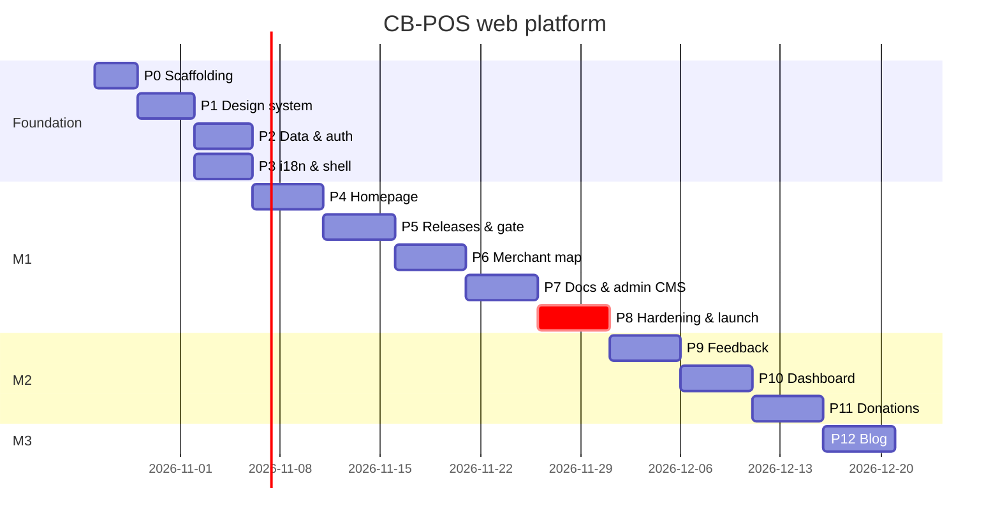

# 07 — Implementation Plan

| | |
|---|---|
| Version | 1.0 |
| Date | 2026-10-21 |
| Status | Active. Tick boxes in the same PR that completes the item (`CLAUDE.md §11.7`) |
| Cadence | 1-week sprints, 1–2 engineers + AI agents |
| Milestones | **M1 Public launch** (end of Sprint 7) · **M2 Community** (Sprint 10) · **M3 Content** (Sprint 11) |

Every phase lists: **goal**, **checklist** (each item is one commit or a small PR), **verify** (commands or observable checks), and **exit criteria**. A phase starts only when the previous phase's exit criteria are met, except where it's marked *parallel*.

---

## Overview

| Sprint | Phases | Milestone |
|---|---|---|
| 1 | Phase 0 Scaffolding · Phase 1 Design system | — |
| 2 | Phase 2 Data & auth · Phase 3 i18n & shell | — |
| 3 | Phase 4 Homepage | — |
| 4 | Phase 5 Releases & download gate | — |
| 5 | Phase 6 Merchant map | — |
| 6 | Phase 7 Docs center & admin CMS core | — |
| 7 | Phase 8 Legal, hardening & production launch | **M1** |
| 8 | Phase 9 Feedback tracker | — |
| 9 | Phase 10 Merchant dashboard | — |
| 10 | Phase 11 Donations | **M2** |
| 11 | Phase 12 Blog & content extras | **M3** |

---

## Phase 0 — Repository & platform scaffolding (Sprint 1)

**Goal:** an empty Next.js 15 app that builds, previews in `workerd`, and deploys to a preview Worker, with all bindings wired.

### 0.1 Verify assumptions (record results in `docs/adr/0000-phase0-verification.md`)
- [ ] Confirm the current `@opennextjs/cloudflare` binding names (`NEXT_INC_CACHE_R2_BUCKET`, `NEXT_TAG_CACHE_D1`, `NEXT_CACHE_DO_QUEUE`, `WORKER_SELF_REFERENCE`) and the override import paths in `02-TRD §2.4`.
- [ ] Confirm the Workers free-plan limits (CPU per request, compressed bundle size, requests/day), D1, KV, R2 and Durable Objects free allowances. Update the table in `02-TRD §14`.
- [ ] Confirm the `ratelimits` wrangler syntax and that the Rate Limiting binding is available on the free plan.
- [ ] Confirm `better-auth`, `better-auth-cloudflare` and Better Auth `admin` + `emailOTP` plugin APIs against `02-TRD §12.2`.
- [ ] Confirm drizzle-kit emits partial unique indexes (`.where()`) and `check()` for SQLite.
- [ ] Confirm CARTO basemap terms for this use. Choose fallback styles (OpenFreeMap) and set `MAP_STYLE_*`.
- [ ] Confirm `@lucasmarkes/hairline` exists on npm, and check its licence, size and maintenance → ADR-0007 (adopt or use the fallback, `03 §9.6`).
- [ ] Confirm PayHere accepts donation use for the Ceybyte merchant account (else `FEATURE_PAYHERE=false` for M2).

### 0.2 Scaffold
- [ ] `pnpm create next-app@15` with TypeScript, App Router, `src/`, ESLint and Tailwind v4, using `--import-alias "@/*"`.
- [ ] Add `@opennextjs/cloudflare`, `wrangler`. Create `open-next.config.ts`, `wrangler.jsonc` (`02-TRD §2.2`), and `initOpenNextCloudflareForDev()` in `next.config.ts`.
- [ ] Create Cloudflare resources: D1 `cbpos-db`, `cbpos-db-preview`, `cbpos-next-tags`; R2 `cbpos-uploads` (private, CORS + lifecycle per `02-TRD §9.1`) and `cbpos-cache`; KV `CACHE_KV`; Turnstile widget (hostnames `ceybyte.com`, `localhost`).
- [ ] `.dev.vars.example` with every secret from `02-TRD §2.3` (Turnstile test keys by default). `.gitignore` covers `.dev.vars`, `.wrangler/`, `.open-next/`, `.bundle/`.
- [ ] `pnpm cf-typegen` → `cloudflare-env.d.ts` committed.
- [ ] `src/lib/env.ts` (zod-validated env access).
- [ ] `package.json` scripts exactly as in `CLAUDE.md §3`.
- [ ] TS config: `strict`, `noUncheckedIndexedAccess`. ESLint: `next/core-web-vitals`, `@typescript-eslint/strict`, custom rules `no-raw-color` and `no-bare-merchant-select` (stubs, filled in Phases 1 and 2). Prettier.
- [ ] Vitest + `@cloudflare/vitest-pool-workers` config. Playwright config (projects: desktop Chrome, Pixel 7; base URL `pnpm preview`).
- [ ] `scripts/bundle-check.ts`: runs `wrangler deploy --dry-run --outdir .bundle`, gzips the worker, and fails above 2.8 MiB.
- [ ] `scripts/i18n-check.ts`: key parity across `messages/{en,si,ta}.json` + `[[TRANSLATE]]` scan (fails in `--strict` mode).
- [ ] GitHub Actions `ci.yml` and `deploy.yml` (`02-TRD §17`). Repo secrets `CLOUDFLARE_API_TOKEN`, `CLOUDFLARE_ACCOUNT_ID`.
- [ ] `docs/adr/0001…0006` stubs from `02-TRD §18`.

**Verify:** `pnpm lint && pnpm typecheck && pnpm test && pnpm build && pnpm preview` serves the default page at `:8787`. A PR shows a working preview URL. `pnpm bundle:check` prints the size.

**Exit criteria:** a preview deploy from CI succeeds. Every box in 0.1 is answered in ADR-0000, and any changed facts are reflected in `02-TRD`.

---

## Phase 1 — Design system & brand primitives (Sprint 1)

**Goal:** tokens, fonts, primitives and motion foundations exactly as specified in `03-DESIGN.md`, reviewable on a dev-only styleguide page.

- [ ] `src/app/globals.css`: the full token set, `@theme inline`, utilities (`text-display`…`text-hash`), `:lang(si|ta)` script rules, reduced-motion block (`03 §3–4`).
- [ ] Fonts via `next/font/google` with per-locale preload (`03 §4.1`).
- [ ] `next-themes` provider (`data-theme`, default dark, no system). Theme toggle component.
- [ ] `pnpm dlx shadcn@latest init` (Tailwind v4 mode). Add `button input textarea select checkbox dialog drawer accordion tabs badge table sonner command popover tooltip skeleton separator switch radio-group label`. Adapt each to tokens and the radius scale.
- [ ] Brand: `Logo`, `Kbd`, `HashBlock`, `GridCanvas`, `Crosshair`, `SectionEyebrow`, `StatTile`, `Callout`, `FileDrop`, `PhoneInput`.
- [ ] Motion: `tokens.ts`, `Reveal`, `MotionConfig` wrapper, `SmoothScroll` (Lenis + GSAP, lazy, guarded), `useCountUp`.
- [ ] Hairline: adopt the package or build `IsoFigure` per ADR-0007 (POS counter, installer box, wizard window, printer, unplugged cable).
- [ ] Rive: self-host the WASM at `/rive/`, plus a `RiveLazy` wrapper with poster fallback. Placeholder `.riv` files may be used until the final assets arrive, but every one must have a real poster image.
- [ ] Fill in the `no-raw-color` ESLint rule.
- [ ] `/_styleguide` route (only when `NODE_ENV !== "production"`) rendering every component, state and theme in `en`, `si` and `ta`.
- [ ] Run the `impeccable` audit on the styleguide and fix the findings (`CLAUDE.md §7`).

**Verify:** a Playwright visual snapshot of `/_styleguide` in both themes × 3 locales. Axe shows zero violations. Manual check: no clipped Sinhala/Tamil diacritics in buttons, inputs, accordion triggers or badges at 360px.

**Exit criteria:** every component in `03 §8` exists with all listed states, and the contrast pairs in `03 §2.1` have been verified in the browser.

---

## Phase 2 — Data layer & auth (Sprint 2)

**Goal:** the schema from `05-SCHEMA.md` live in local and preview D1, Better Auth working with roles, and the shared server utilities in place.

- [ ] `src/lib/enums.ts`, `src/server/db/schema.ts`, `relations.ts`, `index.ts`, `projections.ts` (verbatim from `05 §2–7`).
- [ ] `pnpm db:generate` → review the SQL (partial indexes, checks, FKs) → `pnpm db:migrate:local`.
- [ ] `src/server/db/tx.ts` `runAtomic()` (batch wrapper).
- [ ] `src/server/auth.ts`: per-request `createAuth(env)` (Drizzle adapter `usePlural`, admin plugin, emailOTP via Resend, Google, `nextCookies`). `src/app/api/auth/[...all]/route.ts`.
- [ ] `requireSession(role?)` helper. Middleware cookie-presence guards (`02 §3`).
- [ ] `scripts/make-admin.ts`.
- [ ] Server utilities: `turnstile.ts`, `ratelimit.ts` (+ hourly KV window), `iphash.ts` (daily salt), `log.ts` (redacting), `api.ts` (envelope + `ApiError`), `r2.ts` (presign PUT/GET, head check, magic bytes), `audit.ts` (redacting writer), `geo-cache.ts` (`bumpGeoVersion`, snapshot builder).
- [ ] `src/lib/phone.ts` (normalise, validate mobile/landline, format), `src/lib/money.ts` (cents ↔ `Rs. 1,250.00`), `src/lib/tax.ts` (display-only VAT/SSCL example maths), `src/lib/sri-lanka.ts` (bounds, haversine, nearest city).
- [ ] `public/data/lk-districts.json` (25 districts: slug, names en/si/ta, province, centroid, bbox) and `public/data/lk-cities.json` (≥ 300 towns: name en/si/ta, district, lat, lng). Source: an OSM extract (ODbL attribution in the footer credits).
- [ ] `scripts/seed.ts` (`05 §9`) → `pnpm db:seed:local`.
- [ ] Unit tests: phone, money, tax, sri-lanka, iphash, PayHere hash and GitHub HMAC helpers (test vectors). **Contract test `geo.contract.test.ts`.**
- [ ] Fill in the `no-bare-merchant-select` lint rule.

**Verify:** `pnpm test` is green, including the contract test. Sign up, sign in with OTP, and sign in with Google on preview. `make-admin` promotes a user, `/admin` renders a placeholder for the admin, and a merchant user gets a 404.

**Exit criteria:** the migrations apply cleanly to `cbpos-db-preview` from CI. The auth flows work on the preview Worker.

---

## Phase 3 — i18n engine & layout shell (Sprint 2, parallel with Phase 2)

**Goal:** trilingual routing, the header and footer, SEO plumbing and analytics consent (F-01).

- [ ] `src/i18n/routing.ts` (`locales: ["en","si","ta"]`, `defaultLocale: "en"`, `localePrefix: "always"`), `request.ts`, `navigation.ts`.
- [ ] `src/middleware.ts`: compose next-intl with the admin/dashboard guards. Make sure the matcher excludes `/api`, `/ingest`, `/media`, `/_next` and files.
- [ ] `src/app/[locale]/layout.tsx`: `<html lang>`, fonts, theme, `NextIntlClientProvider`, header, footer, skip link, offline banner, toaster.
- [ ] `messages/en.json` seeded with every key from `06 §3–4`. `si.json`/`ta.json` mirror the keys with `[[TRANSLATE]]` values.
- [ ] `LanguageSwitcher` (keeps path + query, sets the cookie) and the docs/blog fallback logic hook.
- [ ] SEO: `generateMetadata` helper with `hreflang` alternates + `x-default`, `sitemap.ts` (per locale), `robots.ts`, JSON-LD helpers (`SoftwareApplication`, `FAQPage`, `BreadcrumbList`, `Article`).
- [ ] PostHog: `/ingest` rewrites in `next.config.ts`, `AnalyticsProvider` that initialises only after consent, the consent bar (`06 §2` system state), and `capture()` wrapper with a typed event union from `04 §7`.
- [ ] Security headers + CSP with nonce (`02 §12.3`).
- [ ] `not-found.tsx`, `error.tsx`, `loading.tsx` patterns.

**Verify:** `/` with `Accept-Language: si-LK` → `307 /si`. The switcher keeps the path. `pnpm i18n:check` passes (non-strict). There are no PostHog requests before consent (Playwright network assertion). CSP reports no violations on the shell.

**Exit criteria:** AC-01.1, AC-01.4 (non-strict) and AC-12.2 pass in E2E.

---

## Phase 4 — Homepage showcase (Sprint 3)

**Goal:** S01 with all 8 sections, real data hooks and motion (F-02).

- [ ] `/api/stats` (KV `stats:v1` → D1 fallback, Cache API) + `getHomeStats()` for ISR with tag `home-stats`.
- [ ] Hero: copy, CTA (opens the gate stub; the gate is built in Phase 5), meta line from `getLatestRelease()` (stubbed until Phase 5), Rive `hero-pos` + poster, Hairline counter figure, cyan glow.
- [ ] Telemetry strip: four `StatTile`s with count-up, plus the map teaser (a static image generated by `scripts/map-teaser.ts` at build from the geo snapshot. In Phase 4 it's a static SVG of Sri Lanka with no pins until Phase 6).
- [ ] Problem: 3 cards + GSAP fault-line scrub.
- [ ] Bento: 6 interactive cards with keyboard parity:
  - [ ] Keyboard (key listeners scoped to card focus)
  - [ ] Offline toggle (Rive `bento-offline` or Motion fallback)
  - [ ] Dual-tax calculator (`src/lib/tax.ts`, mono, disclaimer link)
  - [ ] Hardware list
  - [ ] Receipt tabs (Rive `bento-receipt` + real receipt images)
  - [ ] Weighing ticker + backup line
- [ ] How It Works with the progress hairline scrub.
- [ ] FAQ accordion + `FAQPage` JSON-LD.
- [ ] Final banner with pointer glow. Architectural footer.
- [ ] Sticky header CTA hides while the hero CTA is visible.
- [ ] Reduced-motion pass (`03 §9.7`) and the `impeccable` audit.

**Verify:** Lighthouse mobile on `/en`, `/si`, `/ta`: Perf ≥ 90, A11y 100, LCP ≤ 2.5 s, CLS ≤ 0.05, initial JS ≤ 180 KB gz. Reduced-motion E2E renders all sections. The stat numbers equal the seeded D1 values (AC-02.3).

**Exit criteria:** AC-02.1–AC-02.3 pass, and only one `#39FF14` element is visible per viewport (manual check at 360/768/1280/1440).

---

## Phase 5 — Releases sync & download gate (Sprint 4)

**Goal:** real installer delivery and merchant capture (F-03, F-06).

### 5.1 Releases (F-06)
- [ ] Shared `Manifest` zod in `src/features/releases/manifest.ts`.
- [ ] `workers/release-sync/`: wrangler config (D1, KV, service binding to `cbpos-web`, crons `*/30 * * * *` and `15 3 * * *`). `scheduled()` → `syncReleases()` (ETag, validate, GitHub release body, batch upsert, KV, revalidate call) and `runCleanup()` (`05 §10`, implemented incrementally as tables gain data). `fetch()` handles `/sync` (internal secret).
- [ ] `POST /api/webhooks/github` (HMAC, event filter, `waitUntil` service call). Configure the webhook on `ceybyte/cbpos-releases`.
- [ ] `POST /api/internal/revalidate`.
- [ ] `GET /api/releases/latest`, `GET /api/download/latest` (KV → D1 → `FALLBACK_RELEASE`, log via `waitUntil`, 302).
- [ ] `scripts/snapshot-release.ts` runs in `prebuild` → `src/features/releases/fallback.generated.ts`.
- [ ] S06 Releases page: latest card, hash blocks, verify expander, changelog (notes rendered with the Phase 7 renderer; plain Markdown for now), beta toggle, yanked styling.
- [ ] Coordinate with the release repo: its CI writes `latest.json` with sizes and sha256s (template PR to `ceybyte/cbpos-releases`).

### 5.2 Download gate (F-03)
- [ ] `src/features/download-gate/schema.ts` (step 1, step 2, combined, with i18n error keys).
- [ ] `POST /api/downloads` (Turnstile → RL → zod → phone dedupe → batch insert merchant + log → claim token + `cb_gate`/`cb_claim` cookies → `bumpGeoVersion` if public → response).
- [ ] `DownloadModal`: responsive Dialog/Vaul, `?download=1` sync, Lenis pause, sessionStorage persistence, direction-aware steps, Turnstile lazy render.
- [ ] Step 2: district/city selects from JSON, Detect My Location (bounds check, nearest city, accuracy notice), lazy MiniMap with a draggable pin (bounds-clamped), opt-in + terms checkboxes.
- [ ] What Next: layout morph, Rive check, hash block, SmartScreen box, steps, WhatsApp link, claim card, retry link, mobile share.
- [ ] `/{locale}/download` no-JS full page using the same form components.
- [ ] Returning-visitor fast path via the `cb_gate` cookie.
- [ ] Wire every CTA (`source` property) and the analytics events from `04 §1.1`.

**Verify:** E2E `01-visitor-download.spec.ts` in 3 locales (302 to the GitHub asset, default `is_public_on_map=false`, keyboard-only run). Webhook test: publish a test release in a fork/staging repo and check the site updates in under 2 minutes. An invalid manifest leaves `is_latest` unchanged and writes an audit warning.

**Exit criteria:** AC-03.1–AC-03.5 and AC-06.1–AC-06.2 pass.

---

## Phase 6 — Merchant map (Sprint 5)

**Goal:** S03, the privacy-safe live map (F-04).

- [ ] `GET /api/merchants/geo`: layered read (`02 §10.2`), ETag/304, headers, `RL_READ`.
- [ ] `bumpGeoVersion()` called from every public-field write path (gate; later the dashboard and admin). `geo:dirty` debounce + cron rebuild.
- [ ] Map page shell (SSG): panel, filters, `DistrictGrid`, result list, skeletons, no-WebGL list mode.
- [ ] `MerchantMap` client: MapLibre lazy, theme-aware style with fallback URL, `maxBounds`, min/max zoom, no rotation, GeoJSON source with `cluster: true`, `clusterRadius: 50`, `clusterMaxZoom: 13`, `clusterProperties: { supporters: ["+", ["case", ["get","isSupporter"], 1, 0]] }`. Layers: clusters, cluster-count, gold cluster ring, unclustered cyan, unclustered gold, halos.
- [ ] Interactions: cluster expansion, popup (desktop) / sheet (mobile), filters → `setData`, search, district fly-to, URL state (`?d=`, `?c=`, `?s=1`, `?m=`), keyboard list navigation, reduced-motion `jumpTo`.
- [ ] "Add my shop" branch, "Report this listing" link (ticket type `listing_report`; the ticket form arrives in Phase 9, so until then link to the WhatsApp support line).
- [ ] Map teaser image generation from the snapshot (`scripts/map-teaser.ts`) wired into the homepage.

**Verify:** E2E `02-map-explorer.spec.ts` (whitelist assertion on the network response, hidden merchant absent within 60 s). The CPU time for a geo cache hit is < 2 ms in `wrangler tail`. A 5,000-feature synthetic load stays smooth on a mid-range Android (manual).

**Exit criteria:** AC-04.1–AC-04.4 pass.

---

## Phase 7 — Docs center & admin CMS core (Sprint 6)

**Goal:** F-05 plus the parts of F-08 needed for M1 (Overview, Merchants, Docs, Releases, Audit).

### 7.1 Rendering pipeline
- [ ] `src/server/markdown/`: unified pipeline (`02 §8`), the directive whitelist (`callout`, `kbd`, `screenshot`, `video`, `steps`), sanitize schema, publish-time Shiki, TOC + plain-text extraction, `hast-util-to-jsx-runtime` renderer with component map. Unit tests with fixtures (including XSS attempts).

### 7.2 Docs (F-05)
- [ ] `src/features/docs/source.ts`: D1 → Fumadocs `PageTree` (per locale, with EN fallback nodes).
- [ ] `/{locale}/docs` hub (S04) and `/{locale}/docs/[...slug]` (S05) with `generateStaticParams`, fallback banner, `hreflang`, tax callout injection, version badge, helpful widget, prev/next.
- [ ] Search: publish-time Orama index → KV, `/api/docs/search-index`, `⌘K`/`/` dialog with locale-first ranking and `EN` labels.
- [ ] `/media/[...key]` public R2 route with the prefix allow-list.
- [ ] Printable shortcuts page.

### 7.3 Admin CMS core (F-08)
- [ ] `/admin` layout: role check (404 for non-admins), nav, global search, `?` shortcut sheet, `j/k` list navigation hook.
- [ ] Overview KPIs.
- [ ] Merchants: table, filters, detail drawer, "Reveal contact (logged)", status/supporter actions (with `bumpGeoVersion`), CSV export (streamed, audited).
- [ ] Docs: category tree editor, article list by translation group (EN/SI/TA dots), Markdown editor + live preview (same renderer), media upload to `docs/`, publish/unpublish → `revalidateTag('docs', 'doc:{key}')` + index rebuild.
- [ ] Releases: table, force sync, yank toggle, manual entry.
- [ ] Audit log viewer with the diff view.

### 7.4 Content
- [ ] Write the 8 seed articles in English (`05 §9`). Hand them off to translators along with the UI strings.

**Verify:** E2E `03-docs.spec.ts`. Publishing an article makes it live and searchable in ≤ 60 s (AC-05.2). Axe passes on articles. A non-admin gets a 404 on `/admin` (AC-08.1).

**Exit criteria:** AC-05.1–AC-05.3 and AC-08.1 pass. Admins can moderate merchants and publish docs without engineering help.

---

## Phase 8 — Legal, hardening & production launch (Sprint 7) → **M1**

**Goal:** F-12 complete, security and performance verified, and `ceybyte.com` live.

### 8.1 Legal & content
- [ ] S11 pages (terms, privacy, tax-disclaimer, data-safety, cookies) with summary boxes, version stamps and the "English prevails" note. The legal text is reviewed by a Sri Lankan lawyer (or at least checked against the PDPA's obligations) before launch.
- [ ] `terms_version` constant wired into the gate. Inline disclaimers in all the places listed in FR-12.1.
- [ ] CI grep for banned phrases (`06 §5`, AC-12.1).
- [ ] **Product facts PF-1…PF-8 signed off** by the CB-POS team (`06 §0`). Copy updated where needed.
- [ ] Sinhala and Tamil translations delivered for all M1 UI strings, the legal pages and the 8 docs. `pnpm i18n:check --strict` passes. Native-speaker review of S01, S02, S03 and S05 screenshots for clipping and tone.

### 8.2 Hardening
- [ ] Security review: run `/security-review` and fix the findings. Verify CSP in production mode. Webhook signature negative tests. Turnstile enforced on every public POST (integration test enumerates the routes).
- [ ] Rate-limit tests (429 + `Retry-After`). WAF rate-limiting rule configured on the zone.
- [ ] Privacy review: the contract test, log redaction test, PostHog payload review (no PII in any event), replay masking verified in a recorded session.
- [ ] Performance: Lighthouse CI budgets (`02 §15`) on the M1 routes. `wrangler tail` CPU sampling on the top routes (all p95 < 8 ms). Bundle ≤ 2.8 MiB.
- [ ] Failure drills:
  - [ ] D1 unavailable → download still works via KV/fallback
  - [ ] GitHub raw down → sync logs a warning and the site keeps serving
  - [ ] Map tiles down → fallback style, then list mode
- [ ] Accessibility: a full keyboard-only pass of S01–S06 and S11, a screen reader pass (NVDA + Chrome on Windows, TalkBack on Android) of the gate and the map.

### 8.3 Production deployment
- [ ] Create production D1/R2/KV (if they don't exist yet) and set all production secrets (`wrangler secret put`).
- [ ] Custom domain `ceybyte.com` on the Worker, `www` → apex 301, HSTS.
- [ ] Production Turnstile keys, PostHog project, Resend domain (SPF/DKIM), Google OAuth production redirect URIs.
- [ ] `deploy.yml` run: migrations → deploy web → deploy release-sync → smoke tests.
- [ ] `make-admin` for the maintainers. Seed docs categories and articles to production (`--allow-production-content`).
- [ ] Trigger a real release sync and confirm `/api/releases/latest` and the download 302 hit the production installer.
- [ ] PostHog funnels created (`04 §7`). Ops daily summary webhook live.
- [ ] Rollback rehearsed (`wrangler rollback`) on preview.

**Exit criteria (M1):** every M1 acceptance criterion in `01-PRD.md` passes in production. The infra bill is Rs. 0. A first real merchant downloads through the gate and appears on the map (if opted in).

---

## Phase 9 — Feedback tracker (Sprint 8)

**Goal:** F-07 plus admin triage.

- [ ] `src/features/feedback/schema.ts`. `POST /api/feedback` (Turnstile, RL, zod, `public_number` assignment, draft attachment move). `GET /api/feedback/similar`. `POST /api/feedback/[id]/vote` (voter key, batch count update).
- [ ] Upload purposes `crash_log`, `ticket_screenshot` in presign/confirm (draft entity refs).
- [ ] S07 board (ISR `feedback` tag, filters, sort, pagination), S08 submit (prefill from query, similar list, dropzones with progress, question auto-reply), S08 detail (timeline, response block, vote).
- [ ] Admin Feedback module: queue, status transitions (state machine `04 §4.3`), duplicate picker, release picker, response editor, "Mark screenshot safe" (R2 copy to `screenshots/public/`), crash log presigned GET.
- [ ] Map "Report this listing" now opens `type=listing_report`.
- [ ] Cleanup cron: draft uploads > 24 h.

**Verify:** E2E `04-feedback.spec.ts` (privacy of logs and contact, size rejection client + server, vote dedupe).

**Exit criteria:** AC-07.1–AC-07.2 pass. The triage queue works fully by keyboard.

---

## Phase 10 — Merchant dashboard (Sprint 9)

**Goal:** F-09 listing self-service.

- [ ] Claim flow: signed `cb_claim` cookie → Better Auth `databaseHooks.session.create.after` → `claimListing` (verify HMAC + hash, single use, set `owner_user_id`, log `listing_claimed`).
- [ ] S12 login (tabs, OTP, Google, claim context). S13 dashboard layout + Overview.
- [ ] My listing: form + MiniMap, `updateMyListing` and `setMyVisibility` actions (owner-scoped, `bumpGeoVersion`, hidden-status rule).
- [ ] My tickets, My donations (lists, empty until Phase 11).
- [ ] Settings: language (`users.locale` + cookie), email/password, delete account (confirm by shop name → soft delete, revoke sessions). Cleanup cron hard-deletes after 30 days.
- [ ] Admin: "Link merchant to user" action for manual claims.

**Verify:** E2E `06-dashboard.spec.ts` (gate → sign up → listing visible; cross-merchant access returns `NOT_FOUND`; delete removes the pin ≤ 60 s).

**Exit criteria:** AC-09.1–AC-09.2 pass.

---

## Phase 11 — Donations (Sprint 10) → **M2**

**Goal:** F-11 with all three tiers (PayHere behind its flag).

- [ ] `src/features/donations/schema.ts`. `POST /api/donations` (reference code, submit secret cookie, private merchant link by phone). `POST /api/donations/[ref]/submit`. `GET /api/donations/[ref]/status`.
- [ ] Upload purpose `donation_slip` (ref + secret auth, magic-byte check).
- [ ] S09: tiers, amount chips (cents), LankaQR card (static QR asset from the acquirer), bank details with copy buttons, slip dropzone, pending/approved states, resume link, supporters wall (ISR `supporters`), transparency block (monthly aggregate), legal line.
- [ ] PayHere: `/api/donations/payhere/checkout` (hash), auto-submit form, `/api/webhooks/payhere` (md5sig, merchant/amount/currency checks, idempotent, status mapping), `/donate/thanks` polling. Sandbox end-to-end first, then live keys.
- [ ] Admin Donations queue: slip preview via presigned GET in a sandboxed iframe/img, approve/reject with reasons, `recomputeSupporter`, `bumpGeoVersion`, `revalidateTag('supporters','home-stats')`, message moderation.
- [ ] Cron: `awaiting_payment` > 14 days → `cancelled`. Rejected slips purged after 90 days.
- [ ] Dashboard "My donations" wired up.

**Verify:** E2E `05-donation.spec.ts` (bank slip → admin approve → gold pin; PayHere replay idempotent; bad signature 400; 8 MB PDF rejected client + server).

**Exit criteria (M2):** AC-11.1–AC-11.3 and AC-08.2 pass, and the M2 features run in production with real LankaQR/bank details.

---

## Phase 12 — Blog & content extras (Sprint 11) → **M3**

**Goal:** F-10 plus deferred extras.

- [ ] Blog routes (S10 index + post) using the shared renderer. Tag filter, reading time (locale-aware divisor), related posts, "Also in English" section.
- [ ] Admin Blog module: editor, cover upload (`blog/`), schedule (`scheduled` status), publish → `revalidateTag('blog','post:{key}')`.
- [ ] OG image generation at publish (static template → PNG in R2 `og/`). `og:image` via `/media/og/...`.
- [ ] RSS per locale. Sitemap includes posts.
- [ ] Cron: hourly `blog` revalidation for scheduled posts (add the cron `0 * * * *`, still within the 5-trigger limit).
- [ ] Docs video embeds (`::video` directive with R2-hosted MP4, captions required).
- [ ] Dynamic LankaQR: only if a free acquirer API exists (else record "deferred" in ADR).
- [ ] Launch posts: "CB-POS is free", "How CB-POS calculates VAT from MRP" (with the disclaimer), and a first merchant story (with written consent).

**Verify:** AC-10.1. RSS validates. A scheduled post appears within an hour of `published_at`.

**Exit criteria (M3):** the blog is live in at least EN, with SI/TA posts published as translations arrive.

---

## Ongoing (every sprint)

- [ ] Weekly: review the PostHog funnels against the `01 §2.3` targets and pick one conversion experiment.
- [ ] Weekly: free-tier usage check against `02 §14`. If any metric passes 60% of its allowance, open an ADR.
- [ ] Per release of CB-POS: confirm the sync, update the docs for changed features, write a blog post for notable releases, and mark linked tickets `shipped`.
- [ ] Monthly: dependency updates (minor/patch only), Lighthouse re-run, an axe sweep, and the translation backlog cleared.
- [ ] Quarterly: legal text review (tax rates, PDPA guidance), and a check that the tax disclaimer still matches CB-POS behaviour.

---

## Definition of done (per checklist item)

Copied from `CLAUDE.md §11`, so it's on hand in every session:

1. Meets the PRD acceptance criteria for the feature.
2. Matches the S-screen blueprint and copy, using only tokens.
3. Handles loading, empty, error, success and offline states.
4. `pnpm lint && pnpm typecheck && pnpm test && pnpm i18n:check` pass.
5. The E2E flow passes in `en`, `si` and `ta` with zero axe violations.
6. The anti-slop checklists are ticked in the PR.
7. The box is ticked in this file in the same PR.
