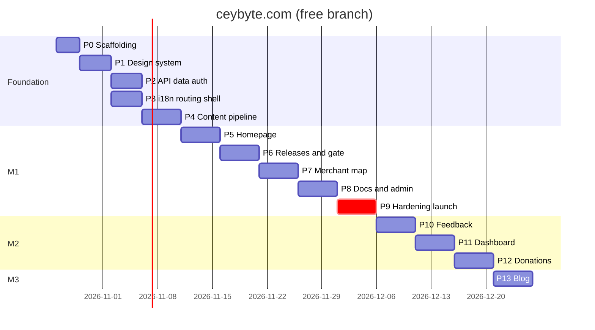

# 07 — Implementation Plan · branch `free`

| | |
|---|---|
| Version | 2.0-free |
| Date | 2026-10-21 |
| Status | Active. Tick boxes in the same PR that completes the item (`CLAUDE.md §11.7`) |
| Cadence | 1-week sprints, 1–2 engineers + AI agents |
| Architecture | Static export + Hono Worker on Cloudflare free plan, Bun tooling (`02-TRD.md`) |
| Milestones | **M1 Public launch** (end of Sprint 8) · **M2 Community** (Sprint 11) · **M3 Content** (Sprint 12) |

Every phase lists a **goal**, a **checklist** (one commit or small PR per item), **verify** steps, and **exit criteria**. A phase starts when the previous phase's exit criteria are met, unless it's marked *parallel*.

Every UI item also passes the design gates in `CLAUDE.md §7` (hallmark, impeccable, emil). Every product claim is checked against `00-CBPOS_FACTS.md`.

---

## Overview

| Sprint | Phases | Milestone |
|---|---|---|
| 1 | P0 Scaffolding · P1 Design system | — |
| 2 | P2 API, data & auth · P3 i18n, routing & shell | — |
| 3 | P4 Content pipeline | — |
| 4 | P5 Homepage | — |
| 5 | P6 Releases & download gate | — |
| 6 | P7 Merchant map | — |
| 7 | P8 Docs center & admin CMS core | — |
| 8 | P9 Legal, hardening & launch | **M1** |
| 9 | P10 Feedback tracker | — |
| 10 | P11 Merchant dashboard | — |
| 11 | P12 Donations | **M2** |
| 12 | P13 Blog & extras | **M3** |

---

## Phase 0 — Scaffolding (Sprint 1)

**Goal:** a Bun monorepo whose static site and Worker build, preview locally and deploy to a preview Worker.

### 0.1 Verify (record in `docs/adr/0000-phase0-verification.md`)
Already verified on 2026-10-21: Workers free limits (64 MiB size, 10 ms CPU, static assets free and unlimited), `@lucasmarkes/hairline@0.5.1` (MIT), the three design skills, CARTO's commercial licence requirement. Re-check anything older than 30 days at start.
- [x] `ratelimits` wrangler syntax (dry-run deploy). Free-plan availability confirmed at the first real deploy.
- [x] `run_worker_first` array syntax and `not_found_handling: "404-page"` with `html_handling: "auto-trailing-slash"`.
- [ ] Better Auth + `better-auth-cloudflare` with Hono on D1 (Drizzle adapter, `emailOTP`, `admin`). *Moved to the start of Phase 2.*
- [ ] `next-intl` static export: `setRequestLocale` + `generateStaticParams`, no middleware. *Moved to the start of Phase 3.*
- [ ] drizzle-kit emits partial unique indexes and `check()` for SQLite. *Moved to the start of Phase 2.*
- [ ] MapLibre Sinhala/Tamil label shaping, re-tested with a sample style. If it now shapes correctly, revisit ADR-0008's Latin-label rule. *Moved to the start of Phase 7.*

### 0.2 Skills
- [x] `bunx skills add emilkowalski/skills`, `bunx skills add Nutlope/hallmark`, `bunx skills add pbakaus/impeccable`; commit `.claude/skills` and the lockfile.
- [x] `.github/pull_request_template.md` design-gate table present (already committed).

### 0.3 Scaffold
- [x] `bun init`; root `package.json` with `workspaces: ["apps/*", "packages/*"]`; `bun.lock` committed.
- [x] `apps/web`: `bun create next-app@15` (TS, App Router, `src/`, Tailwind v4); `next.config.ts` with `output: "export"`, `trailingSlash: true`, `images: { unoptimized: true }`; `dev`/`build` scripts use `bun --bun next`.
- [x] `apps/api`: Hono app, `wrangler.jsonc` from `02-TRD §2.2`, `/api/health` route. (`scheduled` and the cron triggers are added in Phase 6 with the first job, so no empty handler ships.)
- [x] `packages/shared`: `enums.ts` with tests, `bun test` set up. (`schemas/`, `db/`, `money`, `phone`, `tax`, `sri-lanka` are written for real in Phase 2 rather than as empty stubs.)
- [x] Cloudflare: D1 `cbpos-db` + `cbpos-db-preview` (APAC), KV `CACHE_KV` (+ preview id), Turnstile widget (`ceybyte.com`, `cbpos.hasendra.workers.dev`, `localhost`; secret stored as a Worker secret). Worker deployed to `https://cbpos.hasendra.workers.dev`; CI deploys on push.
- [x] R2 `cbpos-uploads` (private, CORS in `apps/api/r2/cors-uploads.json`) and `cbpos-public` (custom domain `cdn.ceybyte.com`, CORS with `Range`), both bound.
- [x] `ceybyte.com` served by the Worker (custom domain); `www.ceybyte.com` → 301 → apex via the `cbpos-www-redirect` Worker. `DEPLOY_URL` repo variable set; deploy smoke-tests apex, API and the redirect.
- [x] Default branch is `free` (needed: `repository_dispatch` and scheduled workflows only run on the default branch).
- [x] `.dev.vars.example` with every secret in `02-TRD §2.3`. `.gitignore`: `.dev.vars`, `.wrangler/`, `apps/web/out`, `apps/web/.content`.
- [x] Root scripts as in `CLAUDE.md §3` (each later script is added by the phase that builds it: `build:content` P4, `db:*` P2, `tiles:build` P7). `bun run dev` runs web + Worker together, with `/api` proxied to `:8787` in dev.
- [x] TS `strict` + `noUncheckedIndexedAccess` (per-workspace `tsc --noEmit` from `tsconfig.base.json`). ESLint + Prettier. Custom rules `no-raw-color` (Phase 1) and `no-bare-merchant-select` (Phase 2) land with the code they guard.
- [x] Vitest + `@cloudflare/vitest-plugin` in `apps/api`. Playwright config against `bun run preview`, with an axe smoke test.
- [x] `scripts/i18n-check.ts` (Bun).
- [x] GitHub Actions `ci.yml` and `deploy.yml` (`02-TRD §17`) with `oven-sh/setup-bun`. Deploy skips until Cloudflare secrets exist.

**Verify:** `bun install && bun run lint && bun run typecheck && bun run test && bun run build && bun run preview` serves the placeholder page and `/api/health`. A PR gets a preview URL.

**Exit:** preview deploy from CI succeeds. ADR-0000 complete. ✅ Met 2026-10-22: CI deploys to production `ceybyte.com` on every push to `free`.

---

## Phase 1 — Design system (Sprint 1)

**Goal:** tokens, fonts, primitives and motion foundations from `03-DESIGN.md`, on a dev-only styleguide, with every component through the design gates.

- [ ] `globals.css`: tokens, `@theme inline`, utilities, `:lang(si|ta)` rules, reduced motion, `.hairline-scope` mapping (`03 §3, §4, §9.6`).
- [ ] Fonts with per-locale preload. `next-themes` provider and toggle.
- [ ] shadcn init (Tailwind v4) and the component set (`button input textarea select checkbox dialog drawer accordion tabs badge table sonner command popover tooltip skeleton separator switch radio-group label`), adapted to tokens.
- [ ] Brand: `Logo`, `Kbd`, `HashBlock`, `GridCanvas`, `Crosshair`, `StatTile`, `Callout`, `FileDrop`, `PhoneInput`.
- [ ] Motion: tokens, `Reveal`, `MotionConfig`, `SmoothScroll` (lazy), `useCountUp`.
- [ ] Hairline wrapper `<Figure name=… />` (lazy per figure, translated labels, reduced-motion `intensity={0}`).
- [ ] Rive: self-hosted WASM, `RiveLazy` with poster fallback.
- [ ] `/_styleguide` (excluded from production export) showing every state in both themes × 3 locales.
- [ ] **Design gates:** `emil-design-eng` on every component; `impeccable audit` + `critique` on the styleguide; fix or log findings (ADR-0010 for Inter).

**Verify:** visual snapshots of `/_styleguide`, axe clean, Sinhala/Tamil clipping check at 320/375/414/768.

**Exit:** every component in `03 §8` exists with all states and passed its gates.

---

## Phase 2 — API, data & auth (Sprint 2)

**Goal:** `05-SCHEMA.md` live in local and preview D1, Hono API skeleton with the shared middleware, passwordless Better Auth working.

- [ ] `packages/shared/src/db/{schema,relations,projections}.ts` from `05 §2–7`. `bun run db:generate` → review SQL → `db:migrate:local`.
- [ ] Hono middleware: request ID, security headers, error envelope (`ApiError` → `ApiResult`), `dbMiddleware`, `requireSession`, `requireRole("admin")` returning 404.
- [ ] Libraries: `turnstile.ts`, `ratelimit.ts` (+ hourly KV window), `iphash.ts`, `log.ts` (redacting), `r2.ts` (presign PUT/GET, head check, magic bytes), `audit.ts` (redacting), `geo-cache.ts`, `rebuild.ts` (`repository_dispatch`), `github.ts`.
- [ ] Better Auth at `/api/auth/*`: Drizzle adapter (`usePlural`), `admin`, `emailOTP` via Resend, Google; `emailAndPassword` off; KV secondary storage. `scripts/make-admin.ts`.
- [ ] `packages/shared`: phone (E.164, mobile/landline), money (cents ↔ `Rs. 1,250.00`), tax display maths (round-half-even; MRP 1,180.00 → 1,000.00 / 180.00 / 12.50), sri-lanka (bounds, haversine, nearest city).
- [ ] `apps/web/public/data/lk-districts.json` (25 districts, names en/si/ta, province, centroid, bbox) and `lk-cities.json` (≥ 300 towns, OSM-derived, ODbL credited).
- [ ] `scripts/seed.ts` (`05 §9`) → `db:seed:local`.
- [ ] Tests: unit (`bun test`) for every `packages/shared` module; **`geo.contract.test.ts`**; API integration (vitest pool workers) for auth and the 404 admin rule.

**Verify:** OTP sign-in and Google sign-in on preview; `make-admin` works; a merchant gets 404 on `/api/admin/overview`.

**Exit:** migrations apply to `cbpos-db-preview` from CI; auth works on the preview Worker.

---

## Phase 3 — i18n, routing & shell (Sprint 2, parallel with P2)

**Goal:** trilingual static routing, the Worker's rewrites, header/footer, SEO plumbing, consent-gated analytics (F-01).

- [ ] `next-intl` static setup: `routing.ts`, `request.ts`, `navigation.ts`; `[locale]/layout.tsx` with `generateStaticParams` for 3 locales and `setRequestLocale` in every page.
- [ ] Worker: `GET /` locale redirect (cookie → `Accept-Language` → `en`), `/{locale}/feedback/CB-*` shell rewrite, `/ingest/*` PostHog proxy.
- [ ] Trilingual `404.html` page.
- [ ] Layout: `<html lang>`, fonts, theme, header (language switcher, theme toggle, Download), architectural footer, skip link, offline banner, toaster.
- [ ] `messages/en.json` from `06 §3–4`; `si.json`/`ta.json` mirrored with `[[TRANSLATE]]`.
- [ ] SEO: `generateMetadata` with `hreflang` + `x-default`, static `sitemap.xml`/`robots.txt` generated at build, JSON-LD helpers.
- [ ] `_headers` file (CSP, security headers, cache rules) per `02 §12.3`.
- [ ] Consent bar + `AnalyticsProvider` (init only after consent) + typed `capture()` over the `04 §7` event union.

**Verify:** `/` with `Accept-Language: si-LK` → `307 /si/`; switcher keeps the path; no PostHog requests before consent; CSP report shows no violations.

**Exit:** AC-01.1, AC-01.4 (non-strict), AC-12.2 pass in E2E.

---

## Phase 4 — Content pipeline (Sprint 3)

**Goal:** the publish → rebuild → deploy loop works end to end, because docs, blog and releases all depend on it (`02 §6`).

- [ ] `scripts/build-content.ts`: `wrangler d1 execute --json` (local or remote by flag) → `apps/web/.content/*.json`.
- [ ] `packages/shared/src/markdown/`: unified pipeline, directive whitelist, sanitize schema, Shiki, TOC and plain-text extraction. Unit tests with fixtures, including XSS attempts.
- [ ] Search index builder (Orama per locale → `public/search/{locale}.json` + manifest).
- [ ] OG image generator (satori + resvg under Bun).
- [ ] `scripts/snapshot-release.ts` → `FALLBACK_RELEASE` constant in the Worker.
- [ ] `rebuild.ts` (`repository_dispatch: content-published`) and `GET /api/admin/rebuild/status` (latest workflow run).
- [ ] `deploy.yml` handles `repository_dispatch` with a concurrency group that cancels in-progress runs.

**Verify:** insert a published doc row in preview D1 → trigger dispatch → the page is live on preview within 5 minutes; a second publish during the build cancels the first run.

**Exit:** publish-to-live works on preview with real content.

---

## Phase 5 — Homepage (Sprint 4)

**Goal:** S01 with all 8 sections, live stats and motion (F-02).

**Prerequisite:** real CB POS captures from UR-20 (or a static capture taken by the team following `03 §6.2`). No hero ships with an invented UI.

- [ ] `GET /api/stats` (KV `stats:v1` → D1 fallback, Cache API 300 s) + `useStats()` hook with skeleton/hidden states.
- [ ] Hero: copy from `06 §3.1` with fact IDs checked, CTA (gate stub until P6), meta line from `.content/releases.json`, capture with rim glow, Hairline `Keyboard` figure.
- [ ] Telemetry strip: 4 `StatTile`s (live) + map teaser (static image from `scripts/map-teaser.ts`, regenerated each build).
- [ ] Problem: 3 cards + GSAP fault-line scrub.
- [ ] Bento, each card using only the real facts:
  - [ ] Keyboard: F3 / Enter / F5 demo [B1]
  - [ ] Offline toggle
  - [ ] Dual-tax calculator using `packages/shared/src/tax.ts` (round-half-even, SSCL line, "VAT registration on" note) [C1], [C2]
  - [ ] Hardware connection types [E1], [E4]
  - [ ] Receipt language tabs (item names stay English) [F2]
  - [ ] Scale-label scan + `Vault` backup figure [E3], [G2]
- [ ] How It Works (Exploded / Padlock / Patch figures) with the progress scrub.
- [ ] FAQ accordion + `FAQPage` JSON-LD. Final banner. Footer.
- [ ] **Design gates:** hallmark build + audit on `/en/` (scores ≥ 3), impeccable audit/critique/polish, emil review of every animation, `review-animations` verdict approve.

**Verify:** Lighthouse mobile on `/en/`, `/si/`, `/ta/`: Perf ≥ 90, A11y 100, LCP ≤ 2.0 s, CLS ≤ 0.05, initial JS ≤ 180 KB gz; reduced-motion E2E; stat values equal seeded D1 values.

**Exit:** AC-02.1–AC-02.3 pass; one `#39FF14` element per viewport at every checked width.

---

## Phase 6 — Releases & download gate (Sprint 5)

**Goal:** real installer delivery and merchant capture (F-03, F-06).

### 6.1 Releases
- [ ] `syncReleases()` job (ETag, `Manifest` zod, GitHub release lookup for size/date, `download_url` cross-check, batch upsert, KV `release:latest`, rebuild dispatch) — called from `scheduled()` and the webhook.
- [ ] `POST /api/webhooks/github` (HMAC, event filter) and the webhook on `ceybyte/cbpos-releases`.
- [ ] `GET /api/releases/latest`, `GET /api/download/latest` (KV → D1 → fallback, log in `waitUntil`, 302).
- [ ] S06 page from `.content/releases.json` (hash block, verify expander with `CBPOSSetup-{version}.exe`, changelog, yanked styling) + "newer version available" banner from the runtime check. Hairline `Branches` header.
- [ ] First production sync imports `v1.3.0`; admins paste notes from `CHANGELOG.md` (UR-09 pending).

### 6.2 Download gate
- [ ] `packages/shared/src/schemas/download-gate.ts`.
- [ ] `POST /api/downloads` (Turnstile → RL → zod → phone dedupe → batch insert merchant + log → claim token → `cb_gate` + `cb_gate_done` cookies → `bumpGeoVersion` if public).
- [ ] `DownloadModal`: Dialog/Vaul, `?download=1`, Lenis pause, sessionStorage, direction-aware steps, lazy Turnstile.
- [ ] Step 2: district/city selects, Detect My Location (bounds, nearest city, accuracy notice), lazy MiniMap with draggable pin, opt-in + terms (links to EULA, tax disclaimer, data safety).
- [ ] What Next: layout morph, Rive check, hash block, SmartScreen box [A5], admin-permission note [A4], default PIN note [I1], WhatsApp link, claim card, retry, mobile share.
- [ ] No-JS `/{locale}/download/` page posting to the same API.
- [ ] **Design gates** on the modal (both containers) and What Next.

**Verify:** `01-visitor-download.spec.ts` × 3 locales (302 to the GitHub asset, opt-in default false, keyboard-only run). Publish a test release in a staging releases repo → download endpoint switches within 1 minute, pages within 5.

**Exit:** AC-03.1–AC-03.5 and AC-06.1–AC-06.2 pass.

---

## Phase 7 — Merchant map (Sprint 6)

**Goal:** S03, the privacy-safe live map (F-04).

- [ ] `scripts/tiles.ts` (Bun): `pmtiles extract <protomaps daily build> sri-lanka.pmtiles --bbox=79.5,5.8,82.0,10.0 --maxzoom=15` → upload to `cbpos-public/tiles/`. Quarterly reminder in the ops calendar.
- [ ] Style builder: `@protomaps/basemaps` `dark`/`light` flavours recoloured to tokens, `lang: "en"` labels, glyphs and sprites self-hosted on `cbpos-public`.
- [ ] `GET /api/merchants/geo` (layered read, ETag/304, headers, `RL_READ`); `geo:dirty` debounce in cron.
- [ ] Static map shell: panel, filters, `DistrictGrid`, results list, skeletons, no-WebGL list mode.
- [ ] `MerchantMap` client: `pmtiles` protocol, `maxBounds`, zoom 6.5–16, no rotation, clustered source with the supporters `clusterProperties`, cyan/gold layers and halos.
- [ ] Interactions: cluster expansion, popup/sheet (localized names in HTML), filters → `setData`, search, district fly-to, URL state, keyboard list nav, reduced-motion `jumpTo`.
- [ ] "Add my shop" branch; "Report this listing" (WhatsApp until P10).
- [ ] **Design gates** on the map page.

**Verify:** `02-map-explorer.spec.ts` (whitelist assertion, hidden merchant gone within 60 s); Worker CPU for a geo cache hit < 2 ms in `wrangler tail`; tile requests never hit the Worker.

**Exit:** AC-04.1–AC-04.4 pass.

---

## Phase 8 — Docs center & admin CMS core (Sprint 7)

**Goal:** F-05 and the M1 parts of F-08 (Overview, Merchants, Docs, Releases, Audit).

### 8.1 Docs
- [ ] `apps/web/src/features/docs/source.ts`: `.content` → Fumadocs page tree per locale with EN fallback nodes.
- [ ] S04 hub and S05 article pages (`generateStaticParams` for every published article × locale), fallback banner, tax callout injection, version badge, helpful widget (`POST /api/docs/feedback`), prev/next.
- [ ] `⌘K` / `/` search dialog over the static Orama index, locale-first ranking with `EN` labels.
- [ ] Printable shortcuts page from the real keymap [B1].

### 8.2 Admin console (static shell + `/api/admin/*`)
- [ ] Layout: session/role check before rendering, nav, global search, `?` shortcut sheet, `j/k` navigation.
- [ ] Overview KPIs. Merchants (table, filters, detail drawer, reveal-and-audit, status/supporter actions, streamed CSV).
- [ ] Docs: category tree, translation-group list (EN/SI/TA dots), Markdown editor with in-browser preview (same pipeline), media upload, publish → rebuild with live build status.
- [ ] Releases: table, sync now, yank, notes editor. Audit log viewer.

### 8.3 Content
- [ ] Write the 11 seed articles in English from `00-CBPOS_FACTS.md`, each citing its fact IDs (`05 §9`). Hand off to translators with the UI strings.

**Verify:** `03-docs.spec.ts`; publish → live and searchable within 5 minutes (AC-05.2); axe on articles; non-admin 404 (AC-08.1).

**Exit:** AC-05.1–AC-05.3 and AC-08.1 pass.

---

## Phase 9 — Legal, hardening & launch (Sprint 8) → **M1**

### 9.1 Legal & content
- [ ] S11 pages: terms, **EULA**, privacy (with the app network disclosure [A7], [A8]), tax disclaimer, data safety, cookies. Summary boxes, version stamps, "English prevails". Reviewed by a Sri Lankan lawyer (or at least against PDPA obligations).
- [ ] `terms_version` wired into the gate; inline disclaimers per FR-12.1.
- [ ] CI grep for banned claims (`CLAUDE.md §8.1`) across `messages/*.json` and `.content`.
- [ ] Re-run the CB POS facts audit against the newest tag; update copy for anything that changed. Confirm the status of UR-01, UR-02, UR-03 and adjust What Next / multi-till docs.
- [ ] Sinhala and Tamil for all M1 strings, legal pages and seed docs; `bun run i18n:check --strict` passes; native-speaker screenshot review of S01, S02, S03, S05.
- [ ] Check every page, meta tag and OG image uses "CB POS" with a non-breaking space (PRD OQ-3).everywhere.

### 9.2 Hardening
- [ ] `/security-review`; fix findings. Webhook negative tests. Turnstile enforced on every public POST (integration test enumerates routes).
- [ ] Rate-limit tests; WAF rule configured.
- [ ] Privacy: contract test, log redaction test, PostHog payload review, replay masking checked in a recorded session.
- [ ] Performance: Lighthouse CI budgets; `wrangler tail` CPU on every API route (p95 < 7 ms).
- [ ] Failure drills: D1 down → download still works (KV/fallback); GitHub raw down → sync warns, site serves; tiles missing → list mode; Actions down → admin sees "publish queued", site unaffected.
- [ ] Accessibility: keyboard-only pass of S01–S06 and S11; NVDA + Chrome and TalkBack passes of the gate and the map.
- [ ] Final **design gate** sweep: hallmark audit + impeccable polish on every M1 screen.

### 9.3 Launch
- [ ] Production D1/R2/KV, secrets, custom domains (`ceybyte.com`, `cdn.ceybyte.com`), `www` → apex redirect rule, HSTS.
- [ ] Production Turnstile, PostHog project, Resend domain (SPF/DKIM), Google OAuth redirect URIs.
- [ ] `deploy.yml` run: migrations → build → deploy → smoke tests. `make-admin` for maintainers. Seed docs categories/articles (`--allow-production-content`).
- [ ] Real release sync; `/api/download/latest` 302s to `CBPOSSetup-1.3.0.exe` (or newer).
- [ ] Update the `cbpos-releases` README to point bugs to `ceybyte.com/{locale}/feedback` (coordinate with the app team).
- [ ] PostHog funnels (`04 §7`); ops summary webhook; rollback rehearsed (`wrangler rollback`).

**Exit (M1):** every M1 acceptance criterion passes in production; bill is Rs. 0; a real shop downloads through the gate.

---

## Phase 10 — Feedback tracker (Sprint 9)

- [ ] `POST /api/feedback` (Turnstile, RL, zod, `public_number`, draft attachment move), `GET /api/feedback`, `GET /api/feedback/{number}`, `/similar`, `/vote`.
- [ ] Upload purposes `crash_log` (`cbpos_logs.txt`, [J1]) and `ticket_screenshot`.
- [ ] S07 board, S08 submit (query prefill for when UR-07 ships; log path help text; credential warning), S08 detail shell via the Worker rewrite. Hairline `Query` empty state.
- [ ] Admin Feedback: queue, state machine (`04 §4.3`), duplicate and release pickers, response editor, screenshot approval (copy to `cbpos-public`), crash-log presigned GET.
- [ ] Map "Report this listing" → `listing_report`. Cron: draft uploads > 24 h deleted.
- [ ] **Design gates.**

**Verify:** `04-feedback.spec.ts`. **Exit:** AC-07.1–AC-07.2 pass.

---

## Phase 11 — Merchant dashboard (Sprint 10)

- [ ] Claim flow: `cb_claim` HMAC cookie → Better Auth `databaseHooks.session.create.after` → claim (single use, logs `listing_claimed`).
- [ ] S12 login (Google + email OTP, claim context). S13 dashboard shell + Overview.
- [ ] `/api/me/listing` (GET/PATCH, owner-scoped, `bumpGeoVersion`, hidden-status rule), visibility toggle.
- [ ] My tickets, My donations. Settings: language, email, linked Google, delete (confirm by shop name → soft delete → sessions revoked). Cron hard-deletes after 30 days.
- [ ] Admin "link merchant to user".
- [ ] **Design gates.**

**Verify:** `06-dashboard.spec.ts`. **Exit:** AC-09.1–AC-09.2 pass.

---

## Phase 12 — Donations (Sprint 11) → **M2**

- [ ] `POST /api/donations`, `/{ref}/submit`, `/{ref}/status`, `GET /api/donations/summary`; upload purpose `donation_slip` (ref + secret, magic bytes).
- [ ] S09: amount chips (cents), bank details with copy buttons (`DONATION_*` vars baked at build), optional bank txn reference, slip dropzone, pending/approved states, resume link, supporters wall and monthly total (runtime), legal line.
- [ ] Admin Donations: slip preview (presigned GET, sandboxed), approve/reject with reasons, `recomputeSupporter`, `bumpGeoVersion`, message moderation.
- [ ] Cron: `awaiting_payment` > 14 days → `cancelled`; rejected slips purged after 90 days. Dashboard "My donations".
- [ ] **Design gates.**

**Verify:** `05-donation.spec.ts`. **Exit (M2):** AC-11.1–AC-11.3 and AC-08.2 pass with the real bank details in production.

---

## Phase 13 — Blog & extras (Sprint 12) → **M3**

- [ ] Blog routes (S10) from `.content/blog.json`; tags, reading time (locale-aware divisor), related posts, "Also in English".
- [ ] Admin Blog: editor, cover upload, scheduling; cron triggers a rebuild when a scheduled post is due.
- [ ] OG images per post; RSS per locale; sitemap includes posts.
- [ ] Docs video embeds (`::video`, captions required).
- [ ] Payment gateway ADR (card and/or LankaQR): fees, donation eligibility, webhook security. Build only after approval.
- [ ] Launch posts: "CB POS is free", "How CB POS works out VAT and SSCL from MRP" (with the disclaimer and [C1]/[C2] examples), a first shop story (written consent).
- [ ] **Design gates.**

**Exit (M3):** blog live in EN, with SI/TA posts as translations arrive.

---

## Ongoing (every sprint)

- [ ] Weekly: PostHog funnels against `01 §2.3`; pick one conversion experiment.
- [ ] Weekly: free-tier usage against `02 §14`; any metric past 60% → ADR (Workers Paid, or move to `main`).
- [ ] Per CB POS release: re-run the facts audit, update `00`/`08`, update docs and copy, blog post if notable, mark linked tickets `shipped`.
- [ ] Monthly: dependency updates (minor/patch), Lighthouse, axe sweep, translation backlog, skill updates reviewed.
- [ ] Quarterly: rebuild map tiles; legal review (tax rates, PDPA guidance); tax disclaimer still matches the app.

---

## Definition of done (per item)

1. Meets the PRD acceptance criteria.
2. Matches the screen blueprint and copy; every product claim cites `00-CBPOS_FACTS.md`; tokens only.
3. Passed the design gates in `CLAUDE.md §7`, with results in the PR.
4. Handles loading, empty, error, success and offline states.
5. `bun run lint && bun run typecheck && bun run test && bun run i18n:check` pass.
6. The E2E flow passes in `en`, `si` and `ta` with zero axe violations.
7. The box is ticked here in the same PR.
