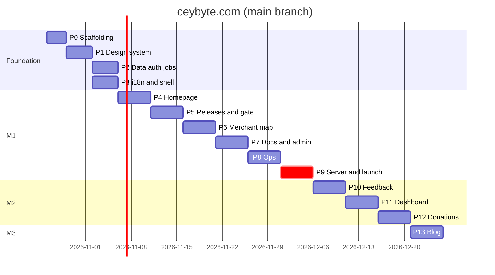

# 07 — Implementation Plan · branch `main`

| | |
|---|---|
| Version | 2.0-main |
| Date | 2026-10-21 |
| Status | Active. Tick boxes in the same PR that completes the item (`CLAUDE.md §11.7`) |
| Cadence | 1-week sprints, 1–2 engineers + AI agents |
| Architecture | One VPS: Next.js 15 on Bun, PostgreSQL 17, Valkey, Garage, pg-boss worker, Dokploy, Cloudflare Tunnel (`02-TRD.md`) |
| Milestones | **M1 Public launch** (end of Sprint 8) · **M2 Community** (Sprint 11) · **M3 Content** (Sprint 12) |

Every phase lists a **goal**, a **checklist** (one commit or small PR per item), **verify** steps and **exit criteria**. Every UI item passes the design gates in `CLAUDE.md §7`. Every product claim is checked against `00-CBPOS_FACTS.md`.

Until the VPS is bought, Phases 0–8 run entirely on the local `compose.dev.yml` stack and CI. Phase 9 is the first one that needs the server.

---

## Overview

| Sprint | Phases | Milestone |
|---|---|---|
| 1 | P0 Scaffolding · P1 Design system | — |
| 2 | P2 Data, auth & jobs · P3 i18n & shell | — |
| 3 | P4 Homepage | — |
| 4 | P5 Releases & download gate | — |
| 5 | P6 Merchant map | — |
| 6 | P7 Docs center & admin CMS core | — |
| 7 | P8 Ops: images, backups, monitoring | — |
| 8 | P9 Server, legal, hardening & launch | **M1** |
| 9 | P10 Feedback tracker | — |
| 10 | P11 Merchant dashboard | — |
| 11 | P12 Donations | **M2** |
| 12 | P13 Blog & extras | **M3** |

---

## Phase 0 — Scaffolding (Sprint 1)

**Goal:** a Bun + Next.js 15 app with the local service stack, CI, and Docker images that build and boot.

### 0.1 Verify (record in `docs/adr/0000-phase0-verification.md`)
Already verified on 2026-10-21: `@lucasmarkes/hairline@0.5.1` (MIT), the three design skills, CARTO's commercial licence requirement, MinIO community edition archived. Re-check anything older than 30 days at start.
- [ ] `bun --bun next build` and `bun .next/standalone/server.js` for Next 15: SSR, ISR (`revalidateTag`), Server Actions, middleware, `next/font`, streaming. Record any gap; if one blocks, switch `Dockerfile.web` to Node 22 (ADR-0012).
- [ ] Garage v2: presigned PUT/GET, `PutBucketCors`, website mode with Range requests, behind Traefik.
- [ ] Better Auth with `drizzle-orm/postgres-js` and Valkey `secondaryStorage` under Bun.
- [ ] pg-boss v10 under Bun (schedules, singleton keys, retries).
- [ ] Dokploy: Compose deploy from GHCR tags, pre-deploy command, deploy webhook, Cloudflare Tunnel compatibility.
- [ ] MapLibre Sinhala/Tamil label shaping with a sample style (revisit ADR-0008's Latin-label rule if fixed).

### 0.2 Skills
- [ ] `bunx skills add emilkowalski/skills`, `bunx skills add Nutlope/hallmark`, `bunx skills add pbakaus/impeccable`; commit `.claude/skills` and the lockfile.

### 0.3 Scaffold
- [ ] `bun create next-app@15` (TS, App Router, `src/`, Tailwind v4, ESLint), `output: "standalone"`; scripts per `CLAUDE.md §3`; `bun.lock` committed.
- [ ] `compose.dev.yml`: `postgres:17-alpine`, `valkey/valkey:8-alpine`, `dxflrs/garage:v2` (+ init script creating buckets, keys, CORS, website mode).
- [ ] `src/lib/env.ts` (zod, exits on missing vars); `.env.example` with every variable in `02-TRD §2.4`.
- [ ] `apps/worker/src/index.ts`: pg-boss boot, health log, graceful shutdown.
- [ ] `Dockerfile.web` (`oven/bun` build stage → slim runtime, non-root, read-only FS, `HEALTHCHECK /api/health`) and `Dockerfile.worker`.
- [ ] TS strict + `noUncheckedIndexedAccess`; ESLint/Prettier; custom rules `no-raw-color`, `no-bare-merchant-select`.
- [ ] `bun test` setup (unit + integration with service containers); Playwright config against the built image.
- [ ] `scripts/i18n-check.ts`.
- [ ] GitHub Actions `ci.yml` (services, tests, image build, E2E) and `deploy.yml` (GHCR push + Dokploy webhook, inactive until Phase 9).

**Verify:** `bun run services:up && bun run dev` serves the placeholder; `bun run docker:build` produces both images; the web image passes `/api/health` against the dev services.

**Exit:** CI green on a PR, including image build and a smoke E2E. ADR-0000 complete.

---

## Phase 1 — Design system (Sprint 1)

**Goal:** tokens, fonts, primitives and motion from `03-DESIGN.md`, on a dev-only styleguide, every component through the design gates.

- [ ] `globals.css`: tokens, `@theme inline`, utilities, `:lang(si|ta)` rules, reduced motion, `.hairline-scope` mapping.
- [ ] Fonts with per-locale preload; `next-themes` provider and toggle.
- [ ] shadcn (Tailwind v4) component set, adapted to tokens.
- [ ] Brand components: `Logo`, `Kbd`, `HashBlock`, `GridCanvas`, `Crosshair`, `SectionEyebrow`, `StatTile`, `Callout`, `FileDrop`, `PhoneInput`.
- [ ] Motion: tokens, `Reveal`, `MotionConfig`, `SmoothScroll` (lazy), `useCountUp`.
- [ ] Hairline `<Figure name=… />` wrapper (lazy per figure, translated labels, reduced-motion `intensity={0}`).
- [ ] Rive: self-hosted WASM, `RiveLazy` with poster.
- [ ] `/_styleguide` (dev only) in both themes × 3 locales.
- [ ] **Design gates:** `emil-design-eng` per component; `impeccable audit` + `critique` on the styleguide; ADR-0010.

**Verify:** visual snapshots, axe clean, Sinhala/Tamil clipping at 320/375/414/768.

**Exit:** every component in `03 §8` exists with all states and passed its gates.

---

## Phase 2 — Data, auth & jobs (Sprint 2)

**Goal:** the PostgreSQL schema, Better Auth, server utilities and the job system working locally and in CI.

- [ ] `src/lib/enums.ts`, `src/server/db/{schema,relations,projections,index}.ts` from `05`; `bun run db:generate` → review SQL (partial indexes, checks, FKs) → `db:migrate`.
- [ ] Two database roles: `cbpos` (app: DML only) and `cbpos_migrator` (DDL); documented in `deploy/postgres-init.sql`.
- [ ] Better Auth: email + password, email OTP (Resend), Google, `admin` plugin, `nextCookies`, Valkey secondary storage. `/api/auth/[...all]`. `scripts/make-admin.ts`.
- [ ] `requireSession(role?)`, middleware cookie guards.
- [ ] `src/server`: `valkey.ts`, `s3.ts` (presign PUT/GET, head, magic bytes), `turnstile.ts`, `ratelimit.ts` (`rate-limiter-flexible` on Valkey), `iphash.ts`, `log.ts` (pino, redacting), `api.ts` (envelope), `audit.ts`, `jobs.ts` (typed `enqueue`), `geo-cache.ts`.
- [ ] Worker jobs skeletons: `release-sync`, `geo-rebuild`, `render-content`, `render-og`, `send-email`, `log-download`, `move-attachments`, `cleanup`, `publish-due`, `ops-summary`; schedules registered at boot.
- [ ] `/api/internal/revalidate` (constant-time secret) used by the worker.
- [ ] `src/lib`: phone, money, tax display maths (round-half-even; MRP 1,180.00 → 1,000.00 / 180.00 / 12.50), sri-lanka.
- [ ] `public/data/lk-districts.json` and `lk-cities.json` (OSM-derived, ODbL credited).
- [ ] `scripts/seed.ts` (`05 §9`).
- [ ] Tests: unit for every `src/lib` module; **`geo.contract.test.ts`**; integration for auth, limiters, S3 presign/confirm, a job round-trip.

**Verify:** sign-up/in with password, OTP and Google locally; `make-admin`; merchant gets 404 on `/admin`; jobs run and retry.

**Exit:** migrations and all tests run green in CI against service containers.

---

## Phase 3 — i18n & shell (Sprint 2, parallel with P2)

- [ ] `src/i18n/{routing,request,navigation}.ts`; `middleware.ts` composing next-intl, guards and CSP nonce.
- [ ] `[locale]/layout.tsx`: `<html lang>`, fonts, theme, header, architectural footer, skip link, offline banner, toaster.
- [ ] `messages/en.json` from `06 §3–4`; `si`/`ta` mirrored with `[[TRANSLATE]]`.
- [ ] Language switcher (keeps path/query, sets cookie).
- [ ] SEO: `generateMetadata` (`hreflang` + `x-default`), `sitemap.ts`, `robots.ts`, JSON-LD helpers.
- [ ] PostHog `/ingest` rewrite, consent bar, `AnalyticsProvider`, typed `capture()`.
- [ ] Security headers + CSP with nonce (`02 §12.3`). `not-found.tsx` (Hairline `Plug`), `error.tsx`, `loading.tsx`.

**Verify:** `/` + `Accept-Language: si-LK` → `307 /si`; no PostHog requests before consent; no CSP violations.

**Exit:** AC-01.1, AC-01.4 (non-strict), AC-12.2 pass in E2E.

---

## Phase 4 — Homepage (Sprint 3)

**Prerequisite:** real CB-POS captures (UR-20 or captured by the team per `03 §6.2`). No hero ships with an invented UI.

- [ ] `getHomeStats()` (Valkey `stats:v1` → Postgres) for ISR with tag `home-stats`; `/api/stats`.
- [ ] Hero (copy with fact IDs checked, capture with rim glow, Hairline `Keyboard`), telemetry strip (live), map teaser (image built by `render-og`-style job from the geo snapshot).
- [ ] Problem cards + GSAP fault lines.
- [ ] Bento with real facts only: keyboard F3/Enter/F5 [B1]; offline toggle; dual-tax with SSCL line and VAT-registration note [C1], [C2]; hardware connection types [E1], [E4]; receipt tabs with English item names [F2]; scale-label scan + `Vault` [E3], [G2].
- [ ] How It Works (Exploded / Padlock / Patch), FAQ + JSON-LD, final banner, footer.
- [ ] **Design gates:** hallmark build + audit (scores ≥ 3), impeccable audit/critique/polish, emil + `review-animations` approve.

**Verify:** Lighthouse mobile on the built image: Perf ≥ 90, A11y 100, LCP ≤ 2.0 s, CLS ≤ 0.05, initial JS ≤ 180 KB; reduced-motion E2E; stats equal seeded values.

**Exit:** AC-02.1–AC-02.3; one `#39FF14` per viewport at every width.

---

## Phase 5 — Releases & download gate (Sprint 4)

- [ ] `release-sync` job (ETag, `Manifest` zod, GitHub lookup for size/date, `download_url` cross-check, transaction, Valkey, revalidate) on a 30-minute schedule and the webhook.
- [ ] `POST /api/webhooks/github`; `GET /api/releases/latest`; `GET /api/download/latest` (Valkey → Postgres → `FALLBACK_RELEASE`, `log-download` job, 302).
- [ ] S06 releases page (hash block, verify expander with `CBPOSSetup-{version}.exe`, changelog, yanked styling, `Branches` figure). Notes editor in admin until UR-09.
- [ ] Gate: shared schema, `POST /api/downloads` (Turnstile → limiter → zod → phone dedupe → transaction → claim + gate cookies → geo-rebuild if public).
- [ ] `DownloadModal` (Dialog/Vaul, `?download=1`, Lenis pause, sessionStorage, steps, lazy Turnstile), Step 2 location tools and MiniMap, What Next (hash, SmartScreen [A5], admin permission [A4], default PIN [I1], WhatsApp, claim, retry, mobile share), no-JS page.
- [ ] **Design gates** on the modal and What Next.

**Verify:** `01-visitor-download.spec.ts` × 3 locales; staging-repo release → download endpoint switches within 1 minute.

**Exit:** AC-03.1–AC-03.5, AC-06.1–AC-06.2.

---

## Phase 6 — Merchant map (Sprint 5)

- [ ] `scripts/tiles.ts`: `pmtiles extract` Sri Lanka (`--bbox=79.5,5.8,82.0,10.0 --maxzoom=15`) → Garage `public/tiles/`; glyphs and sprites self-hosted.
- [ ] Style builder (`@protomaps/basemaps` dark/light recoloured, `lang: "en"`).
- [ ] `/api/merchants/geo` (Valkey snapshot, ETag/304, `s-maxage=60`), `geo-rebuild` job with debounce.
- [ ] Map page: SSG shell, panel, filters, `DistrictGrid`, results, no-WebGL list mode; `MerchantMap` with clustering, layers, interactions, URL state, keyboard nav, reduced-motion `jumpTo`.
- [ ] **Design gates.**

**Verify:** `02-map-explorer.spec.ts` (whitelist, hidden merchant gone within 60 s).

**Exit:** AC-04.1–AC-04.4.

---

## Phase 7 — Docs center & admin CMS core (Sprint 6)

- [ ] `render-content` job (unified pipeline, Shiki, sanitize, TOC, search text, Orama index → `public/search/`, revalidate). Unit tests incl. XSS fixtures.
- [ ] Fumadocs source from Postgres; S04 hub, S05 article (fallback banner, tax callout, version badge, helpful widget, prev/next), `⌘K` search, printable shortcuts [B1].
- [ ] Admin console: layout + role check, nav, `?` sheet, `j/k`; Overview; Merchants (table, drawer, reveal-and-audit, status/supporter, streamed CSV); Docs (category tree, translation groups, Markdown editor + preview with the same pipeline, media upload, publish); Releases (sync, yank, notes); Audit log.
- [ ] Write the 11 seed articles from `00-CBPOS_FACTS.md` with fact IDs (`05 §9`).
- [ ] **Design gates.**

**Verify:** `03-docs.spec.ts`; publish → live and searchable within 60 s; non-admin 404.

**Exit:** AC-05.1–AC-05.3, AC-08.1.

---

## Phase 8 — Ops: images, backups, monitoring (Sprint 7)

**Goal:** everything needed to run production is scripted and tested before a server exists.

- [ ] `deploy/compose.prod.yml` (services, limits, volumes, networks, Traefik labels per `02 §2.2`), `deploy/garage.toml`, `deploy/postgres-init.sql`.
- [ ] `deploy/bootstrap.sh` (idempotent hardening + Docker + Dokploy + `cloudflared`), tested on a local VM (Multipass/UTM).
- [ ] Backup scripts: `pg_dump -Fc` + `rclone crypt` to R2, Garage `rclone sync`, retention; `bun run backup:test` (restore into scratch DB + checks) in a monthly CI job.
- [ ] `deploy/RESTORE.md` runbook; rehearse the full restore on the local VM.
- [ ] Uptime Kuma monitors defined as code (export JSON); alert webhook; disk-usage alert.
- [ ] GHCR retention action (keep 5 tags); `deploy.yml` with Dokploy webhook, health wait and previous-tag rollback.

**Verify:** on the local VM: bootstrap → deploy compose → seed → backup → destroy → restore → health checks pass within 2 hours.

**Exit:** restore rehearsal passes; runbook reviewed.

---

## Phase 9 — Server, legal, hardening & launch (Sprint 8) → **M1**

### 9.1 Server
- [ ] Buy the VPS (`02 §2.1`; Singapore region). Run `bootstrap.sh`. Create the Cloudflare Tunnel; route `ceybyte.com`, `cdn.ceybyte.com`, `s3.ceybyte.com`, `status.ceybyte.com`, `deploy.ceybyte.com` (Access-protected for the last two).
- [ ] Cloudflare: SSL Full (strict), Cache Rules (`02 §2.3`, §6), WAF rate-limit rule, `www` → apex redirect, HSTS.
- [ ] Dokploy projects `production` and `staging`; env vars from the password manager; first deploy via `deploy.yml`.
- [ ] Production Turnstile keys, PostHog project, Resend domain (SPF/DKIM), Google OAuth redirect URIs, R2 backup bucket + token.

### 9.2 Legal & content
- [ ] S11 pages: terms, **EULA**, privacy (with the app network disclosure [A7], [A8]), tax disclaimer, data safety, cookies; lawyer review (or at least against PDPA obligations).
- [ ] `terms_version` in the gate; inline disclaimers per FR-12.1; CI grep for banned claims.
- [ ] Re-run the CB-POS facts audit against the newest tag; update copy; check UR-01/02/03 status.
- [ ] Sinhala and Tamil for all M1 strings, legal pages and seed docs; `i18n:check --strict`; native-speaker screenshot review.
- [ ] Decide PRD OQ-3 (CB-POS vs CB POS) and apply.

### 9.3 Hardening
- [ ] `/security-review`; Turnstile on every public POST (enumerated test); limiter tests; webhook negative tests.
- [ ] Privacy: contract test, log redaction, PostHog payload review, replay masking check.
- [ ] Server: external port scan shows only SSH; containers non-root and read-only; Postgres/Valkey/Garage admin unreachable from outside.
- [ ] Performance: Lighthouse budgets on production; TTFB from Colombo (WebPageTest or a Sri Lankan probe) ≤ 300 ms on ISR hits.
- [ ] Failure drills on staging: Postgres down → download still 302s; Valkey down → pages serve, limiters fail closed for writes; Garage down → uploads show a retry message; tiles missing → list mode.
- [ ] Accessibility passes (keyboard, NVDA, TalkBack).
- [ ] Final **design gate** sweep on every M1 screen.

### 9.4 Launch
- [ ] `make-admin`; seed docs to production; first release sync imports `v1.3.0`.
- [ ] First nightly backup verified in R2; `backup:test` passes against it.
- [ ] Update the `cbpos-releases` README to point bugs to `ceybyte.com/{locale}/feedback` (with the app team).
- [ ] PostHog funnels; Uptime Kuma alerts live; rollback rehearsed.

**Exit (M1):** every M1 acceptance criterion passes in production; the only bill is the VPS; a real shop downloads through the gate.

---

## Phase 10 — Feedback tracker (Sprint 9)

- [ ] `POST /api/feedback` (Turnstile, limiter, zod, serializable `public_number`, `move-attachments` job), `/similar`, `/vote`.
- [ ] Upload purposes `crash_log` (`cbpos_logs.txt` [J1]) and `ticket_screenshot`.
- [ ] S07 board (ISR), S08 submit (query prefill for UR-07, log path help, credential warning), S08 detail (ISR on demand). `Query` empty state.
- [ ] Admin Feedback: queue, state machine, duplicate/release pickers, response, screenshot approval (copy to `public`), crash-log presigned GET.
- [ ] Map "Report this listing" → `listing_report`. Cleanup job removes stale drafts.
- [ ] **Design gates.**

**Exit:** `04-feedback.spec.ts`; AC-07.1–AC-07.2.

---

## Phase 11 — Merchant dashboard (Sprint 10)

- [ ] Claim flow (HMAC cookie → `databaseHooks.session.create.after` → single-use claim).
- [ ] S12 login (Google, email + password, OTP, claim context); S13 dashboard (Overview, My listing with MiniMap, My tickets, My donations, Settings incl. password change and delete).
- [ ] Owner-scoped Server Actions; geo-rebuild on public changes; hidden-status rule; delete → soft delete + sessions revoked; cleanup hard-deletes after 30 days.
- [ ] Admin "link merchant to user".
- [ ] **Design gates.**

**Exit:** `06-dashboard.spec.ts`; AC-09.1–AC-09.2.

---

## Phase 12 — Donations (Sprint 11) → **M2**

- [ ] `POST /api/donations`, `/[ref]/submit`, `/[ref]/status`; upload purpose `donation_slip` (ref + secret, magic bytes).
- [ ] S09 (amount chips, bank details from env with copy buttons, optional txn reference, slip dropzone, states, resume link, supporters wall + monthly total via ISR `supporters`).
- [ ] Admin Donations (slip preview, approve/reject, `recomputeSupporter` serializable, geo-rebuild, message moderation).
- [ ] Cleanup: `awaiting_payment` > 14 days → `cancelled`; rejected slips purged after 90 days. Dashboard "My donations".
- [ ] Confirm slips are in the nightly backup set.
- [ ] **Design gates.**

**Exit (M2):** `05-donation.spec.ts`; AC-11.1–AC-11.3, AC-08.2 with real bank details.

---

## Phase 13 — Blog & extras (Sprint 12) → **M3**

- [ ] Blog routes (ISR), tags, reading time, related posts, "Also in English"; admin editor, cover upload, scheduling (`publish-due` job hourly).
- [ ] OG images (`render-og`), RSS per locale, sitemap entries.
- [ ] Docs video embeds (`::video`, captions required).
- [ ] Payment gateway ADR (card and/or LankaQR). Build only after approval.
- [ ] Launch posts ("CB-POS is free", "How CB-POS works out VAT and SSCL from MRP" with [C1]/[C2], a consented shop story).
- [ ] **Design gates.**

**Exit (M3):** blog live in EN; SI/TA as translations arrive.

---

## Ongoing

- [ ] Weekly: PostHog funnels vs `01 §2.3`; one experiment.
- [ ] Weekly: VPS CPU/RAM/disk and backup reports vs `02 §14.2` triggers.
- [ ] Monthly: `backup:test`; OS and image updates (Dokploy, Postgres minor, Valkey, Garage); dependency updates (minor/patch); Lighthouse; axe sweep; skill updates reviewed.
- [ ] Per CB-POS release: re-run the facts audit; update `00`/`08`, docs and copy; mark linked tickets `shipped`.
- [ ] Quarterly: rebuild map tiles; full restore rehearsal on staging; legal review.

---

## Definition of done (per item)

1. Meets the PRD acceptance criteria.
2. Matches the screen blueprint and copy; every product claim cites `00-CBPOS_FACTS.md`; tokens only.
3. Passed the design gates in `CLAUDE.md §7`, with results in the PR.
4. Handles loading, empty, error, success and offline states.
5. `bun run lint && bun run typecheck && bun run test && bun run i18n:check` pass.
6. The E2E flow passes in `en`, `si` and `ta` against the built image, with zero axe violations.
7. New stored data is in the backup set.
8. The box is ticked here in the same PR.
